# Fase A: Visión de la Arquitectura (TOGAF)
## Proyecto: Modelo de IA para Enrutamiento Inteligente de PQRS
**Empresa de Referencia:** TelcoLatam (Empresa de Telecomunicaciones)

> **Nota de versión.** Este documento es la revisión arquitectónica de la Fase A original. Los cambios frente a la versión previa están marcados con 🔧 y resumidos en la sección 0. Los valores marcados como **(supuesto)** son cifras de ejemplo, razonables pero ilustrativas, que deben validarse con datos reales de TelcoLatam antes de la aprobación formal del documento.

---

## 0. Registro de cambios aplicados en esta revisión

| # | Cambio | Motivo |
|---|---|---|
| 1 | Se añadieron los Riesgos 3, 4 y 5 (integración con el CRM heredado, resistencia al cambio, cumplimiento de la Ley 1581 de 2012) | Estaban mencionados como preocupaciones de las partes interesadas pero no se reflejaban en el registro de riesgos |
| 2 | Se reconciliaron las métricas de cobertura (85%), exactitud (88%) y umbral de confianza (75%) | Eran tres cifras relacionadas sin una explicación de cómo se conectan entre sí |
| 3 | Se explicó la relación entre el objetivo de negocio (–40% en tiempo de primera respuesta) y el KPI de triage (–90%) | El objetivo de negocio y el KPI operativo miden cosas distintas y no estaban conectados |
| 4 | Se definió el modelo de respuesta cuando un ticket se divide entre varias divisiones: **respuestas independientes, una por división** | Decisión pendiente, confirmada por el patrocinador |
| 5 | Se especificó la jurisdicción de protección de datos: **Colombia — Ley 1581 de 2012 (Habeas Data)**, Decreto 1377 de 2013, y el marco regulatorio de tiempos de respuesta de PQR (Resolución CRC 5050 de 2016, art. 2.1.24.3) | La versión original mencionaba "la Ley de Protección de Datos Personales" sin especificar país |
| 6 | Se añadió un concepto de solución (*Solution Concept*) en diagrama | La Visión de Arquitectura solo tenía descripción narrativa |
| 7 | Se amplió la Evaluación de Preparación con factores de gobernanza, capacidad de las áreas receptoras y preparación legal/cumplimiento | Solo cubría TI y Cultura |
| 8 | Se añadieron métricas base **(supuestos ilustrativos)**: CSAT actual y tasa de reasignaciones por mala clasificación | No existía un punto de partida cuantificado para medir la mejora prometida |
| 9 | Se reescribieron los principios con la estructura completa de TOGAF (Nombre, Enunciado, Justificación, Implicaciones) y se agregaron un principio de Tecnología y uno de Privacidad | Faltaban implicaciones concretas y no había principio para el dominio Tecnología, pese a estar en el alcance |
| 10 | Se incluyó explícitamente en el Alcance la interfaz de validación/corrección para agentes | Era un requisito de un stakeholder pero no aparecía en la sección de alcance |
| 11 | Se agregó un mapa de partes interesadas (poder/interés) con roles adicionales | Faltaban el Oficial de Protección de Datos, los líderes de las divisiones receptoras y el cliente final |
| 12 | Se agregó una memoria de cálculo ilustrativa **(supuesto)** para el ROI de 8 meses | La cifra no tenía sustento numérico |
| 13 | Se agregó la sección 12 con la arquitectura de sistemas (GCP) y el presupuesto desarrollados en la propuesta técnica posterior | El presupuesto de USD 50.000 (sección 3) tampoco tenía desglose de a qué se destinaría |

---

## 1. Establecer el Proyecto de Arquitectura

La arquitectura empresarial es una capacidad de negocio, por lo que este ciclo del ADM (Architecture Development Method) se manejará como un proyecto formal utilizando el marco de gestión de proyectos de TelcoLatam.

* **Nombre del Proyecto:** IA-PQRS Smart Routing.
* **Alineación corporativa:** Este proyecto apoya el marco de gestión estratégica de Servicio al Cliente, buscando el respaldo de la gerencia corporativa y el compromiso de la gerencia de línea.
* 🔧 **Patrocinio formal:** Director de Servicio al Cliente (patrocinador de negocio) y Gerente de TI (patrocinador tecnológico), quienes firman la aprobación de esta fase (sección 11).

## 2. Identificar las Partes Interesadas, las Preocupaciones y los Requisitos del Negocio

El compromiso de las partes interesadas en esta etapa tiene tres objetivos: identificar componentes de la visión y requisitos, identificar los límites del alcance y reconocer las preocupaciones y factores culturales que darán forma a la comunicación de la arquitectura.

### 2.1 Partes interesadas principales

* **Director de Servicio al Cliente (Stakeholder principal):**
  * *Preocupación:* Tiempos de respuesta lentos y alta insatisfacción del cliente.
  * *Requisito:* Clasificación precisa de al menos el 85% de las PQRS sin intervención humana.
* **Gerente de TI (Stakeholder técnico):**
  * *Preocupación:* Integración del modelo de IA con el CRM heredado (legacy) de la empresa.
  * *Requisito:* Arquitectura basada en microservicios y APIs RESTful.
* **Agentes de Soporte (Usuarios finales):**
  * *Preocupación:* Miedo al reemplazo laboral y fatiga por reasignación manual.
  * *Requisito:* Interfaz clara donde la IA sugiera el área (Facturación, Soporte Técnico, Retención) y permita corrección manual si es necesario.

### 2.2 🔧 Mapa de partes interesadas (poder / interés)

| Parte interesada | Interés | Poder / influencia | Estrategia de involucramiento |
|---|---|---|---|
| Director de Servicio al Cliente | Alto | Alto | Gestionar de cerca — patrocinador |
| Gerente de TI | Alto | Alto | Gestionar de cerca — patrocinador |
| Agentes de Soporte | Alto | Medio | Mantener informados; involucrar en el diseño de la interfaz de validación |
| 🔧 Líderes de Facturación / Soporte Técnico / Retención (nuevo) | Medio | Medio | Mantener satisfechos — deben validar su capacidad de recibir casos ya enrutados, incluyendo respuestas independientes por división (sección 8) |
| 🔧 Oficial de Protección de Datos / Cumplimiento (nuevo) | Medio | Alto | Consultar antes de usar el histórico de PQRS para entrenar el modelo (ver Principio de Privacidad, sección 7, y Riesgo 5, sección 10) |
| 🔧 Cliente final / ciudadano (nuevo) | Alto (impactado por el resultado) | Bajo (influencia directa) | Monitorear a través del CSAT y del tiempo de respuesta |

## 3. Confirmar y Definir los Objetivos del Negocio, los Impulsores del Negocio y las Limitaciones

Es necesario identificar los objetivos comerciales y los impulsores estratégicos de la organización, asegurando que las definiciones existentes estén actualizadas.

* **Objetivo del Negocio:** Reducir el tiempo promedio de primera respuesta a las PQRS en un 40% durante el primer trimestre de implementación.
* **Impulsores del Negocio (Drivers):** Alto volumen de solicitudes diarias (más de 10.000 PQRS) y penalizaciones regulatorias por incumplimiento en tiempos de respuesta. 🔧 En Colombia, el proveedor de servicios de comunicaciones debe responder toda PQR dentro de los 15 días hábiles siguientes a su presentación (Resolución CRC 5050 de 2016, art. 2.1.24.3, prorrogable 15 días hábiles adicionales para práctica de pruebas); si no hay respuesta dentro del término aplica el Silencio Administrativo Positivo, que resuelve la PQR a favor del usuario. Esta es la penalización regulatoria concreta que motiva el proyecto.
* **Limitaciones (Constraints):** Presupuesto estricto de $50.000 USD, límite de tiempo de 3 meses para el MVP, y cumplimiento obligatorio de la **Ley 1581 de 2012 (Ley Estatutaria de Habeas Data)** y su Decreto reglamentario 1377 de 2013 en la manipulación de los textos de las quejas. 🔧 *(Jurisdicción especificada: Colombia, confirmada por el patrocinador.)*

### 3.1 🔧 Nota de trazabilidad: objetivo de negocio vs. KPI operativo

El objetivo de negocio (–40% en el tiempo total de primera respuesta) y el KPI de la sección 9 (–90% en el tiempo de *triage*) miden cosas distintas y no se puede asumir que uno implique el otro automáticamente. El razonamiento que los conecta es el siguiente:

* En la línea base, el cuello de botella declarado no es solo el tiempo de lectura del ticket (3–5 min), sino la **cola de hasta 24 horas** que se forma porque la capacidad de triage manual no alcanza a absorber el volumen (>10.000 PQRS/día).
* Si el motor de IA elimina prácticamente ese tiempo de servicio de triage, la cola generada por saturación de capacidad debería reducirse drásticamente (en términos de teoría de colas: al aumentar la tasa de servicio muy por encima de la tasa de llegada, el tiempo de espera tiende a colapsar), lo que hace plausible el 40% de reducción total.
* Sin embargo, los pasos posteriores (proyección, revisión y firma de la respuesta) **permanecen manuales** y no están cubiertos por esta automatización; si estos pasos resultan ser el nuevo cuello de botella, el 40% podría no alcanzarse solo con la mejora del triage.
* **Recomendación:** medir, además del tiempo de triage, el **tiempo de ciclo total** end-to-end como KPI complementario desde el piloto (sección 8), y tratar el 40% como una meta a validar, no como un hecho garantizado por el 90%.

## 4. Evaluar las Capacidades del Negocio

Este paso busca comprender el nivel de capacidad base y objetivo de la empresa. Es fundamental identificar las capacidades comerciales requeridas que la empresa debe poseer para actuar sobre las prioridades estratégicas.

* **Capacidad Base (Baseline):** Actualmente, la redirección de PQRS es 100% manual. Los agentes leen cada ticket y lo asignan en el CRM, tomando un promedio de 3 a 5 minutos por ticket.
* 🔧 **Métricas base adicionales (supuesto, a validar con datos reales de TelcoLatam):**
  * CSAT actual del proceso de PQRS: **61/100** *(supuesto)*.
  * Tasa de reasignaciones por clasificación inicial incorrecta ("¿Es de nuestra competencia? → No"): **≈ 18% de los tickets** *(supuesto)*.
  * Estas dos cifras deben reemplazarse por datos reales del CRM antes de fijar la línea base definitiva; se incluyen aquí solo para que el caso de negocio tenga un punto de partida cuantificable.
* **Capacidad Objetivo (Target):** Capacidad de procesamiento de lenguaje natural (NLP) integrada en el CRM que pre-clasifica y enruta el ticket en milisegundos.
* **Brechas (Gaps):** La empresa carece de talento interno especializado en IA (brecha de habilidades) y de infraestructura de procesamiento en la nube nativa.

## 5. Evaluar la Preparación para la Transformación del Negocio

Se utiliza una Evaluación de Preparación para la Transformación del Negocio para evaluar y cuantificar la preparación de la organización para someterse a un cambio.

* **Factores de preparación:**
  * *TI:* Preparación media (el CRM tiene APIs, pero la infraestructura es On-Premise).
  * *Cultura Organizacional:* Preparación baja/media. Hay resistencia al cambio por parte del nivel operativo ante la automatización.
  * 🔧 *Gobernanza y patrocinio (nuevo):* Preparación alta — existe patrocinio formal de dos directivos senior (sección 1), pero **falta constituir un comité de gobierno de datos/IA** que apruebe el uso del histórico de PQRS para entrenamiento (ver Riesgo 5).
  * 🔧 *Capacidad de las áreas receptoras — Facturación, Soporte Técnico, Retención (nuevo):* Sin evaluar formalmente. Al haberse definido que cada división responde de forma **independiente** (sección 8), el riesgo de descoordinación entre áreas se reduce, pero debe confirmarse que cada división tiene capacidad operativa para atender casos que hoy le llegan tras una cola de 24 horas y que, en el escenario objetivo, le llegarán casi en tiempo real.
  * 🔧 *Preparación legal / cumplimiento (nuevo):* Media — TelcoLatam ya opera bajo la Ley 1581 de 2012, pero no se ha evaluado si la política de tratamiento de datos vigente cubre el uso de texto histórico de PQRS para entrenar modelos de IA; probablemente se requiera anonimización o una autorización específica del titular (Decreto 1377 de 2013).
* Estos resultados se utilizan para dar forma al alcance de la arquitectura e identificar áreas de riesgo.

## 6. Definir el Alcance

Se debe definir qué está dentro y qué está fuera del alcance de los esfuerzos de la Arquitectura Base y la Arquitectura Objetivo.

* **Dentro del alcance (In-scope):**
  * Desarrollo del modelo de IA (clasificación de texto).
  * Creación del microservicio de inferencia.
  * Integración con el módulo de enrutamiento del CRM actual.
  * 🔧 **Interfaz de validación y corrección de la sugerencia de la IA para los Agentes de Soporte** (antes implícita, ahora explícita, ya que es un requisito directo del stakeholder "Agentes de Soporte" en la sección 2).
* **Fuera del alcance (Out-of-scope):**
  * La resolución automática o respuesta automatizada (Chatbot) hacia el cliente final; el alcance se limita solo al enrutamiento al área responsable.
  * 🔧 **Consolidación automática de respuestas entre divisiones.** Cuando un ticket involucre a más de una división (por ejemplo, Facturación y Soporte Técnico), **cada división elabora y envía su propia respuesta de forma independiente**, siguiendo el proceso ya vigente de proyección, revisión y firma; no se construye un mecanismo de consolidación entre áreas en esta iteración (decisión del patrocinador).
* **Dominios de arquitectura a cubrir:** Negocio, Datos (datasets de entrenamiento de PQRS), Aplicación (APIs e integración CRM) y Tecnología (Infraestructura Cloud).

## 7. Confirmar y Definir los Principios de la Arquitectura, incluyendo los Principios del Negocio

🔧 Los principios se reescriben con la estructura completa de TOGAF (Nombre, Enunciado, Justificación, Implicaciones) y se agregan un principio de Tecnología y uno de Privacidad, dado que ambos dominios están en el alcance pero no tenían principio propio.

**Principio de Negocio 1 — El cliente es el centro de la operación**
* *Enunciado:* Toda decisión de diseño debe priorizar el enrutamiento ágil de la PQRS para mejorar la experiencia del cliente.
* *Justificación:* La insatisfacción del cliente y los tiempos de respuesta lentos son la preocupación explícita del Director de Servicio al Cliente y el driver principal del proyecto.
* *Implicaciones:* Cualquier decisión técnica que agregue latencia perceptible al cliente (por ejemplo, revisiones adicionales no esenciales) debe justificarse explícitamente frente a este principio.

**Principio de Arquitectura (Datos) — Los datos son un activo**
* *Enunciado:* Los históricos de PQRS deben estar limpios, clasificados y gobernados para entrenar modelos efectivos.
* *Justificación:* La calidad del modelo de clasificación depende directamente de la calidad del dataset de entrenamiento.
* *Implicaciones:* Se requiere un proceso de curaduría, etiquetado, auditoría y balanceo del dataset antes del entrenamiento (ver Riesgo 2, sección 10).

**Principio de Arquitectura (Aplicación) — Independencia tecnológica**
* *Enunciado:* El modelo de IA debe estar desacoplado del CRM para permitir escalabilidad futura.
* *Justificación:* Acoplar el modelo directamente al CRM heredado limitaría la escalabilidad y dificultaría futuras migraciones tecnológicas.
* *Implicaciones:* El modelo se expone como microservicio con API REST; el CRM lo consume como cliente, no como componente interno.

**🔧 Principio de Arquitectura (Tecnología) — Preferencia por servicios administrados en la nube (*cloud-first*)** *(nuevo)*
* *Enunciado:* La infraestructura del microservicio de inferencia debe desplegarse preferentemente sobre servicios administrados en la nube, en lugar de ampliar la huella on-premise del CRM heredado.
* *Justificación:* La capacidad objetivo exige clasificar en milisegundos y escalar ante picos de más de 10.000 PQRS/día; la infraestructura on-premise actual no está diseñada para esa elasticidad (brecha de infraestructura, sección 4).
* *Implicaciones:* Se requiere presupuesto y habilidades de operación cloud (brecha ya identificada); la integración con el CRM debe hacerse vía API, no por acceso directo a su base de datos.

**🔧 Principio de Arquitectura (Datos / Privacidad) — Privacidad desde el diseño** *(nuevo)*
* *Enunciado:* El tratamiento del texto de las PQRS para entrenar o ejecutar el modelo de IA debe cumplir la Ley 1581 de 2012 y su Decreto 1377 de 2013 desde la etapa de diseño, no como control posterior.
* *Justificación:* Las PQRS pueden contener datos personales, y ocasionalmente datos sensibles; procesarlos sin las autorizaciones o la anonimización adecuadas expone a TelcoLatam a sanciones de la Superintendencia de Industria y Comercio y a pérdida de confianza del cliente (Riesgo 5, sección 10).
* *Implicaciones:* El dataset de entrenamiento debe anonimizarse o seudonimizarse; la finalidad del tratamiento debe documentarse en la política de datos vigente; el Oficial de Protección de Datos debe validar el proceso antes de iniciar el entrenamiento.

## 8. Desarrollar la Visión de la Arquitectura

Basándose en las preocupaciones de las partes interesadas, los requisitos, el alcance y los principios, se crea una vista de alto nivel de las arquitecturas base y objetivo.

* **Escenario de Negocio** 🔧 *(corregido para reflejar la decisión de respuestas independientes):* Un cliente envía una queja extensa sobre una caída de internet y un cobro injustificado. En la *Arquitectura Base*, el ticket espera en una cola general hasta 24 horas hasta que un agente humano lo lee y lo envía primero a Soporte Técnico y, después, de forma secuencial, a Facturación — duplicando la espera del cliente. En la *Arquitectura Objetivo*, el modelo de IA extrae la intención y las entidades del texto, identifica que el caso corresponde a dos áreas (Soporte Técnico y Facturación) y notifica a ambas **simultáneamente**; cada división recibe su propio caso y **elabora y envía su respuesta de forma independiente**, siguiendo el mismo proceso de proyección, revisión y firma ya vigente, sin necesidad de coordinación ni consolidación entre áreas.
* Estas definiciones iniciales de la arquitectura deben almacenarse en el Repositorio de Arquitectura.

### 8.1 🔧 Concepto de solución (*Solution Concept*) *(nuevo)*

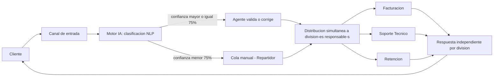

*Cada rectángulo Gx representa una división que, si recibe el caso, sigue su propio ciclo de proyección–revisión–firma ya vigente en el Procedimiento PQRSD, sin depender de las demás.*

## 9. Definir las propuestas de valor de la arquitectura objetivo y los KPI

Es fundamental desarrollar el caso de negocio, definir las propuestas de valor para los grupos de partes interesadas y establecer métricas de rendimiento.

* **Propuesta de Valor:** Transformar el centro de contacto de un cuello de botella reactivo a un despachador inteligente y automatizado, reduciendo costos operativos y mitigando el riesgo de multas regulatorias.
* **KPIs (Indicadores Clave de Rendimiento)** 🔧 *reescritos y reconciliados:*
  * **Cobertura de enrutamiento automático:** ≥ 85% de las PQRS deben quedar enrutadas sin intervención humana (requisito del Director de Servicio al Cliente), lograda cuando el modelo entrega una confianza ≥ 75% (umbral operativo del Riesgo 1).
  * **Exactitud del modelo:** > 88% de precisión en la clasificación del área responsable, medida sobre el subconjunto de PQRS que supera el umbral de confianza del 75% (es decir, sobre el tramo cubierto automáticamente).
    * 🔧 *Nota de reconciliación:* cobertura (85%) y exactitud (88%) son magnitudes independientes — no hay garantía teórica de que un único umbral del 75% las satisfaga a ambas simultáneamente. Se recomienda tratar el 75% como punto de partida y ajustarlo durante el piloto (Fase C/D) según el balance real cobertura/exactitud que arroje el modelo.
  * **Reducción de tiempo de triage:** 90% de disminución en el tiempo de clasificación inicial (de 3–5 minutos a milisegundos).
  * **Reducción de tiempo total de primera respuesta:** 40% en el primer trimestre — sujeta a la nota de trazabilidad de la sección 3.1; se recomienda monitorear también el tiempo de ciclo de los pasos manuales posteriores (proyección, revisión, firma) como KPI complementario.
  * **Retorno de Inversión (ROI):** Recuperación de la inversión en 8 meses mediante la optimización de horas-hombre.
    * 🔧 **Memoria de cálculo ilustrativa (supuesto, a validar con datos reales de TelcoLatam):**
      * Volumen: 10.000 PQRS/día; con 85% de cobertura automática ≈ 8.500 tickets/día dejan de requerir triage manual.
      * Ahorro estimado por ticket automatizado: ≈ 4 minutos (de ~4 min manual a prácticamente 0).
      * Ahorro de tiempo: 8.500 × 4 min ≈ 566 horas-agente/día.
      * Costo promedio hora-agente *(supuesto)*: USD 6/hora → ahorro ≈ USD 3.400/día ≈ USD 71.000/mes (22 días hábiles).
      * Con una inversión de USD 50.000, el punto de equilibrio aritmético se alcanzaría en menos de un mes de operación estable, lo que sugiere que el horizonte de 8 meses de la Fase A original es conservador y probablemente ya incorpora la curva de aprendizaje del modelo, el tiempo de estabilización y los costos de infraestructura/talento adicionales (brecha de la sección 4) que no estaban desglosados. Se recomienda documentar estos supuestos explícitamente en el caso de negocio formal.

## 10. Identificar los riesgos de la transformación empresarial y las actividades de mitigación

Se deben identificar los riesgos asociados con la Visión de la Arquitectura y evaluar su nivel inicial y su estrategia de mitigación. Se consideran dos niveles de riesgo: Nivel de Riesgo Inicial y Nivel de Riesgo Residual.

* **Riesgo 1 — Clasificación errónea del modelo de IA (falsos positivos):** puede retrasar aún más el ticket (Riesgo Inicial: Crítico).
  * *Mitigación:* Implementar un umbral de confianza (*confidence score*). Si la IA tiene menos del 75% de seguridad en la predicción, el ticket se envía a la cola manual. (Riesgo Residual: Marginal).
* **Riesgo 2 — Sesgo en los datos de entrenamiento históricos** que provoque mala atención a ciertas demografías (Riesgo Inicial: Marginal).
  * *Mitigación:* Auditoría y balanceo del dataset antes de la fase de entrenamiento. (Riesgo Residual: Insignificante).
* 🔧 **Riesgo 3 — Integración con el CRM heredado** *(nuevo):* Las limitaciones, límites de tasa o indisponibilidad de las APIs del CRM on-premise pueden impedir el enrutamiento en tiempo real, afectando directamente la preocupación ya declarada por el Gerente de TI (Riesgo Inicial: Alto).
  * *Mitigación:* Diseñar el microservicio de inferencia desacoplado (Principio de independencia tecnológica) con reintentos automáticos y una cola de contingencia hacia el Repartidor si el CRM no responde a tiempo. (Riesgo Residual: Moderado).
* 🔧 **Riesgo 4 — Resistencia al cambio / baja adopción por parte de los agentes** *(nuevo):* El temor al reemplazo laboral y la preparación cultural baja/media (sección 5) pueden generar baja adopción del paso de validación humana, o desconfianza sistemática hacia las sugerencias de la IA (Riesgo Inicial: Alto).
  * *Mitigación:* Comunicar explícitamente que el rol del agente es de validación y no de reemplazo; capacitación temprana; involucrar a los Agentes de Soporte en el diseño de la interfaz de validación (Fase C). (Riesgo Residual: Bajo).
* 🔧 **Riesgo 5 — Incumplimiento de la Ley 1581 de 2012 en el tratamiento de datos de entrenamiento** *(nuevo):* Usar el histórico de PQRS sin las autorizaciones o la anonimización requeridas expone a TelcoLatam a sanciones de la Superintendencia de Industria y Comercio y a daño reputacional (Riesgo Inicial: Alto).
  * *Mitigación:* Anonimización/seudonimización del dataset y validación previa con el Oficial de Protección de Datos, conforme al Principio de Privacidad desde el diseño (sección 7). (Riesgo Residual: Bajo).

## 11. Desarrollar la Declaración de Trabajo de Arquitectura y plantear su aprobación

Se evaluarán los productos de trabajo requeridos contra los requisitos de rendimiento comercial y se estimarán los recursos necesarios para desarrollar la hoja de ruta.

* **Documento de Aprobación:** Se elabora formalmente la Declaración de Trabajo de Arquitectura, que incluirá la visión general, el plan del proyecto y los roles de: científicos de datos, ingenieros de datos, arquitectos de TI, 🔧 y además un **responsable de cumplimiento/protección de datos** y un **líder de producto o gerente de proyecto**, dado el nuevo Principio de Privacidad y los Riesgos 3 a 5 identificados en esta revisión.
* **Comunicaciones:** Se desarrolla el Plan de Comunicaciones de Arquitectura Empresarial para interactuar con las partes interesadas —incluyendo ahora a los líderes de las divisiones receptoras y al Oficial de Protección de Datos (sección 2.2)— sobre el progreso del proyecto.
* **Aprobación:** Se revisan los planes con los patrocinadores (Director de Servicio al Cliente y Gerente de TI) para asegurar la aprobación formal bajo los procedimientos de gobernanza adecuados y obtener la firma (*sign-off*) para proceder a la Fase B (Arquitectura de Negocio).

## 12. Arquitectura de Sistemas y Presupuesto (actualización posterior)

### 12.1 Resumen del cambio

El presupuesto de USD 50.000 fijado en la sección 3 no tenía una memoria de cálculo que lo respaldara. Además, se decidió anteponer un filtro de clasificación sin IA (motor de reglas por palabras clave) antes de invocar el modelo de IA, para reducir la latencia y el costo, escalando a IA solo cuando el motor de reglas no puede determinar el área con certeza. Con base en esto se desarrolló, como propuesta técnica posterior a esta Fase A, la arquitectura de sistemas en GCP y el presupuesto desglosado que se resumen a continuación.

### 12.2 Arquitectura

La clasificación pasa a tener tres niveles: **(1) Motor de Reglas** (Cloud Run, sin IA, diccionario de palabras clave por división) → si no clasifica con certeza, **(2) Motor IA** (Cloud Run + Vertex AI, modelo Gemini 2.5 Flash-Lite) aplicando el umbral de confianza del 75% ya definido en la sección 10 → si tampoco alcanza el umbral, **(3) cola manual** del Repartidor, sin cambios frente a la línea base. Un motor de reglas no requiere dataset de entrenamiento, es inmediato de construir dentro del plazo de 3 meses del MVP, y sus decisiones son 100% explicables, algo relevante frente a la obligación regulatoria de justificar cómo se resuelve cada PQR (Resolución CRC 5050 de 2016, ya referenciada en la sección 3).

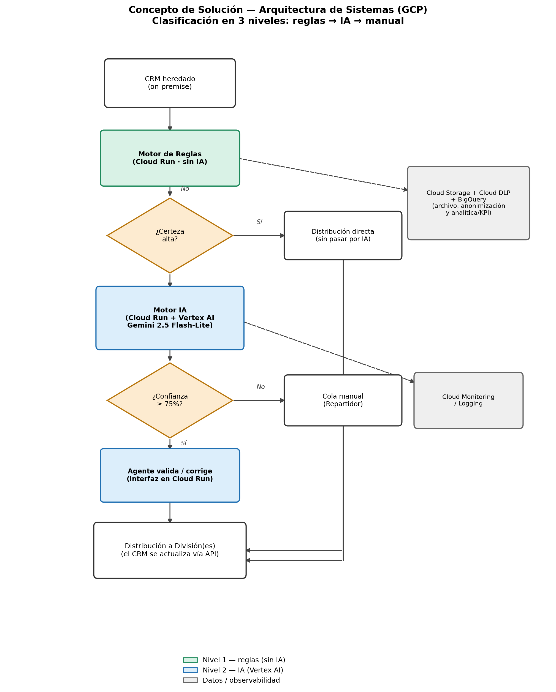

*Figura. Concepto de solución de la arquitectura objetivo en GCP: clasificación en 3 niveles (reglas → IA → manual), con los componentes de datos y observabilidad como soporte transversal.*

| Componente | Servicio GCP | Rol |
|---|---|---|
| Ingesta de eventos | Pub/Sub | Desacopla el CRM heredado de los servicios de clasificación, con reintentos automáticos (mitiga el Riesgo 3, sección 10) |
| Motor de reglas | Cloud Run | Servicio sin estado; ejecuta el diccionario de palabras clave por división |
| Motor de IA | Cloud Run + Vertex AI (Gemini 2.5 Flash-Lite) | Cloud Run orquesta la llamada al modelo de lenguaje alojado en Vertex AI |
| Interfaz de validación del agente | Cloud Run + Firestore | El Agente de Soporte confirma o corrige la sugerencia; Firestore guarda el estado del caso |
| Archivo y anonimización | Cloud Storage + Cloud DLP | Cloud DLP redacta datos personales antes de reentrenar el modelo (Principio de Privacidad desde el Diseño, sección 7) |
| Analítica y KPI | BigQuery | Tablero de cobertura, exactitud y tiempo de ciclo (KPI de la sección 9) |
| Observabilidad | Cloud Monitoring / Cloud Logging | Alerta si la tasa de escalamiento a IA o a cola manual se dispara |
| Identidad y seguridad | IAM + VPC Service Controls | Un solo perímetro de cumplimiento; ningún dato de PQRS sale de GCP |

### 12.3 Presupuesto

**MVP (3 meses):**

| Ítem | Costo estimado |
|---|---|
| Científico de Datos / ML Engineer (contratista, perfil semi-senior en Colombia) **(supuesto)** | ≈ USD 7.400 |
| Ingeniero Cloud/Backend (recurso interno ya asignado; no es desembolso nuevo) | ≈ USD 2.600 (costo de oportunidad, referencial) |
| Revisión de cumplimiento (Ley 1581 / anonimización) **(supuesto)** | ≈ USD 1.500 |
| Infraestructura GCP durante el MVP (dentro de los niveles gratuitos a este volumen) | ≈ USD 100 |
| Capacitación a agentes **(supuesto)** | ≈ USD 800 |
| Contingencia (15%) | ≈ USD 1.470 |
| **Total incremental (efectivo nuevo)** | **≈ USD 11.270** |

**Operación en régimen estable (post-MVP, mensual):** infraestructura ≈ USD 50–80/mes (Pub/Sub, Cloud Run, Vertex AI, BigQuery, Monitoring) + ML Engineer a 20% de dedicación **(supuesto)** ≈ USD 490/mes → **total ≈ USD 550–570/mes (≈ USD 6.600–6.900/año)**, frente a un ahorro estimado en horas-agente de ≈ USD 71.000/mes (memoria de cálculo del ROI, sección 9).

**Conclusión:** el presupuesto real del MVP, desglosado, se ubica entre USD 11.000 y 14.000 — muy por debajo de los USD 50.000 originalmente asignados. Esto no implica que $50.000 fuera insuficiente; el problema señalado era la falta de desglose, no la magnitud. Con el desglose en mano, el comité de aprobación puede optar por mantener los USD 50.000 como margen de contingencia e iteración, o reasignar el excedente a otras iniciativas.

### 12.4 Riesgos y consideraciones de esta arquitectura

* El motor de reglas requiere mantenimiento continuo del diccionario de palabras clave a medida que cambian los productos/servicios de TelcoLatam; sin este mantenimiento, aumenta la carga sobre el Motor IA (sin impacto material en el costo, sí en la latencia).
* Los precios de Vertex AI cambian con frecuencia; el presupuesto de la sección 12.3 usa el escenario de "peor caso" (100% de los casos escalados a IA) para no depender de qué tan bien funcione el motor de reglas.
* El crédito de bienvenida de USD 300 de Google Cloud aplica solo a cuentas nuevas y por tiempo limitado; no debe tratarse como ahorro recurrente.
* Los Riesgos 3, 4 y 5 (sección 10 de este documento) siguen aplicando íntegramente a esta arquitectura.

---

### Aprobación

| Rol | Nombre | Firma | Fecha |
|---|---|---|---|
| Director de Servicio al Cliente | | | |
| Gerente de TI | | | |

# Fase B: Arquitectura de Negocio
## Marco de trabajo TOGAF — ADM (Architecture Development Method)
### Proyecto: IA-PQRS Smart Routing
**Enrutamiento inteligente de Peticiones, Quejas, Reclamos y Sugerencias (PQRS)**
**Empresa de referencia:** TelcoLatam

*Documento elaborado como continuación de la Fase A: Visión de la Arquitectura.*

---

## 1. Introducción y alcance de la Fase B

El objetivo de la Fase B del ADM de TOGAF es desarrollar la Arquitectura de Negocio objetivo que describe cómo TelcoLatam necesita operar para alcanzar las metas establecidas en la Fase A (Visión de la Arquitectura), documentando tanto la arquitectura de línea base (situación actual) como la arquitectura objetivo, e identificando las brechas, los requisitos de negocio y los componentes de la hoja de ruta necesarios para cerrarlas.

Este documento toma como entrada directa la Visión de la Arquitectura aprobada en la Fase A (proyecto "IA-PQRS Smart Routing") y el procedimiento operativo vigente "Procedimiento PQRSD", que documenta el proceso manual actual de gestión y respuesta a PQRS. A partir de ambos insumos se construye la arquitectura de negocio línea base y objetivo, los catálogos y matrices formales, el análisis de brechas, la especificación de requisitos y los componentes de la hoja de ruta que exige esta fase.

### 1.1 Trazabilidad con la Fase A

| Elemento de la Fase A | Contenido aprobado | Reflejo en esta Fase B |
|---|---|---|
| Objetivo de negocio | Reducir el tiempo promedio de primera respuesta a las PQRS en 40% en el primer trimestre | Motiva el rediseño del proceso de triage/enrutamiento (secciones 3 y 6) |
| Impulsores (drivers) | Alto volumen (>10.000 PQRS/día) y penalizaciones regulatorias por incumplimiento | Justifica la automatización de la clasificación (sección 3.1) |
| Limitaciones | Presupuesto de USD 50.000, MVP en 3 meses, cumplimiento de la Ley de Protección de Datos Personales | Delimita el alcance de la hoja de ruta (sección 8) y los requisitos RN-05 (sección 7) |
| Capacidad base / objetivo | De un proceso 100% manual (3–5 min/ticket) a un motor NLP que clasifica en milisegundos | Estructura la comparación línea base vs. objetivo (secciones 2 y 3) |
| Brechas identificadas | Falta de talento en IA e infraestructura cloud nativa | Insumo directo del análisis de brechas (sección 6) |
| Alcance (in/out) | Dentro: modelo de clasificación y enrutamiento. Fuera: respuesta automatizada al cliente | Delimita qué procesos de la línea base cambian y cuáles permanecen (sección 3.1) |
| Principios de negocio y arquitectura | El cliente es el centro de la operación; los datos son un activo; independencia tecnológica | Guían las decisiones de diseño del proceso objetivo (sección 3) |
| KPI | Accuracy > 88%, reducción de 90% en tiempo de triage, ROI en 8 meses | Métricas de éxito de la arquitectura objetivo (sección 3.1) |
| Riesgos y mitigación | Clasificación errónea (umbral de confianza 75%) y sesgo en los datos (auditoría/balanceo) | Incorporados como controles del proceso objetivo (secciones 3.4 y 7) |

## 2. Arquitectura de Negocio – Línea Base (Baseline)

### 2.1 Descripción general

Actualmente la gestión de PQRS en TelcoLatam es 100% manual: un agente lee cada ticket y lo asigna dentro del CRM, tomando en promedio de 3 a 5 minutos por caso (capacidad base declarada en la Fase A). Este proceso está formalizado en el "Procedimiento PQRSD" vigente, descrito a continuación.

### 2.2 Catálogo de Actor / Rol – Línea Base

| Rol | Responsabilidad principal | Aplicaciones requeridas |
|---|---|---|
| Repartidor | Distribuye las solicitudes internamente, hace seguimiento al vencimiento de términos, elabora el informe mensual y mantiene las plantillas de respuesta. | Suite ofimática, lector de PDF |
| Proyecta la respuesta | Analiza la solicitud, consolida la información, elabora el documento de respuesta con la plantilla oficial y lo remite a revisión. | Suite ofimática, lector de PDF |
| Revisor | Verifica que el documento cumpla los lineamientos institucionales, normativos y de forma; informa inconsistencias sin modificar el documento. | Editor de texto, lector de PDF, certificado de firma PDF |
| Jefe de División | Firma el documento final, validando que el contenido sea adecuado antes del envío al interesado. | Editor de texto, lector de PDF, certificado de firma PDF |

### 2.3 Catálogo de Proceso / Evento / Control / Producto – Línea Base

| Tipo | Elemento | Descripción |
|---|---|---|
| Evento | Recepción de PQRS | Ingreso de la solicitud por el canal de entrada |
| Proceso | Análisis y distribución | El repartidor analiza y distribuye la solicitud a la división encargada |
| Control | Verificación de competencia | Determina si la solicitud corresponde al área o debe reasignarse |
| Control | Verificación de reserva legal | Determina si procede solicitar información adicional o rechazar la petición |
| Proceso | Proyección de la respuesta | Elaboración del documento de respuesta con la plantilla oficial |
| Control | Revisión de forma y fondo | Validación de lineamientos institucionales antes de la firma |
| Control | Lineamientos de elaboración | Plantilla oficial, lenguaje neutral, dirección física, fuente Nunito 10.5–12 pt |
| Producto | Respuesta oficial firmada | Documento firmado por el Jefe de División, enviado por correo o físico |

### 2.4 Diagrama de Proceso de Negocio – Línea Base

Vista simplificada del flujo de extremo a extremo, tal como está documentada en el Procedimiento PQRSD:

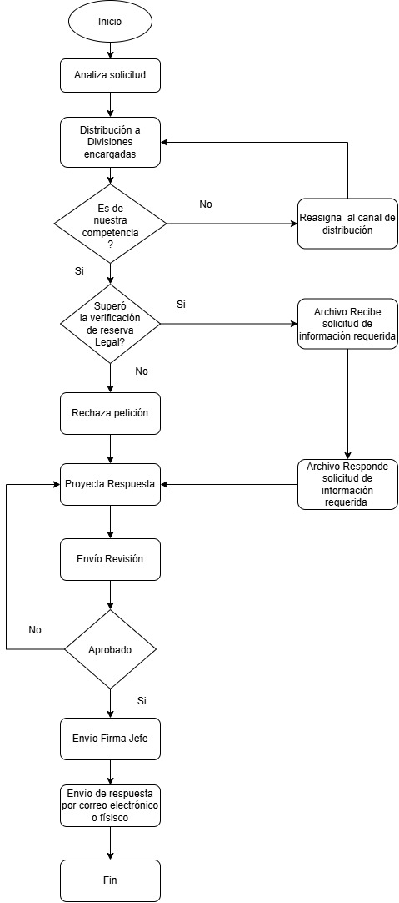

*Figura 1. Flujo del proceso PQRSD (línea base) — vista simplificada.*

Vista del mismo proceso organizada por carriles de actor, que respalda el catálogo de la sección 2.2:

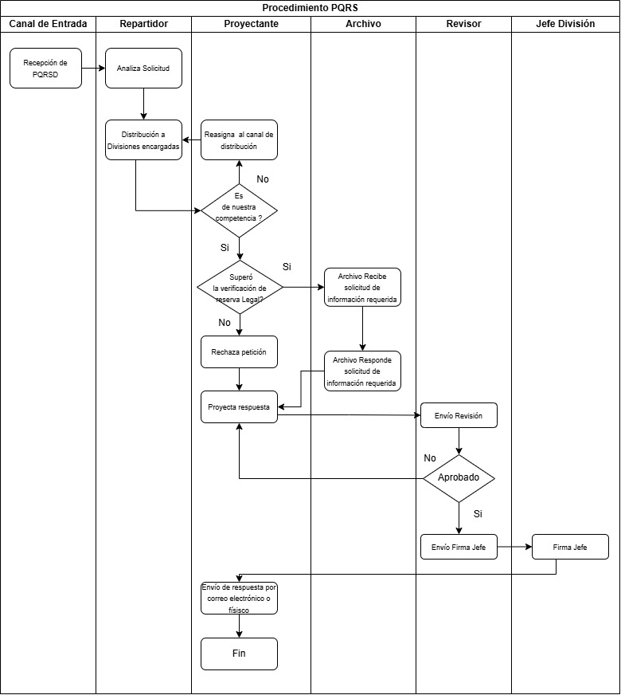

*Figura 2. Flujo del proceso PQRSD (línea base) — vista por actor (swimlane).*

### 2.5 Limitaciones observadas en la línea base

* Proceso 100% manual: cada ticket es leído y clasificado por una persona (3–5 minutos por caso).
* Sin mecanismo de priorización ni de clasificación automática de la intención del ciudadano/cliente.
* El volumen actual (>10.000 PQRS/día declarado en la Fase A) satura la capacidad de triage manual, generando los tiempos de respuesta lentos reportados por el Director de Servicio al Cliente.
* No existe un umbral de confianza ni una segunda validación automatizada; toda la trazabilidad depende de la disponibilidad del repartidor.

## 3. Arquitectura de Negocio – Objetivo (Target)

### 3.1 Descripción general

La arquitectura objetivo incorpora un motor de Procesamiento de Lenguaje Natural (NLP) que extrae la intención y las entidades del texto de la PQRS y sugiere, en milisegundos, la o las divisiones responsables (por ejemplo, Facturación y Soporte Técnico de forma simultánea cuando el caso lo requiere, como en el escenario de negocio descrito en la Fase A). El alcance aprobado en la Fase A automatiza únicamente el paso de clasificación y enrutamiento inicial; la elaboración, revisión y firma de la respuesta permanecen sin cambios, dado que la resolución o respuesta automatizada al cliente (chatbot) está explícitamente fuera de alcance.

Para mitigar el riesgo de clasificación errónea (riesgo crítico identificado en la Fase A) se incorpora un umbral de confianza del 75%: por debajo de ese umbral, el caso se enruta a la cola manual del Repartidor, tal como ocurre hoy. Adicionalmente, y para atender la preocupación de los Agentes de Soporte (miedo al reemplazo laboral y fatiga por reasignación manual) y el nivel de preparación cultural bajo/medio reportado en la Fase A, se mantiene un punto de validación humana en el que el agente puede corregir la sugerencia de la IA.

*Esta arquitectura objetivo persigue directamente los KPI definidos en la Fase A: exactitud de clasificación superior al 88%, reducción del 90% en el tiempo de triage y retorno de la inversión en 8 meses.*

🔧 **Actualización (propuesta de arquitectura de sistemas):** antes de invocar el Motor IA, un Motor de Reglas determinístico (palabras clave por división) intenta clasificar el caso. Solo cuando este primer nivel no puede determinar el área con certeza, el caso se escala al Motor IA. Esto reduce la latencia y el costo de inferencia sin cambiar el umbral de confianza del 75% ni el punto de validación humana ya descritos.

### 3.2 Catálogo de Actor / Rol – Objetivo

| Rol / Actor | Responsabilidad en la arquitectura objetivo | Aplicaciones / servicios |
|---|---|---|
|  Motor de Reglas | Servicio determinístico (sin IA) que compara el texto contra un diccionario de palabras clave por división; si la certeza es alta, enruta directo, sin invocar el Motor IA. | Microservicio de reglas (Cloud Run) |
|  Motor de Clasificación IA | Servicio automatizado que analiza el texto, extrae intención y entidades, y sugiere el área responsable con un puntaje de confianza, solo para los casos que el Motor de Reglas no resolvió. | Microservicio de inferencia NLP (API REST) |
|  Agente de Soporte | Revisa la sugerencia de la IA en los casos con confianza ≥ 75% y puede corregirla antes de la distribución. | Interfaz de validación integrada al CRM |
|  Repartidor | Atiende únicamente los casos con confianza < 75% (cola manual); conserva sus funciones de seguimiento e informes. | Suite ofimática, lector de PDF |
| Proyecta la respuesta / Revisor / Jefe de División | Sin cambios frente a la línea base: elaboran, revisan y firman la respuesta una vez recibido el caso ya enrutado. | Suite ofimática, editor de texto, certificado de firma PDF |
| Director de Servicio al Cliente | Patrocinador y stakeholder principal; valida que se cumpla el requisito de 85% de clasificación sin intervención humana. | Tablero de KPI |
| Gerente de TI | Stakeholder técnico; garantiza la integración por microservicios y APIs REST con el CRM heredado. | Plataforma de integración / APIs |
|  Científico de Datos / Ingeniero de Datos | Curan, etiquetan, auditan y balancean el dataset histórico de PQRS; entrenan y validan el modelo NLP. | Plataforma de datos / entrenamiento de modelos |
|  Arquitecto de TI | Diseña la arquitectura de microservicios desacoplada del CRM y su despliegue en la nube. | Repositorio de arquitectura |

### 3.3 Catálogo de Función y Servicio de Negocio

| Función de negocio | Servicio de negocio | Descripción |
|---|---|---|
| Gestión de PQRS | Recepción y registro de solicitudes | Ingreso del caso por el canal de entrada (sin cambios) |
| Clasificación y enrutamiento |  Clasificación por reglas (sin IA) | Servicio nuevo: primer nivel, determinístico, por palabras clave |
| Clasificación y enrutamiento |  Clasificación automática por IA | Servicio nuevo: segundo nivel, solo para lo que las reglas no resuelven |
| Clasificación y enrutamiento |  Validación humana de la sugerencia | Servicio nuevo: el agente confirma o corrige la sugerencia de la IA |
| Atención al cliente | Atención por Facturación / Soporte Técnico / Retención | Áreas receptoras del caso ya enrutado (sin cambios) |
| Elaboración y aprobación de respuestas | Proyección, revisión y firma de la respuesta | Sin cambios frente a la línea base |

### 3.4 Catálogo de Proceso / Evento / Control / Producto – Objetivo

| Tipo | Elemento | Descripción |
|---|---|---|
| Evento | Recepción de PQRS | Ingreso de la solicitud por el canal de entrada (sin cambios) |
|  Proceso | Clasificación por reglas | El motor de reglas compara el texto contra un diccionario de palabras clave por división |
|  Control | Certeza de la clasificación por reglas | Determina si el caso se enruta directo o se escala al Motor IA |
|  Proceso | Clasificación NLP | El motor de IA extrae intención y entidades y sugiere el área responsable (solo casos escalados) |
|  Control | Umbral de confianza (75%) | Determina si el caso se enruta automáticamente o pasa a cola manual |
|  Proceso | Validación del agente | El agente confirma o corrige la sugerencia antes de la distribución |
| Proceso | Distribución simultánea | Notificación a una o varias divisiones responsables en paralelo |
| Control | Verificación de competencia / reserva legal | Sin cambios frente a la línea base |
| Proceso | Proyección, revisión y firma de la respuesta | Sin cambios frente a la línea base |
| Producto | Respuesta oficial firmada | Sin cambios frente a la línea base |

### 3.5 Diagrama de Proceso de Negocio – Objetivo

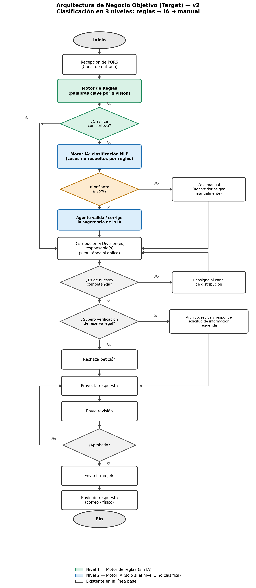

*Figura 3. Flujo del proceso PQRS con clasificación en 3 niveles (arquitectura objetivo). Verde: reglas sin IA; azul: IA.*

## 4. Matriz de interacción Actor – Proceso

Participación de cada actor en los procesos de la arquitectura objetivo (X = participa):

| Actor / Rol | Recepción | Clasif. reglas | Clasif. IA | Valida agente | Distribución | Competencia/ reserva legal | Proyecta resp. | Revisión | Firma |
|---|---|---|---|---|---|---|---|---|---|
| Motor de Reglas | | X | | | | | | | |
| Motor de Clasificación IA | | | X | | | | | | |
| Agente de Soporte | | | | X | | | | | |
| Repartidor | X | | | | X | | | | |
| División responsable | | | | | X | X | | | |
| Proyecta la respuesta | | | | | | | X | | |
| Revisor | | | | | | | | X | |
| Jefe de División | | | | | | | | | X |

## 5. Matriz Función de Negocio – Organización

| Función de negocio | Área / unidad organizacional responsable |
|---|---|
| Recepción y registro de solicitudes | Canal de entrada / Atención al Cliente |
| Clasificación automática por IA | TI — Ciencia de Datos (operación del microservicio) |
| Validación humana de la sugerencia | Atención al Cliente (Agentes de Soporte) |
| Atención por área responsable | Facturación / Soporte Técnico / Retención |
| Elaboración y aprobación de respuestas | División responsable / Jefatura de División |
| Gobierno y KPI del proceso | Dirección de Servicio al Cliente |
| Integración e infraestructura | Gerencia de TI |

## 6. Análisis de brechas (Gap Analysis)

| Brecha | Estado actual (línea base) | Estado objetivo | Acción para cerrarla |
|---|---|---|---|
| Talento en IA | No existe equipo interno de ciencia/ingeniería de datos | Modelo NLP en producción, monitoreado y reentrenado | Incorporar científico(s) e ingeniero(s) de datos al proyecto (según Declaración de Trabajo de la Fase A) |
| Infraestructura | CRM on-premise, sin infraestructura cloud nativa | Microservicio de inferencia desacoplado, desplegable en la nube | Diseñar la arquitectura de microservicios con el Arquitecto de TI (Fase C/D) |
| Datos | Histórico de PQRS sin limpiar, clasificar ni gobernar | Dataset etiquetado, auditado y balanceado, gobernado como activo | Ejecutar el principio de arquitectura "los datos son un activo" antes del entrenamiento |
| Proceso | Clasificación 100% manual, sin umbral de confianza ni trazabilidad automática | Clasificación automática con umbral de confianza y validación humana | Implementar el flujo objetivo descrito en la sección 3 |
| Adopción / cultura | Preparación cultural baja/media; resistencia al cambio y temor al reemplazo laboral | Agentes con rol de validación y corrección, no de reemplazo | Mantener el punto de validación humana y capacitar a los agentes (hoja de ruta, sección 8) |

## 7. Especificación de requisitos de arquitectura (Business Requirements)

Requisitos de negocio derivados de las partes interesadas y restricciones definidas en la Fase A, y de los lineamientos vigentes del Procedimiento PQRSD:

| ID | Requisito | Fuente |
|---|---|---|
| RN-01 | El motor de clasificación debe alcanzar al menos 85% de exactitud en la asignación del área responsable sin intervención humana. | Director de Servicio al Cliente |
| RN-02 | El motor de clasificación debe exponerse como microservicio con APIs RESTful, integrado al CRM heredado. | Gerente de TI |
| RN-03 | La interfaz debe mostrar al agente el área sugerida por la IA y permitir su corrección manual. | Agentes de Soporte |
| RN-04 | Cuando la confianza del modelo sea inferior al 75%, el caso debe enrutarse a la cola manual del Repartidor. | Mitigación del Riesgo 1 (Fase A) |
| RN-05 | El tratamiento del texto de las PQRS debe cumplir la Ley de Protección de Datos Personales. | Restricciones del proyecto (Fase A) |
| RN-06 | El dataset de entrenamiento debe auditarse y balancearse para mitigar sesgos hacia ciertas demografías. | Mitigación del Riesgo 2 (Fase A) |
| RN-07 | Debe mantenerse el uso de la plantilla oficial, el lenguaje neutral y los demás lineamientos de elaboración de respuestas ya vigentes. | Procedimiento PQRSD |
| RN-08 | El desarrollo del MVP debe ejecutarse dentro de un presupuesto de USD 50.000 y un plazo de 3 meses. | Limitaciones del proyecto (Fase A) |

## 8. Componentes de la hoja de ruta de Arquitectura de Negocio

Hoja de ruta de alto nivel para el MVP, acorde con el plazo de 3 meses y el presupuesto de USD 50.000 definidos en la Fase A:

| Fase | Horizonte | Componentes principales |
|---|---|---|
| Fase 1 — Cimentación | Mes 1 | Recolección, limpieza, etiquetado, auditoría y balanceo del dataset histórico de PQRS; definición de la arquitectura del microservicio. |
| Fase 2 — Construcción | Mes 2 | Entrenamiento y validación del modelo NLP; desarrollo de la API de inferencia; diseño de la interfaz de validación para agentes. |
| Fase 3 — Integración y despliegue | Mes 3 | Integración con el CRM heredado; pruebas piloto con umbral de confianza del 75%; capacitación a agentes; despliegue del MVP y medición de KPI iniciales. |

## 9. Impacto en el panorama arquitectónico y gobernanza

### 9.1 Dominios de arquitectura impactados

* Negocio: rediseño del proceso de triage y enrutamiento de PQRS (este documento).
* Datos: gobierno, etiquetado y balanceo del histórico de PQRS (a detallar en la Fase C).
* Aplicación: microservicio de inferencia, interfaz de validación e integración con el CRM (a detallar en la Fase C).
* Tecnología: infraestructura cloud para el despliegue del microservicio (a detallar en la Fase D).

### 9.2 Riesgos heredados de la Fase A

| Riesgo | Nivel inicial | Mitigación | Nivel residual |
|---|---|---|---|
| Clasificación errónea del modelo de IA | Crítico | Umbral de confianza del 75%; por debajo, enrutamiento manual | Marginal |
| Sesgo en los datos de entrenamiento | Marginal | Auditoría y balanceo del dataset antes del entrenamiento | Insignificante |

### 9.3 Gobierno de arquitectura

Conforme a la Declaración de Trabajo de Arquitectura aprobada en la Fase A, esta Arquitectura de Negocio debe someterse a revisión y aprobación formal del Director de Servicio al Cliente y del Gerente de TI antes de dar paso a la Fase C (Arquitectura de Sistemas de Información), siguiendo el Plan de Comunicaciones de Arquitectura Empresarial definido para el proyecto.

## 10. Conclusión y aprobación para avanzar a la Fase C

Esta Fase B documenta la arquitectura de negocio línea base (proceso manual descrito en el Procedimiento PQRSD) y la arquitectura de negocio objetivo (enrutamiento asistido por IA en 3 niveles: reglas → IA → manual), junto con los catálogos, matrices, el análisis de brechas, los requisitos de negocio y la hoja de ruta necesarios para cerrar la distancia entre ambas, en línea con los objetivos, principios y KPI aprobados en la Fase A. Con esta base, el proyecto "IA-PQRS Smart Routing" queda en condiciones de avanzar hacia la Fase C: Arquitectura de Sistemas de Información.

### Aprobación

| Rol | Nombre | Firma | Fecha |
|---|---|---|---|
| Director de Servicio al Cliente | | | |
| Gerente de TI | | | |

# Fase C: Arquitectura de Sistemas de Información
## Marco de trabajo TOGAF — ADM (Architecture Development Method)
### Proyecto: IA-PQRS Smart Routing
**Enrutamiento inteligente de Peticiones, Quejas, Reclamos y Sugerencias (PQRS)**
**Empresa de referencia:** TelcoLatam

*Documento elaborado como continuación de la Fase B: Arquitectura de Negocio, e informado directamente por el concepto de solución técnica desarrollado en la Fase A: Visión de la Arquitectura (sección 12).*

> **Nota de versión.** Esta es una revisión de la Fase C que incorpora la arquitectura real en GCP y la clasificación en 3 niveles (reglas → IA → manual) confirmadas en la Fase A y en la actualización de la Fase B. Los cambios frente a la versión anterior de este documento están resumidos en la sección 0.

---

## 0. Registro de cambios aplicados en esta revisión

| # | Cambio | Motivo |
|---|---|---|
| 1 | Se incorporó el **Motor de Reglas** (Cloud Run, sin IA) como primer nivel de clasificación, antes del Motor IA | Confirmado en la Fase A (sección 12.1) y en la actualización de la Fase B (sección 3.1) |
| 2 | Se reemplazó la arquitectura "cloud-agnóstica" genérica por la arquitectura real en **Google Cloud Platform (GCP)**: Pub/Sub, Cloud Run, Vertex AI (Gemini 2.5 Flash-Lite), Firestore, Cloud Storage + Cloud DLP, BigQuery, Cloud Monitoring/Logging, IAM + VPC Service Controls | Especificada en la Fase A, sección 12.2 |
| 3 | Se reemplazó la estimación de costos propia (≈USD 43.500, basada en supuestos de mercado) por el **desglose oficial de la Fase A** (≈USD 11.270 de inversión incremental para el MVP) | La Fase A, sección 12.3, ya trae una memoria de cálculo validada internamente; mantener una estimación paralela habría sido incoherente |
| 4 | Se incorporaron los **Riesgos 3, 4 y 5** de la Fase A (integración con el CRM heredado, resistencia al cambio, cumplimiento de la Ley 1581 de 2012) al gobierno de esta fase | Estaban documentados en la Fase A pero no reflejados aún en la arquitectura de sistemas |
| 5 | Se especificó la jurisdicción legal — **Colombia: Ley 1581 de 2012 (Habeas Data), Decreto 1377 de 2013 y Resolución CRC 5050 de 2016** — en los requisitos de sistema y en el gobierno de datos | La versión anterior hablaba de "la Ley de Protección de Datos Personales" sin especificar país |
| 6 | Se actualizaron el catálogo de aplicaciones, el catálogo de interfaces y el diagrama de arquitectura objetivo para reflejar los componentes reales de GCP en lugar de nombres genéricos ("API Gateway", "microservicio de inferencia") | Consistencia con el concepto de solución de la Fase A |

---

## 1. Introducción y alcance de la Fase C

La Fase C del ADM de TOGAF se centra en la Arquitectura de Aplicaciones y Datos: establece cómo el software y la información habilitan las capacidades de negocio definidas en la Fase B. Su objetivo no es diseñar una única aplicación, sino construir el mapa completo del ecosistema de software que soporta el proceso de gestión de PQRS y permite la toma de decisiones estratégica.

La arquitectura de aplicaciones debe servir directamente a la Arquitectura de Negocio definida en la Fase B, y materializar el concepto de solución ya esbozado en la Fase A. Sin esta alineación, la TI se convierte en un bloqueador en lugar de un motor de transformación: por eso cada componente de este documento se conecta explícitamente con un rol, un proceso o un requisito ya aprobado en las fases anteriores.

### 1.1 Trazabilidad con las Fases A y B

| Elemento | Fuente | Contenido aprobado | Reflejo en esta Fase C |
|---|---|---|---|
| Catálogo de actores objetivo (incluye Motor de Reglas) | Fase B, sección 3.2 | Motor de Reglas, Motor de Clasificación IA, Agente de Soporte, Científico/Ingeniero de Datos, Arquitecto de TI | Motiva el catálogo de aplicaciones objetivo (sección 3) |
| Concepto de solución en GCP | Fase A, sección 12.2 | Clasificación en 3 niveles (reglas → IA → manual) sobre Pub/Sub, Cloud Run, Vertex AI, Firestore, Cloud Storage + DLP, BigQuery, Monitoring/Logging, IAM + VPC SC | Base directa de la arquitectura de aplicaciones objetivo (sección 3) y de datos (sección 4) |
| Presupuesto desglosado del MVP | Fase A, sección 12.3 | Inversión incremental ≈ USD 11.270; operación estable ≈ USD 550-570/mes | Anexo A de este documento |
| Riesgos 3, 4 y 5 | Fase A, sección 10 | Integración con el CRM heredado; resistencia al cambio; incumplimiento de la Ley 1581 de 2012 | Sección 9.3 (riesgos técnicos) |
| Jurisdicción legal | Fase A, secciones 3 y 7 | Ley 1581 de 2012, Decreto 1377 de 2013, Resolución CRC 5050 de 2016 | Sección 4.3 (gobierno de datos) y requisito RS-05 |
| Requisitos de negocio (RN-01 a RN-08) | Fase B, sección 7 | Exactitud, integración REST, umbral de confianza, protección de datos, presupuesto | Traducidos a requisitos de sistema RS-01 a RS-10 (sección 7) |
| Hoja de ruta de negocio (3 meses) | Fase B, sección 8 | Cimentación, construcción, integración y despliegue | Detallada con componentes técnicos de GCP (sección 8) |

---

## 2. Arquitectura de Aplicaciones — Línea Base

### 2.1 Descripción general

Los sistemas actuales soportan el proceso 100% manual descrito en el Procedimiento PQRSD y en la Fase B: un agente registra y asigna cada ticket en el CRM heredado, y el resto del ciclo (elaboración, revisión y firma) se apoya en herramientas ofimáticas independientes, sin ninguna integración automatizada entre ellas.

### 2.2 Catálogo de Aplicaciones — Línea Base

| Aplicación | Tipo | Función en el proceso | Usada por |
|---|---|---|---|
| CRM heredado (on-premise) | Sistema de registro | Registro y asignación manual de la PQRS | Repartidor |
| Suite ofimática | Productividad | Elaboración de la respuesta con la plantilla oficial | Proyecta la respuesta |
| Lector de PDF | Utilitario | Consulta de solicitudes y anexos | Todos los roles |
| Editor de texto + certificado de firma digital | Firma electrónica | Revisión y firma del documento final | Revisor, Jefe de División |
| Repositorio de plantillas | Almacenamiento documental | Custodia de la plantilla oficial de respuesta | Repartidor (mantiene), Proyectista (usa) |

### 2.3 Catálogo de Interfaces — Línea Base

No existen interfaces automatizadas entre los sistemas actuales; toda transferencia de información entre aplicaciones es manual.

| Origen | Destino | Mecanismo | ¿Automatizada? |
|---|---|---|---|
| CRM heredado | Suite ofimática | Copiar/pegar manual del caso asignado | No |
| Suite ofimática | Editor de texto / firma digital | Envío de archivo por correo interno | No |
| Repositorio de plantillas | Suite ofimática | Descarga manual de la plantilla en blanco | No |

### 2.4 Diagrama de Arquitectura de Aplicaciones — Línea Base

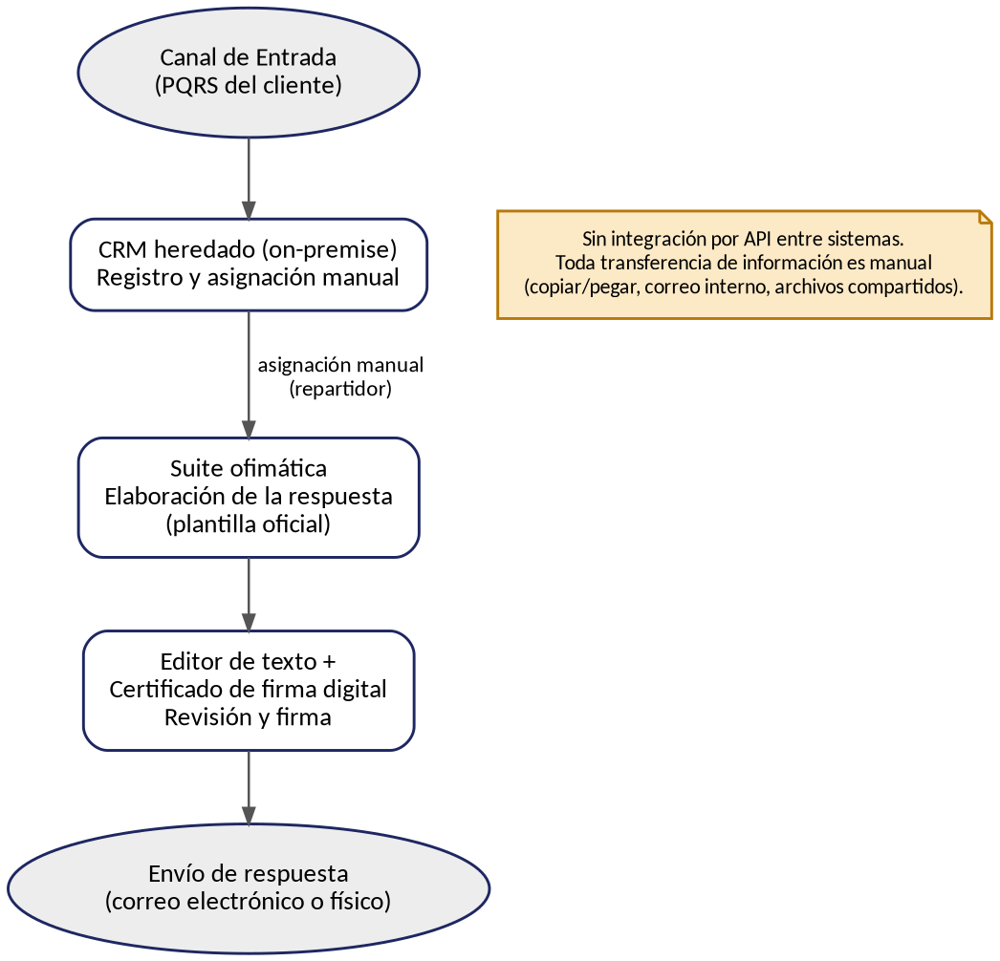

*Figura 1. Arquitectura de aplicaciones de la línea base — sin integración automatizada entre sistemas.*

### 2.5 Limitaciones observadas en la línea base

* El CRM heredado no expone capacidad nativa de integración vía API (aunque la Fase A señala que sí cuenta con APIs, la infraestructura sigue siendo on-premise, sección 5).
* No existe un repositorio de datos gobernado: el histórico de PQRS está disperso y sin etiquetar.
* No hay ningún mecanismo de clasificación automática ni de monitoreo del desempeño del proceso.
* Cada paso depende de la ejecución manual de una persona, sin trazabilidad de sistema.

---

## 3. Arquitectura de Aplicaciones — Objetivo

### 3.1 Descripción general

La clasificación de una PQRS pasa a tener **tres niveles**, tal como se definió en la Fase A (sección 12.1) y se ratificó en la actualización de la Fase B (sección 3.1):

1. **Motor de Reglas** (Cloud Run, sin IA): compara el texto contra un diccionario de palabras clave por división. Si la certeza es alta, enruta directo, sin invocar el Motor IA.
2. **Motor IA** (Cloud Run + Vertex AI, modelo Gemini 2.5 Flash-Lite): solo se invoca cuando el Motor de Reglas no puede determinar el área con certeza. Aplica el umbral de confianza del 75% ya definido en la Fase A.
3. **Cola manual** (Repartidor): recibe los casos que ni las reglas ni la IA lograron clasificar con certeza suficiente, sin cambios frente a la línea base.

Este diseño en tres niveles no es una preferencia estética: un motor de reglas no requiere dataset de entrenamiento, es inmediato de construir dentro del plazo de 3 meses del MVP, reduce la latencia y el costo de inferencia, y sus decisiones son 100% explicables — algo relevante frente a la obligación regulatoria de justificar cómo se resuelve cada PQR (Resolución CRC 5050 de 2016, art. 2.1.24.3).

Las aplicaciones de elaboración, revisión y firma de la respuesta permanecen sin cambios, en línea con el alcance aprobado en la Fase A.

### 3.2 Modelos de Arquitectura de Aplicaciones aplicados al proyecto

| Modelo | Qué evalúa | Aplicación al proyecto IA-PQRS |
|---|---|---|
| Modelo Funcional | Distribución de costos operativos y de capital; identifica aplicaciones que consumen recursos sin generar valor diferencial | El CRM heredado y la suite ofimática son de bajo valor diferencial: se conservan tal cual (costo hundido); la inversión incremental se concentra en el Motor de Reglas y el Motor IA |
| Modelo de Desarrollo | Enfoque de construcción: desarrollo interno, compra externa o integración de plataformas existentes | Vertex AI (Gemini 2.5 Flash-Lite) se **compra** como servicio administrado; el Motor de Reglas y la Interfaz de Validación se **desarrollan a medida** |
| Modelo de Integración | Nivel de rigidez o fluidez de las interfaces; capacidad de adaptación del sistema | Pub/Sub desacopla el CRM heredado de los servicios de clasificación, con reintentos automáticos ante indisponibilidad (mitiga el Riesgo 3 de la Fase A) |
| Modelo de Producto | Valor competitivo único; identifica aplicaciones que generan diferenciación | El activo diferenciador es el diccionario de reglas por división y el dataset propio con el que eventualmente se afine el modelo, no la infraestructura genérica que los rodea |

### 3.3 Estrategia de portafolio: comprar vs. desarrollar

* **Comprar (SaaS / servicio administrado):** Vertex AI con el modelo Gemini 2.5 Flash-Lite para la clasificación de segundo nivel — es una capacidad genérica de lenguaje, no diferenciadora por sí misma.
* **Desarrollar a medida:** el Motor de Reglas (diccionario de palabras clave propio de TelcoLatam) y la Interfaz de Validación embebida en el flujo del agente — aquí está el conocimiento específico del negocio.
* **Plataforma de integración (administrada):** Pub/Sub como capa de desacople entre el CRM heredado y los servicios de clasificación.

### 3.4 Catálogo de Aplicaciones — Objetivo

| Aplicación | Servicio GCP | Estado | Función en el proceso |
|---|---|---|---|
| Ingesta de eventos | Pub/Sub | Nuevo | Desacopla el CRM heredado de los servicios de clasificación, con reintentos automáticos |
| Motor de Reglas | Cloud Run | Nuevo | Servicio sin estado; ejecuta el diccionario de palabras clave por división (primer nivel) |
| Motor IA | Cloud Run + Vertex AI (Gemini 2.5 Flash-Lite) | Nuevo | Clasifica por NLP los casos que el Motor de Reglas no resolvió (segundo nivel) |
| Interfaz de Validación | Cloud Run + Firestore | Nuevo | El Agente de Soporte confirma o corrige la sugerencia; Firestore guarda el estado del caso |
| Archivo y anonimización | Cloud Storage + Cloud DLP | Nuevo | Cloud DLP redacta datos personales antes de usar el histórico para reentrenar el modelo |
| Analítica y KPI | BigQuery | Nuevo | Tablero de cobertura, exactitud y tiempo de ciclo |
| Observabilidad | Cloud Monitoring / Cloud Logging | Nuevo | Alerta si la tasa de escalamiento a IA o a cola manual se dispara |
| Identidad y seguridad | IAM + VPC Service Controls | Nuevo | Perímetro único de cumplimiento; ningún dato de PQRS sale de GCP |
| CRM heredado | (on-premise, existente) | Sin cambios (extendido) | Continúa como sistema de registro y distribución del caso |
| Suite ofimática + firma digital | (existente) | Sin cambios | Elaboración, revisión y firma de la respuesta |

### 3.5 Catálogo de Interfaces — Objetivo

| Interfaz | Origen → Destino | Mecanismo | Datos intercambiados |
|---|---|---|---|
| Evento de ingesta | CRM heredado → Pub/Sub | Mensajería asíncrona, con reintentos | Texto de la PQRS |
| Clasificación por reglas | Pub/Sub → Motor de Reglas (Cloud Run) | REST / evento | Texto de la PQRS |
| Escalamiento a IA | Motor de Reglas → Motor IA (Vertex AI) | REST / JSON | Texto de la PQRS (solo si las reglas no resuelven) |
| Resultado de clasificación | Motor IA → Interfaz de Validación | REST / JSON | Área sugerida + puntaje de confianza |
| Confirmación del agente | Interfaz de Validación (Firestore) → CRM heredado | REST / evento | Caso enrutado y división asignada |
| Entrenamiento | Cloud Storage (dataset anonimizado por DLP) → Motor IA | Batch / ETL | Dataset etiquetado y anonimizado |
| Monitoreo | Motor de Reglas y Motor IA → Cloud Monitoring/Logging | Streaming / logs | Métricas de desempeño y tasa de escalamiento |
| Analítica | Interfaz de Validación → BigQuery | Streaming / batch | Métricas de cobertura, exactitud y tiempo de ciclo |

### 3.6 Diagrama de Arquitectura de Aplicaciones — Objetivo

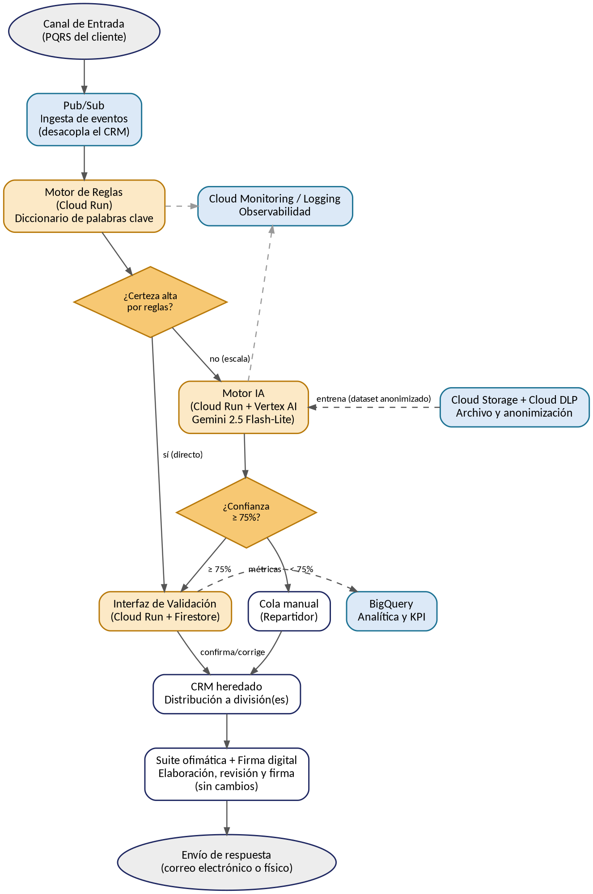

*Figura 2. Arquitectura de aplicaciones objetivo en GCP. En ámbar, los componentes de clasificación (reglas e IA); en azul claro, los componentes de datos, analítica y observabilidad.*

---

## 4. Arquitectura de Datos

### 4.1 Catálogo de Entidades de Datos

| Entidad | Descripción | Aplicación de origen |
|---|---|---|
| PQRS (texto original) | Solicitud recibida del cliente | Canal de entrada / CRM heredado |
| Resultado del Motor de Reglas | Área sugerida (o "sin certeza") | Motor de Reglas (Cloud Run) |
| Clasificación del Motor IA | Área sugerida + puntaje de confianza | Motor IA (Vertex AI) |
| Decisión del agente | Confirmación o corrección de la sugerencia | Interfaz de Validación (Firestore) |
| Caso enrutado | PQRS con la división ya asignada | CRM heredado |
| Respuesta oficial | Documento firmado enviado al cliente | Suite ofimática / firma digital |
| Dataset de entrenamiento (anonimizado) | Histórico de PQRS etiquetado, auditado, balanceado y anonimizado | Cloud Storage + Cloud DLP |
| Registro de auditoría y métricas | Trazabilidad y desempeño del modelo en producción | BigQuery / Cloud Monitoring |

### 4.2 Matriz Entidad de Datos — Aplicación

C = Crea · L = Lee · A = Actualiza

| Entidad de datos | Motor de Reglas | Motor IA | Interfaz Validación (Firestore) | Cloud Storage + DLP | BigQuery |
|---|---|---|---|---|---|
| PQRS (texto original) | L | L | L | L | |
| Resultado del Motor de Reglas | C | L | L | | L |
| Clasificación del Motor IA | | C | L / A | | L |
| Decisión del agente | | | C | L | |
| Dataset de entrenamiento | | L | | C / A | |
| Registro de auditoría | | C | | | C / L |

### 4.3 Principios de gobierno de datos y cumplimiento

* **Jurisdicción y marco legal:** el tratamiento del texto de las PQRS debe cumplir la **Ley 1581 de 2012** (Habeas Data) y su **Decreto reglamentario 1377 de 2013** (Colombia). El texto debe anonimizarse o seudonimizarse mediante **Cloud DLP** antes de almacenarse en Cloud Storage para entrenamiento (RS-05).
* **Validación previa por el Oficial de Protección de Datos:** conforme al mapa de partes interesadas de la Fase A (sección 2.2), el Oficial de Protección de Datos/Cumplimiento debe validar el proceso de anonimización antes de iniciar cualquier entrenamiento o reentrenamiento del modelo.
* **Principio "los datos son un activo"** (heredado de la Fase A, sección 7): gobierno formal del dataset mediante auditoría y balanceo antes de cada reentrenamiento (RN-06).
* **Comité de gobierno de datos/IA:** la Fase A (sección 5) señala que aún falta constituir este comité, encargado de aprobar el uso del histórico de PQRS para entrenamiento; se recomienda constituirlo antes del Mes 2 de la hoja de ruta (sección 8).
* **Retención y trazabilidad:** el registro de auditoría en BigQuery debe conservarse el tiempo suficiente para sustentar decisiones de reentrenamiento y eventuales requerimientos de la Superintendencia de Industria y Comercio.

---

## 5. Matriz Aplicación — Función de Negocio

| Función de negocio (Fase B) | Aplicación que la soporta |
|---|---|
| Recepción y registro de solicitudes | CRM heredado → Pub/Sub |
| Clasificación por reglas (primer nivel) | Motor de Reglas (Cloud Run) |
| Clasificación automática por IA (segundo nivel) | Motor IA (Cloud Run + Vertex AI) |
| Validación humana de la sugerencia | Interfaz de Validación (Cloud Run + Firestore) |
| Atención por área responsable | CRM heredado (distribución) |
| Elaboración y aprobación de respuestas | Suite ofimática + firma digital |
| Gobierno y KPI del proceso | BigQuery (tablero de métricas) |
| Integración e infraestructura | Pub/Sub, IAM + VPC Service Controls |

---

## 6. Análisis de Brechas (Aplicaciones y Datos)

| Brecha | Estado actual | Estado objetivo | Acción para cerrarla |
|---|---|---|---|
| Integración | Sin integración automatizada entre sistemas | Pub/Sub desacopla el CRM de los servicios de clasificación, con reintentos automáticos | Diseñar los tópicos y suscripciones de Pub/Sub (Fase D detalla el dimensionamiento) |
| Clasificación automática | No existe ningún mecanismo de clasificación | Clasificación en 3 niveles: reglas → IA (Vertex AI) → manual | Construir el diccionario de reglas y configurar el Motor IA con el umbral de confianza |
| Gobierno de datos | Dataset disperso, sin etiquetar ni anonimizar | Dataset etiquetado, auditado, balanceado y anonimizado (Cloud DLP) en Cloud Storage | Implementar el pipeline de curaduría y anonimización de datos |
| Monitoreo | Sin trazabilidad automática del desempeño | Cloud Monitoring/Logging + BigQuery con métricas de cobertura, exactitud y tiempo de ciclo | Desplegar los tableros y alertas de observabilidad |
| Cumplimiento legal | Sin comité de gobierno de datos/IA ni proceso formal de anonimización | Comité constituido y pipeline de anonimización validado por el Oficial de Protección de Datos | Constituir el comité y ejecutar la validación antes del entrenamiento (Fase A, sección 5) |

---

## 7. Especificación de Requisitos de Sistemas (RS)

| ID | Requisito de sistema | Requisito de negocio relacionado |
|---|---|---|
| RS-01 | El Motor IA (Vertex AI, Gemini 2.5 Flash-Lite) debe responder en el orden de milisegundos y soportar un volumen superior a 10.000 solicitudes/día | RN-01 |
| RS-02 | El Motor de Reglas y el Motor IA deben exponerse como servicios Cloud Run, consumidos vía Pub/Sub con reintentos automáticos | RN-02 |
| RS-03 | La Interfaz de Validación (Cloud Run + Firestore) debe mostrar el área sugerida y el puntaje de confianza, y permitir la corrección manual en un clic | RN-03 |
| RS-04 | El sistema debe enrutar automáticamente a la cola manual del Repartidor cuando ni el Motor de Reglas ni el Motor IA alcancen la certeza/confianza requerida (< 75%) | RN-04 |
| RS-05 | El pipeline de datos debe anonimizar o seudonimizar los datos personales del texto de la PQRS mediante Cloud DLP, conforme a la Ley 1581 de 2012 y el Decreto 1377 de 2013 | RN-05 |
| RS-06 | BigQuery debe registrar métricas de sesgo por segmento y alertar desviaciones significativas antes de cada reentrenamiento | RN-06 |
| RS-07 | El CRM heredado y la suite ofimática deben conservar sin modificaciones la plantilla oficial y los lineamientos vigentes | RN-07 |
| RS-08 | La arquitectura debe operar dentro de servicios cloud de pago por uso (Cloud Run, Vertex AI, Pub/Sub, BigQuery), ajustándose al presupuesto y plazo del MVP (ver Anexo A) | RN-08 |
| RS-09 | El Motor de Reglas debe resolver el caso sin invocar el Motor IA cuando la certeza sea alta, para reducir la latencia y el costo de inferencia | Fase A, sección 12.1 |
| RS-10 | La ingesta vía Pub/Sub debe incluir reintentos automáticos y una cola de contingencia hacia el Repartidor si el CRM heredado no responde a tiempo | Mitigación del Riesgo 3 (Fase A) |

---

## 8. Componentes de la Hoja de Ruta (Aplicaciones y Datos)

| Fase | Horizonte | Componentes de aplicaciones y datos (GCP) |
|---|---|---|
| Fase 1 — Cimentación | Mes 1 | Diseño de tópicos/suscripciones de Pub/Sub; construcción del diccionario de reglas por división; diseño del esquema de BigQuery y del dataset en Cloud Storage; constitución del comité de gobierno de datos/IA |
| Fase 2 — Construcción | Mes 2 | Despliegue del Motor de Reglas (Cloud Run); configuración del Motor IA (Vertex AI, Gemini 2.5 Flash-Lite) con el umbral de confianza; desarrollo de la Interfaz de Validación (Cloud Run + Firestore); pipeline de anonimización con Cloud DLP |
| Fase 3 — Integración y despliegue | Mes 3 | Integración Pub/Sub ↔ CRM heredado; despliegue piloto con clasificación en 3 niveles; configuración de Cloud Monitoring/Logging e IAM + VPC Service Controls; capacitación a agentes; medición de KPI iniciales en BigQuery |

---

## 9. Rol del Arquitecto y Gobernanza

### 9.1 Roles en la Fase C

| Rol | Responsabilidades en esta fase |
|---|---|
| Arquitecto Empresarial | Crea marcos técnicos y patrones de diseño; establece estándares de desarrollo; define arquitecturas de referencia; gestiona el portafolio de aplicaciones; protege el valor empresarial |
| Arquitecto de Aplicaciones (Arquitecto de TI, catálogo Fase B) | Sirve como puente entre dominios; alinea la estrategia con la ejecución; diseña la arquitectura de microservicios en GCP definida en la Fase A |

### 9.2 Dominios de arquitectura impactados

* **Negocio:** sin cambios adicionales frente a lo definido en la Fase B.
* **Datos:** gobierno, etiquetado, balanceo y anonimización del histórico de PQRS — detallado en la sección 4.
* **Aplicación:** Motor de Reglas, Motor IA, Interfaz de Validación e integración vía Pub/Sub — detallado en la sección 3.
* **Tecnología:** el proveedor cloud ya está definido (GCP); queda para la Fase D el dimensionamiento detallado (regiones, políticas de escalamiento, continuidad/DR, hardening de seguridad).

### 9.3 Riesgos técnicos (heredados de la Fase A, sección 10)

| Riesgo | Nivel inicial | Mitigación | Nivel residual |
|---|---|---|---|
| Integración con el CRM heredado (límites de tasa o indisponibilidad de sus APIs) | Alto | Pub/Sub como capa desacoplada, con reintentos automáticos y cola de contingencia hacia el Repartidor | Moderado |
| Resistencia al cambio / baja adopción por parte de los agentes | Alto | Comunicar que el rol del agente es de validación, no de reemplazo; capacitación temprana; involucrar a los agentes en el diseño de la Interfaz de Validación | Bajo |
| Incumplimiento de la Ley 1581 de 2012 en el tratamiento de datos de entrenamiento | Alto | Anonimización con Cloud DLP y validación previa del Oficial de Protección de Datos | Bajo |
| Mantenimiento del diccionario de reglas (queda desactualizado si cambian productos/servicios) | Moderado | Revisión periódica del diccionario; monitoreo de la tasa de escalamiento al Motor IA como señal de alerta | Bajo |

### 9.4 Gobierno de arquitectura

Esta Arquitectura de Sistemas de Información debe someterse a revisión y aprobación formal del Gerente de TI y del Director de Servicio al Cliente antes de avanzar a la Fase D (Arquitectura Tecnológica), donde se detallará el dimensionamiento de la infraestructura ya definida en GCP (regiones, políticas de escalamiento, continuidad y hardening de seguridad), siguiendo el Plan de Comunicaciones de Arquitectura Empresarial definido para el proyecto.

---

## 10. Conclusión y Aprobación para Avanzar a la Fase D

Esta Fase C documenta la arquitectura de aplicaciones línea base (sistemas manuales y desconectados descritos en el Procedimiento PQRSD) y la arquitectura de aplicaciones y datos objetivo — clasificación en 3 niveles (reglas → IA → manual) sobre servicios administrados de GCP —, junto con los catálogos, matrices, el análisis de brechas, los requisitos de sistemas y la hoja de ruta necesarios para cerrar la distancia entre ambas, en línea con la Arquitectura de Negocio de la Fase B y el concepto de solución de la Fase A.

Con esta base, el proyecto "IA-PQRS Smart Routing" queda en condiciones de avanzar hacia la Fase D: Arquitectura Tecnológica, donde se detallará el dimensionamiento de la infraestructura GCP ya seleccionada.

### Aprobación

| Rol | Nombre | Firma | Fecha |
|---|---|---|---|
| Gerente de TI | | | |
| Director de Servicio al Cliente | | | |

---

## Anexo A. Estimación de Costos del MVP

Esta sección reemplaza la estimación independiente que traía una versión anterior de este documento (≈USD 43.500, basada en supuestos genéricos de mercado). En su lugar, se usa el desglose oficial ya desarrollado en la Fase A (sección 12.3), que es más preciso porque está anclado a los servicios reales de GCP definidos en la sección 3 de este documento.

### A.1 Desglose de costos — MVP (3 meses)

| Ítem | Costo estimado (USD) | Notas |
|---|---|---|
| Científico de Datos / ML Engineer (contratista, perfil semi-senior en Colombia) | ≈ 7.400 | (supuesto, Fase A) |
| Ingeniero Cloud/Backend | ≈ 2.600 | Recurso interno ya asignado; costo de oportunidad, no desembolso nuevo |
| Revisión de cumplimiento (Ley 1581 / anonimización) | ≈ 1.500 | (supuesto, Fase A) |
| Infraestructura GCP durante el MVP | ≈ 100 | Dentro de los niveles gratuitos a este volumen |
| Capacitación a agentes | ≈ 800 | (supuesto, Fase A) |
| Contingencia (15%) | ≈ 1.470 | |
| **Total incremental (efectivo nuevo)** | **≈ 11.270** | |

**Operación en régimen estable (post-MVP, mensual):** infraestructura ≈ USD 50-80/mes (Pub/Sub, Cloud Run, Vertex AI, BigQuery, Monitoring) + ML Engineer a 20% de dedicación (supuesto) ≈ USD 490/mes → total ≈ **USD 550-570/mes** (≈ USD 6.600-6.900/año).

### A.2 Verificación de coherencia con el presupuesto

| Concepto | Monto (USD) |
|---|---|
| Total estimado del MVP (desglose oficial, Fase A) | 11.270 |
| Presupuesto aprobado en la Fase A / RN-08 | 50.000 |
| Margen restante | 38.730 (≈ 77%) |

El presupuesto real del MVP, desglosado, se ubica entre USD 11.000 y 14.000 — muy por debajo de los USD 50.000 originalmente asignados. **Esto no implica que los USD 50.000 fueran insuficientes: el problema original era la falta de desglose, no la magnitud.** Con el desglose en mano, el comité de aprobación puede optar por: (a) mantener los USD 50.000 como margen de contingencia e iteración (por ejemplo, para ajustar el umbral de confianza durante el piloto o ampliar el alcance del diccionario de reglas), o (b) reasignar el excedente a otras iniciativas del portafolio de TI.

**Nota:** el escenario de costos usa el "peor caso" (100% de los casos escalados al Motor IA); en la práctica, cuanto mejor funcione el Motor de Reglas, menor será el consumo de Vertex AI y, por tanto, el costo real. El crédito de bienvenida de USD 300 de Google Cloud no debe tratarse como ahorro recurrente, ya que aplica solo a cuentas nuevas y por tiempo limitado.

# Fase D — Arquitectura Tecnológica

## 1. Información del documento

| Campo | Valor |
|---|---|
| Proyecto | IA-PQRS Smart Routing |
| Empresa de referencia | TelcoLatam |
| Fase ADM | Fase D — Arquitectura Tecnológica |
| Fases de entrada | Fase A (Visión de la Arquitectura), Fase B (Arquitectura de Negocio), Fase C (Arquitectura de Sistemas de Información) |
| Proveedor cloud | Google Cloud Platform (GCP) — decisión ya tomada en la Fase A, sección 12 |
| Estado | Borrador para revisión del Gerente de TI y el Director de Servicio al Cliente |
| Fecha | 2026-09-29 |
| Autor | Arquitectura Empresarial — continuación documental de las Fases A, B y C |

## 2. Objetivo

Definir la arquitectura tecnológica objetivo (infraestructura, plataformas, redes, seguridad, integración y operación) que soporta la clasificación de PQRS en 3 niveles (reglas → IA → manual) establecida en la Fase A (sección 12) y detallada como arquitectura de aplicaciones y datos en la Fase C. Esta fase traduce el concepto de solución en GCP ya aprobado en un diseño técnico dimensionado: selección de región, patrones de cómputo y almacenamiento, conectividad con el CRM heredado on-premise, controles de seguridad e identidad, observabilidad, CI/CD y continuidad operativa — de modo que el proyecto quede listo para pasar de la arquitectura a la implementación (Fase E).

## 3. Alcance

**Dentro del alcance de esta fase:**
* Dimensionamiento técnico de los componentes GCP ya catalogados en la Fase C (Pub/Sub, Cloud Run, Vertex AI, Firestore, Cloud Storage + Cloud DLP, BigQuery, Cloud Monitoring/Logging, IAM + VPC Service Controls).
* Diseño de la conectividad entre el CRM heredado on-premise y GCP.
* Arquitectura de seguridad, identidad y gestión de secretos.
* Estrategia de CI/CD, Infraestructura como Código (IaC) y gobierno de configuración.
* Estrategia de resiliencia, alta disponibilidad, continuidad y recuperación ante desastres (DR).
* Catálogo de estándares y principios tecnológicos, análisis de brechas técnicas y hoja de ruta de implementación.

**Fuera del alcance de esta fase:**
* Rediseño del CRM heredado o de las herramientas ofimáticas usadas por Proyectista/Revisor/Jefe de División (sin cambios, Fase C sección 3.1).
* Migración del CRM a la nube (permanece on-premise; solo se diseña su conectividad).
* Selección o entrenamiento detallado del modelo de IA (cubierto en la Fase C, aquí solo se dimensiona la plataforma que lo aloja: Vertex AI).
* Fase E (Oportunidades y Soluciones) y Fase F (Planificación de la Migración), que consumirán esta arquitectura como insumo.

## 4. Contexto arquitectónico

### 4.1 Arquitectura Baseline

La línea base tecnológica es la ya descrita en las Fases A (sección 5) y C (sección 2): un CRM heredado on-premise con capacidad de exponer APIs pero sin infraestructura cloud nativa, sin integración automatizada entre sistemas, sin gobierno de datos, sin observabilidad ni CI/CD formal. El detalle de hardware, topología de red y versiones de software de este entorno **no está disponible** en la documentación de fases anteriores (`TBD` — ver sección 21).

### 4.2 Arquitectura Target

La arquitectura objetivo despliega los servicios administrados de GCP ya seleccionados en la Fase A/C sobre una región primaria de Sudamérica, con conectividad privada hacia el CRM heredado, un perímetro de seguridad único (VPC Service Controls), IAM de mínimo privilegio, observabilidad extremo a extremo y una estrategia de resiliencia que se apoya explícitamente en el proceso manual ya existente como mecanismo de degradación segura ante fallas (sección 7.14). El detalle completo se desarrolla en la sección 7.

### 4.3 Dependencias con las fases anteriores

| Fase | Insumo que consume esta Fase D |
|---|---|
| Fase A, sección 12 | Selección de proveedor (GCP), concepto de solución en 3 niveles, presupuesto desglosado (≈USD 11.270 MVP / ≈USD 550-570 mes operación), Riesgos 3-5, jurisdicción legal (Ley 1581 de 2012, Decreto 1377 de 2013) |
| Fase B, secciones 3 y 7 | Catálogo de actores objetivo (Motor de Reglas, Motor IA, Agente de Soporte), requisitos de negocio RN-01 a RN-08 |
| Fase C, secciones 3, 4 y 7 | Catálogo de aplicaciones y de interfaces objetivo, catálogo de entidades de datos, requisitos de sistema RS-01 a RS-10, riesgos técnicos preliminares (sección 9.3), y el señalamiento explícito de que "queda para la Fase D el dimensionamiento detallado (regiones, políticas de escalamiento, continuidad/DR, hardening de seguridad)" (Fase C, sección 9.2) |

### 4.4 Principios arquitectónicos aplicables

Se heredan de la Fase A (sección 7) los principios de **Privacidad desde el Diseño**, **Independencia tecnológica** y **Preferencia por servicios administrados en la nube (*cloud-first*)**, y de la Fase C el criterio de **comprar vs. desarrollar** (sección 3.3). Esta fase añade los principios tecnológicos específicos detallados en la sección 11.

### 4.5 Restricciones

* Presupuesto: ≈USD 11.270 de inversión incremental para el MVP y ≈USD 550-570/mes en operación estable (Fase A, sección 12.3; Fase C, Anexo A) — toda decisión de esta fase debe caber dentro de ese marco o justificar explícitamente una excepción.
* Plazo: MVP en 3 meses (Fase A, sección 3; RN-08).
* Jurisdicción legal: Colombia — Ley 1581 de 2012, Decreto 1377 de 2013, y Resolución CRC 5050 de 2016 para tiempos de respuesta (Fase A/C).
* GCP no tiene una región en Colombia; debe seleccionarse una región sudamericana disponible (sección 7.3).
* El CRM heredado permanece on-premise; no se migra en este proyecto.

### 4.6 Supuestos

* **Supuesto:** el CRM heredado puede realizar llamadas salientes HTTPS (egress a internet) o, alternativamente, la red de TelcoLatam puede establecer un túnel VPN hacia GCP. No se confirma cuál de las dos condiciones aplica — ver ADR-02 (sección 15) y TBD (sección 21).
* **Supuesto:** TelcoLatam no cuenta hoy con un proveedor de identidad (IdP) corporativo federable a Google Cloud Identity; se asume Google Workspace/Cloud Identity como directorio para el acceso de agentes, sujeto a confirmación.
* **Supuesto:** el volumen de >10.000 PQRS/día (Fase A) se distribuye de forma no uniforme durante el horario laboral, sin picos que excedan varias veces ese promedio; no se dispone de un perfil de tráfico horario real.
* **Supuesto:** no existen hoy requisitos regulatorios de residencia de datos que exijan que el texto de las PQRS permanezca físicamente en territorio colombiano (la Ley 1581 regula el tratamiento, no exige residencia física); se recomienda validar este punto con el Oficial de Protección de Datos antes de la implementación.

## 5. Requisitos tecnológicos

### 5.1 Requisitos funcionales tecnológicos

| ID | Requisito | Origen |
|---|---|---|
| RT-01 | La plataforma debe recibir el texto de la PQRS desde el CRM heredado y publicarlo como evento en Pub/Sub, sin pérdida de mensajes | RS-02, RS-10 |
| RT-02 | La plataforma debe exponer un mecanismo de ingesta (`ingestion-gateway`) que traduzca la llamada del CRM heredado (que no habla nativamente el protocolo de Pub/Sub) en una publicación autenticada al tópico correspondiente | Nuevo — deriva de RS-02 |
| RT-03 | La plataforma debe permitir al Agente de Soporte confirmar o corregir la sugerencia de clasificación desde una interfaz web con autenticación corporativa | RS-03 |

### 5.2 Requisitos no funcionales

| ID | Requisito | Origen |
|---|---|---|
| RT-04 | Todo dato en tránsito debe cifrarse con TLS 1.2 o superior; todo dato en reposo debe cifrarse con las llaves administradas por Google (o CMEK si el Oficial de Protección de Datos lo exige) | RS-05, principio de Privacidad desde el Diseño (Fase A) |
| RT-05 | Todos los servicios deben desplegarse mediante Infraestructura como Código (Terraform), sin cambios manuales directos en la consola de GCP en producción | Principio tecnológico PT-04 (sección 11) |

### 5.3 Requisitos de disponibilidad

| ID | Requisito | Métrica objetivo | Origen |
|---|---|---|---|
| RT-06 | Los servicios Cloud Run que forman la ruta crítica de clasificación deben tener una disponibilidad mensual objetivo | ≥ 99.5% (heredada del SLA de Cloud Run regional) | RS-01 |
| RT-07 | Ante la indisponibilidad de cualquier componente de clasificación (reglas, IA o validación), el caso debe degradar de forma segura a la cola manual del Repartidor, sin bloquear la recepción de nuevas PQRS | RS-10, Riesgo 3 (Fase A) |

### 5.4 Requisitos de rendimiento

| ID | Requisito | Métrica objetivo | Origen |
|---|---|---|---|
| RT-08 | El Motor de Reglas debe responder en tiempo sub-segundo | p95 ≤ 300 ms | RS-01, RS-09 |
| RT-09 | El Motor IA (llamada a Vertex AI) debe responder dentro de un tiempo razonable para un flujo asíncrono, aunque no sea literalmente de "milisegundos" como sugiere RS-01 — se ajusta la expectativa a la naturaleza de un modelo de lenguaje | p95 ≤ 3 s | Refinamiento arquitectónico de RS-01 (ver ADR-09) |
| RT-10 | El tiempo de ciclo completo de clasificación automática (ingesta → reglas/IA → validación disponible para el agente) no debe exceder | p95 ≤ 8 s | KPI de la Fase A (reducción del 90% en tiempo de triage) |

### 5.5 Requisitos de escalabilidad

| ID | Requisito | Métrica objetivo | Origen |
|---|---|---|---|
| RT-11 | La plataforma debe soportar el volumen actual (>10.000 PQRS/día) con margen de crecimiento sin cambios arquitectónicos | ≥ 3x el volumen actual (≈30.000/día) | RS-01 |
| RT-12 | El escalamiento debe ser automático (sin aprovisionamiento manual de capacidad) para todos los componentes de la ruta de clasificación | Cloud Run y Pub/Sub escalan de forma nativa; Vertex AI gestionado | Principio *cloud-first* (Fase A) |

### 5.6 Requisitos de seguridad

| ID | Requisito | Origen |
|---|---|---|
| RT-13 | El acceso de los Agentes de Soporte a la Interfaz de Validación debe controlarse por identidad (Zero Trust), no por ubicación de red | Principio tecnológico PT-02 |
| RT-14 | Ningún dato de PQRS debe salir del perímetro de seguridad definido (VPC Service Controls) | RS-05, Fase A sección 12.2 |
| RT-15 | Las credenciales de servicio (API keys, tokens) deben gestionarse en Secret Manager con rotación; se evitan llaves estáticas de larga duración donde sea técnicamente posible | Principio tecnológico PT-06 |

### 5.7 Requisitos de continuidad

| ID | Requisito | Métrica objetivo | Origen |
|---|---|---|---|
| RT-16 | Los datos en Firestore, Cloud Storage y BigQuery deben respaldarse de forma que permitan una recuperación ante desastres | RPO ≤ 24 h | Sección 7.14 |
| RT-17 | El tiempo máximo aceptable para restablecer el servicio de clasificación automática tras un desastre regional | RTO ≤ 4 h (con degradación a cola manual mientras tanto) | Sección 7.14, ADR-06 |

### 5.8 Requisitos de interoperabilidad

| ID | Requisito | Origen |
|---|---|---|
| RT-18 | Todas las interfaces internas deben exponerse como REST/JSON documentado con OpenAPI 3.0 | Estándar TE-01 (sección 10) |
| RT-19 | El Motor IA debe poder sustituirse por otro proveedor de modelos de lenguaje sin rediseñar el resto de la arquitectura (principio de independencia tecnológica, Fase A) | Principio tecnológico PT-07 |

### 5.9 Requisitos de observabilidad y operación

| ID | Requisito | Origen |
|---|---|---|
| RT-20 | Cada componente de la ruta de clasificación debe emitir métricas, logs estructurados y trazas distribuidas correlacionables por un identificador único de caso | RS-06, sección 7.11 |
| RT-21 | Deben existir alertas automáticas ante: aumento anómalo de la tasa de escalamiento a IA, agotamiento de presupuesto mensual, y profundidad creciente de la cola de mensajes fallidos (*dead-letter*) | Sección 7.11 |

## 6. Arquitectura Tecnológica Baseline

### 6.1 Vista general

La línea base es deliberadamente simple: un sistema monolítico on-premise (el CRM) rodeado de herramientas ofimáticas de escritorio, sin capa de integración, sin nube y sin automatización. No existe una arquitectura tecnológica formalmente documentada previa a este proyecto.

### 6.2 Infraestructura

`Información no disponible.` Las Fases A-C no documentan servidores, hipervisores ni centros de datos específicos del CRM heredado. Se asume (Supuesto) que corresponde a infraestructura física o virtualizada dentro de un centro de datos propio o contratado de TelcoLatam.

### 6.3 Computación

`Información no disponible` en detalle (modelos de servidor, capacidad). Funcionalmente, el CRM ejecuta los módulos de registro y asignación de PQRS descritos en la Fase C (sección 2.2).

### 6.4 Almacenamiento

`Información no disponible` en detalle técnico. Funcionalmente, el histórico de PQRS está "disperso y sin etiquetar" (Fase C, sección 2.5), sin un repositorio de datos gobernado.

### 6.5 Redes y comunicaciones

`Información no disponible.` La Fase A (sección 5) indica que el CRM "tiene APIs, pero la infraestructura es On-Premise"; no se documenta topología, segmentación ni si existe salida a internet.

### 6.6 Seguridad

`Información no disponible` en el nivel de controles técnicos (firewalls, IAM interno, cifrado). No hay evidencia de un perímetro de seguridad formal ni de gestión de secretos.

### 6.7 Plataformas

CRM heredado (plataforma no especificada por nombre en la documentación de fases anteriores) + suite ofimática de escritorio + editor de texto con certificado de firma digital PDF (Fase C, sección 2.2).

### 6.8 Middleware

No existe middleware de integración; toda transferencia de datos entre aplicaciones es manual (copiar/pegar, envío de archivos por correo interno — Fase C, sección 2.3).

### 6.9 Integración

Ninguna interfaz automatizada (Fase C, sección 2.3): 0 integraciones documentadas entre el CRM, la suite ofimática y el repositorio de plantillas.

### 6.10 Operación y monitoreo

No existe observabilidad de sistema ni monitoreo formal del proceso; el seguimiento depende enteramente de la disponibilidad del Repartidor (Fase B, sección 2.5).

## 7. Arquitectura Tecnológica Target

### 7.1 Principios de diseño

Serverless-first, seguridad por diseño (Zero Trust + privacidad desde el diseño), automatización total de la infraestructura (IaC), observabilidad por defecto, resiliencia mediante degradación segura hacia el proceso manual existente, y costo variable (pago por uso) alineado al presupuesto ya aprobado. El detalle de cada principio está en la sección 11.

### 7.2 Vista general de la arquitectura

La arquitectura target despliega los componentes ya catalogados en la Fase C sobre un único proyecto GCP de producción (más proyectos de *staging*/desarrollo, sección 7.8), en la región **southamerica-east1 (São Paulo)** como región primaria (ADR-01, sección 15), con conectividad privada hacia el CRM heredado, un perímetro VPC Service Controls que envuelve todos los servicios de datos, e IAM de mínimo privilegio con una cuenta de servicio dedicada por componente. La vista conceptual completa está en la sección 8.1.

### 7.3 Arquitectura de infraestructura

| Decisión | Valor | Justificación |
|---|---|---|
| Región primaria | `southamerica-east1` (São Paulo, Brasil) | Región GCP más cercana a Colombia con el catálogo de servicios más maduro en Sudamérica; GCP no tiene región propia en Colombia (ver ADR-01) |
| Región secundaria (DR) | `southamerica-west1` (Santiago, Chile) — a confirmar | Alternativa sudamericana para redundancia de datos; no se activa cómputo aquí en el MVP (ver sección 7.14) |
| Disponibilidad de Vertex AI (Gemini) en la región primaria | **A validar (TBD)** | Los modelos generativos de Vertex AI no siempre están disponibles en todas las regiones; si el modelo no está disponible en `southamerica-east1`, el Motor IA deberá invocar el endpoint global/`us-central1` de Vertex AI, añadiendo latencia cross-region (ver Riesgo TR-03, sección 16) |
| Organización de proyectos GCP | `pqrs-prod`, `pqrs-staging`, `pqrs-shared-services` (CI/CD, logging centralizado) | Aísla producción de pruebas; sigue las prácticas recomendadas de Google Cloud (jerarquía de recursos) |

### 7.4 Arquitectura de computación

| Servicio Cloud Run | Función | Concurrencia | CPU siempre asignada | Instancias mín./máx. |
|---|---|---|---|---|
| `ingestion-gateway` | Recibe la llamada del CRM heredado y publica en Pub/Sub | 80 | Sí (reduce *cold start* para el CRM) | 1 / 10 |
| `motor-reglas` | Clasificación por diccionario de palabras clave (Fase C, sección 3.1) | 80 | No (escala a cero) | 0 / 10 |
| `motor-ia` | Orquesta la llamada a Vertex AI (Gemini 2.5 Flash-Lite) | 40 | No | 0 / 10 |
| `interfaz-validacion` | Aplicación web para el Agente de Soporte, respaldada por Firestore | 80 | No | 0 / 5 |

No se utiliza Google Kubernetes Engine (GKE): dado el volumen (>10.000 PQRS/día, tráfico bajo y no sostenido) y la ausencia de necesidades de orquestación multi-contenedor compleja, Cloud Run cubre el requisito de escalabilidad (RT-11, RT-12) con menor sobrecarga operativa y menor costo — decisión coherente con el principio *cloud-first* de la Fase A y con el presupuesto (ver ADR-04, sección 15).

### 7.5 Arquitectura de almacenamiento

| Componente | Servicio | Configuración objetivo |
|---|---|---|
| Estado de casos en validación | Firestore (modo Nativo, regional en `southamerica-east1`) | Recuperación a un punto en el tiempo (PITR) habilitada; reglas de seguridad restringidas a las cuentas de servicio de los Cloud Run autorizados |
| Texto crudo de la PQRS (pre-anonimización) | Cloud Storage — bucket `pqrs-raw` | Retención corta (ver política de retención, sección 7.7); cifrado con llaves administradas por Google (CMEK opcional, ADR-09) |
| Dataset anonimizado de entrenamiento | Cloud Storage — bucket `pqrs-training-anonymized` (poblado vía Cloud DLP) | Versionado habilitado; ciclo de vida: transición a *Coldline* tras 90 días |
| Analítica y KPI | BigQuery — dataset `pqrs_analytics` | Particionado por fecha de ingesta; *time travel* de 7 días + exportaciones periódicas a Cloud Storage para retención extendida |
| Auditoría | BigQuery — dataset `pqrs_audit` | Acceso restringido a nivel de columna para campos que pudieran contener texto no anonimizado; retención alineada a los requerimientos de trazabilidad de la Superintendencia de Industria y Comercio (Fase C, sección 4.3) |

### 7.6 Arquitectura de red y comunicaciones

* **VPC** dedicada por proyecto (`vpc-pqrs-prod`), con un conector de Acceso a VPC sin servidores (Serverless VPC Access) para que los servicios Cloud Run alcancen recursos privados.
* **Conectividad con el CRM heredado:** dos alternativas evaluadas (ADR-02, sección 15):
  1. **Cloud VPN de alta disponibilidad (HA VPN)** entre la red on-premise de TelcoLatam y la VPC de GCP — recomendado si el CRM no tiene salida a internet o si la política de seguridad de TelcoLatam exige conectividad privada.
  2. **Llamada saliente HTTPS autenticada con Workload Identity Federation** desde el CRM hacia el `ingestion-gateway` (expuesto con ingreso restringido) — recomendado si el CRM sí puede salir a internet, por ser más simple y económico.
  * **Decisión:** se documenta como condicional (TBD) hasta confirmar con el Gerente de TI la postura de red real del CRM (sección 21).
* **Cloud NAT** para that any Cloud Run/recurso privado que requiera salida a internet (por ejemplo, para acceder a Vertex AI si su endpoint no es accesible vía Private Service Connect en la región elegida).
* **Cloud Armor** (WAF) solo si `ingestion-gateway` requiere ingreso público (alternativa 2 anterior); no aplica si se opta por Cloud VPN puro.
* **API Gateway** como capa única de gestión de las APIs REST internas (autenticación por API key/OIDC, cuotas, versión `v1`), evitando el costo de una plataforma de gestión de APIs de nivel empresarial (Apigee) no justificada por el volumen ni el presupuesto del proyecto.

### 7.7 Arquitectura de seguridad

* **Perímetro VPC Service Controls** (ya definido en la Fase A/C) que envuelve Pub/Sub, Cloud Storage, BigQuery, Firestore, Cloud DLP y Vertex AI: ningún dato de PQRS puede exfiltrarse fuera del perímetro, incluso con credenciales válidas pero mal configuradas.
* **IAM de mínimo privilegio:** una cuenta de servicio por componente (`sa-ingestion-gateway`, `sa-motor-reglas`, `sa-motor-ia`, `sa-interfaz-validacion`, `sa-etl-dlp`), cada una con únicamente los roles necesarios (p. ej. `sa-motor-ia` solo tiene `roles/aiplatform.user` y el permiso de publicar en su tópico de salida, no acceso a BigQuery ni a Cloud Storage).
* **Zero Trust para agentes humanos:** la Interfaz de Validación se expone mediante **Identity-Aware Proxy (IAP)**, controlando el acceso por identidad corporativa (Google Workspace/Cloud Identity) y contexto (dispositivo, ubicación), en lugar de depender de que el agente esté conectado a la red corporativa o VPN — cumple RT-13.
* **Gestión de secretos:** todas las credenciales (API keys de contingencia, tokens) se almacenan en **Secret Manager**, con rotación programada; se prioriza **Workload Identity Federation** para evitar llaves de cuenta de servicio estáticas donde el CRM lo permita (ADR-07).
* **Cifrado:** TLS 1.2+ en tránsito (impuesto por defecto en los servicios GCP usados); en reposo, llaves administradas por Google por defecto, con **Cloud KMS (CMEK)** como mejora opcional para el bucket de datos anonimizados si el Oficial de Protección de Datos lo exige (ADR-09, no incluido en el presupuesto del MVP).
* **Gestión de certificados:** certificados TLS administrados automáticamente por Google (Certificate Manager) para cualquier dominio personalizado expuesto a través de API Gateway o un Load Balancer.
* **Gestión de vulnerabilidades:** análisis de imágenes de contenedor habilitado en Artifact Registry (Container Analysis) antes de cada despliegue; **Security Command Center** (nivel estándar/gratuito) habilitado para postura de seguridad continua sobre el perímetro.

### 7.8 Arquitectura de plataformas

Separación por proyecto GCP: `pqrs-dev` (desarrollo), `pqrs-staging` (pruebas de integración y de carga), `pqrs-prod` (producción), y `pqrs-shared-services` (Artifact Registry, Cloud Build, sumideros de logging centralizados). Esta separación es un requisito de gobierno de configuración (sección 12) que la línea base no tenía en absoluto.

### 7.9 Middleware

Pub/Sub actúa como el middleware de mensajería asíncrona entre el CRM heredado y los servicios de clasificación (ya definido en la Fase C); no se introduce un bus de mensajería adicional (se descartaron explícitamente RabbitMQ y Kafka en la Fase A por sobredimensionamiento frente al volumen del proyecto).

### 7.10 Integración tecnológica

Todas las integraciones internas son REST/JSON sobre HTTPS, documentadas con OpenAPI 3.0 (TE-01) y expuestas a través de API Gateway. La integración con Vertex AI usa el SDK/API REST nativo de Google. El detalle punto a punto ya está en el catálogo de interfaces de la Fase C (sección 3.5); esta fase añade el mecanismo de transporte (Pub/Sub, Cloud VPN/WIF) y los controles de autenticación.

### 7.11 Observabilidad

* **Métricas y paneles:** Cloud Monitoring, con paneles para tasa de escalamiento reglas→IA, tasa de escalamiento IA→manual, latencia p95 por componente (RT-08/RT-09/RT-10), tasa de error, y consumo de presupuesto de Vertex AI.
* **Logs:** Cloud Logging con logs estructurados (JSON) correlacionados por un identificador único de caso (*trace ID*) presente en todos los componentes (RT-20); sumidero (*sink*) hacia BigQuery (`pqrs_audit`) para retención extendida.
* **Trazas distribuidas:** Cloud Trace habilitado en la cadena `ingestion-gateway → motor-reglas → motor-ia → interfaz-validacion`, permitiendo diagnosticar en qué salto se concentra la latencia.
* **Reporte de errores:** Error Reporting integrado nativamente con Cloud Run.
* **Alertas (RT-21):** notificaciones (correo, y opcionalmente Slack/PagerDuty si se contratan) ante: aumento anómalo de la tasa de escalamiento a IA, profundidad creciente de la cola de mensajes fallidos (*dead-letter topic* de Pub/Sub), y alertas de presupuesto de facturación (Cloud Billing Budgets) dado el historial de falta de control presupuestal señalado en la Fase A original.

### 7.12 DevSecOps / CI-CD

* **Control de versiones:** el repositorio del proyecto ya existente en GitHub (`Modelo-de-IA-para-Enrutamiento-Inteligente-de-PQRS`), con una carpeta `infra/` para el código Terraform.
* **Integración continua:** Cloud Build (o GitHub Actions equivalente) ejecuta pruebas unitarias, análisis estático de código, escaneo de secretos (p. ej. *trufflehog*/*git-secrets*) y construcción de la imagen de contenedor en cada *pull request*.
* **Despliegue continuo:** Cloud Build publica la imagen en Artifact Registry (con escaneo de vulnerabilidades habilitado) y despliega a Cloud Run con **despliegue gradual (traffic splitting)**: 10% → 50% → 100% del tráfico a la nueva revisión, con reversión automática si las métricas de error superan un umbral.
* **Infraestructura como Código:** Terraform gestiona Pub/Sub, Cloud Run, IAM, VPC, Firestore, BigQuery y VPC Service Controls; ningún cambio manual en la consola de GCP en `pqrs-prod` (RT-05).
* **DevSecOps:** las puertas de calidad (*quality gates*) del pipeline incluyen el análisis estático, el escaneo de secretos y el escaneo de vulnerabilidades de contenedor como bloqueantes, no opcionales.

### 7.13 Resiliencia y alta disponibilidad

Cloud Run es multi-zona dentro de la región de forma nativa (sin configuración adicional); Pub/Sub replica los mensajes dentro de la región del tópico; Firestore y BigQuery ofrecen alta disponibilidad regional gestionada por Google. No se requiere diseño adicional de HA a nivel de infraestructura porque los servicios son completamente administrados — el foco de esta arquitectura está en la **resiliencia del proceso de negocio** (sección 7.14), no en la redundancia de servidores.

### 7.14 Continuidad y recuperación ante desastres

* **Principio de degradación segura (ADR-06):** si cualquier componente de clasificación automática (reglas o IA) falla o se degrada, el diseño ya contempla (RS-10, RT-07) el enrutamiento automático a la cola manual del Repartidor. Esto significa que, ante una falla total de la plataforma en GCP, TelcoLatam **no pierde la capacidad de atender PQRS**: simplemente vuelve al proceso 100% manual que ya opera hoy como línea base. Esta es la estrategia de continuidad de negocio principal del proyecto, y reduce sustancialmente la necesidad de una arquitectura de DR costosa.
* **Backup de datos:**
  * Firestore: exportaciones administradas diarias a Cloud Storage (además del PITR nativo).
  * BigQuery: *time travel* de 7 días + exportación mensual a Cloud Storage (*Coldline*) para retención de auditoría de largo plazo.
  * Cloud Storage: versionado de objetos habilitado en los buckets de datos anonimizados.
* **Objetivos de recuperación:** RPO ≤ 24 h (RT-16) y RTO ≤ 4 h (RT-17) para el restablecimiento de la clasificación automática; durante ese lapso, el sistema opera en modo degradado (100% cola manual) sin interrupción del servicio al cliente.
* **Región secundaria:** `southamerica-west1` queda documentada como región de redundancia de datos (replicación de backups), sin cómputo activo en el MVP — activarla implicaría una inversión adicional no incluida en el presupuesto actual (Anexo A, Fase C).

### 7.15 Estimación de costos, ubicación de los datos y especificación detallada por componente

> **Nota de fuentes y alcance.** El presupuesto operativo agregado (≈ US$550-570/mes) ya fue aprobado en la Fase A (sección 12.3) y desglosado por bloques en la *Propuesta de Arquitectura GCP y Presupuesto* (sección 7). Esta tabla lo desagrega componente por componente, incorporando los elementos de infraestructura, seguridad y CI/CD que esta Fase D añade y que aquellos documentos no costeaban individualmente (Firestore, Secret Manager, API Gateway, Artifact Registry, Cloud Build, Cloud VPN condicional). Los precios unitarios se tomaron de las páginas oficiales de precios de Google Cloud consultadas en septiembre de 2026 y deben reverificarse en la calculadora oficial de Google Cloud antes de la aprobación final; los rangos reflejan el volumen de referencia de la Fase A (**(supuesto)** >10.000 PQRS/día ≈ 300.000/mes) y no un perfil de tráfico horario confirmado (sección 4.6).

| ID | Componente | Servicio / modo específico de GCP usado | Ubicación (región y centro de datos) | Costo estimado (mensual) | Notas |
|---|---|---|---|---|---|
| COMP-01 | CRM heredado | N/A (on-premise, sin cambios funcionales) | Centro de datos de TelcoLatam en Colombia (dirección/proveedor exactos: `Información no disponible`) | US$0 (no es gasto de GCP) | Sección 21, punto 3 |
| COMP-02 | Ingestion Gateway | Cloud Run, 2ª generación, 1 vCPU / 512 MiB, CPU siempre asignada, mín. 1 / máx. 10 instancias | `southamerica-east1` (São Paulo, Brasil) | ≈ US$0-10 | Instancia mínima=1 sale del nivel gratuito de "escala a cero"; impacto marginal a este volumen |
| COMP-03 | Pub/Sub | 5 tópicos (`pqrs-recibido`, `pqrs-requiere-ia`, `pqrs-clasificado`, `pqrs-cola-manual`, `pqrs-enrutado`) + suscripciones push | `southamerica-east1` (política de almacenamiento de mensajes fijada a la región) | ≈ US$0-5 | Primeros 10 GiB de throughput/mes gratis; a 300.000 mensajes/mes de texto corto, prácticamente sin costo |
| COMP-04 | Motor de Reglas | Cloud Run, 2ª generación, 1 vCPU / 512 MiB, escala a 0, máx. 10 instancias | `southamerica-east1` | ≈ US$0-5 | Dentro del nivel gratuito (2M solicitudes + 360.000 GiB-s/mes) a este volumen |
| COMP-05 | Motor IA (orquestador) | Cloud Run, 2ª generación, 1 vCPU / 1 GiB (memoria adicional para el cliente SDK de Vertex AI), escala a 0 | `southamerica-east1` | ≈ US$0-10 | Cómputo de orquestación únicamente; el costo del modelo se factura aparte (fila COMP-06) |
| COMP-06 | Vertex AI — motor de inferencia | Vertex AI Generative AI API, modelo **Gemini 2.5 Flash-Lite** (modelo base de Google, sin *fine-tuning*), invocado por `generateContent` | `southamerica-east1` **si el modelo está disponible ahí (TBD, GAP-10)**; en caso contrario, endpoint de `us-central1` (EE. UU.) | ≈ US$15-20 (peor caso: 100% de los casos escalados a IA) | Cifra heredada de la *Propuesta de Arquitectura GCP*, sección 7; si aplica el endpoint de EE. UU., los datos de PQRS cruzan de región durante la inferencia — implicación de residencia de datos a validar (sección 21, punto 6) |
| COMP-07 | Interfaz de Validación | Cloud Run, 2ª generación, 1 vCPU / 512 MiB, escala a 0, máx. 5 instancias | `southamerica-east1` | ≈ US$0-5 | Tráfico bajo (solo Agentes de Soporte) |
| COMP-08 | Firestore | Modo Nativo, base de datos **regional** (single-region), con recuperación a un punto en el tiempo (PITR) | `southamerica-east1` | ≈ US$0-10 | Nivel gratuito diario: 1 GiB almacenado + 50.000 lecturas + 20.000 escrituras + 20.000 eliminaciones; a >10.000 casos/día con ~2 lecturas y ~2 escrituras por caso, el uso ronda el límite gratuito de escrituras — posible pequeño excedente |
| COMP-09 | Cloud Storage | 2 buckets Standard, regionales: `pqrs-raw` (retención corta) y `pqrs-training-anonymized` (versionado, ciclo de vida a *Coldline* a los 90 días) | `southamerica-east1` | ≈ US$5-10 | El nivel "Always Free" de 5 GiB de Cloud Storage solo aplica a buckets en `us-west1`/`us-central1`/`us-east1`; al ser un bucket regional en Sudamérica, no aplica ese nivel gratuito |
| COMP-10 | Cloud DLP | Trabajos de anonimización por lotes (no continuos) sobre el texto crudo antes de poblar el bucket de entrenamiento | `southamerica-east1` (o API global de DLP) | ≈ US$5-10 | Depende del volumen real de texto a inspeccionar/mes; estimación conservadora, validar con un piloto |
| COMP-11 | BigQuery | 2 *datasets*: `pqrs_analytics` (particionado por fecha) y `pqrs_audit` (acceso restringido por columna) | `southamerica-east1` (almacenamiento regional) | ≈ US$5-10 | Primer 1 TiB de consultas/mes gratis; a este volumen de datos, difícilmente se excede |
| COMP-12 | Cloud Monitoring / Logging / Trace | Métricas, logs estructurados y trazas de los 4 servicios Cloud Run | Global (con datos de origen procesados desde `southamerica-east1`) | ≈ US$0-5 | Niveles gratuitos mensuales: ~150 MiB de métricas, 50 GiB de logs, 2,5M *spans* de traza — suficiente a este volumen |
| COMP-13 | IAM | Cuentas de servicio de mínimo privilegio (una por componente) | Global (sin datos de PQRS) | US$0 | Sin costo directo |
| COMP-14 | VPC Service Controls | Perímetro de seguridad sobre Pub/Sub, Firestore, Cloud Storage, BigQuery, Cloud DLP y Vertex AI | `southamerica-east1` (recursos protegidos) | US$0 | Sin costo directo; es un control de gobierno, no un servicio facturado por uso |
| COMP-15 | Secret Manager | ≈5-8 secretos activos (uno por cuenta de servicio/credencial) | Global, con política de réplica fijada a `southamerica-east1` | ≈ US$0-2 | Nivel gratuito: 6 versiones activas + 10.000 operaciones de acceso/mes; a este número de secretos y de invocaciones, se mantiene cerca del nivel gratuito |
| COMP-16 | Cloud VPN (HA VPN) | 2 túneles (mínimo para 99,99% de disponibilidad) | `southamerica-east1` (extremo GCP); extremo on-premise en el datacenter de TelcoLatam | **Condicional (ADR-02):** ≈ US$72-90/mes si se adopta esta alternativa; **US$0 adicionales** si se adopta la alternativa de HTTPS + Workload Identity Federation (fila COMP-24) | US$0,05/túnel/hora × 2 túneles × 720 h ≈ US$72/mes, más tráfico IPsec — impacto de presupuesto real que depende de GAP-06 |
| COMP-17 | Serverless VPC Access | Conector para que Cloud Run alcance recursos privados (solo necesario si se adopta Cloud VPN) | `southamerica-east1` | ≈ US$5-15 (condicional, solo si aplica COMP-16) | Estimación conservadora por instancias mínimas del conector; validar en la calculadora oficial |
| COMP-18 | API Gateway | Gestión de las APIs REST internas (autenticación, cuotas, versión `v1`) | Global (con *backends* en `southamerica-east1`) | US$0 | Primeras 2.000.000 de llamadas/mes gratis; a ≈300.000 PQRS/mes con 3-4 llamadas internas cada una (≈900.000-1.200.000 llamadas/mes), se mantiene dentro del nivel gratuito |
| COMP-19 | Identity-Aware Proxy (IAP) | Control de acceso Zero Trust a la Interfaz de Validación | `southamerica-east1` (recurso protegido) | US$0 de GCP | El costo real no es de GCP sino de la licencia de Google Workspace/Cloud Identity por agente (fila COMP-23) — **pendiente, TBD sección 21 punto 4** |
| COMP-20 | Artifact Registry | Repositorio de imágenes de contenedor de los 4 servicios Cloud Run (con escaneo de vulnerabilidades) | `southamerica-east1` (o multi-región, a definir en Terraform) | ≈ US$1-5 | Nivel gratuito: 0,5 GiB/mes; con 4 servicios y varias versiones retenidas, el excedente es pequeño (pocos GiB) |
| COMP-21 | Cloud Build | Pipeline de CI/CD (lint, pruebas, escaneo de secretos, build de imagen) | Región del *pool* de ejecución (a definir, recomendado `southamerica-east1` o el más cercano disponible) | ≈ US$0-10 | Nivel gratuito: 2.500 minutos de build/mes; con el volumen de despliegues esperado en un equipo pequeño, se mantiene mayormente dentro del nivel gratuito |
| COMP-22 | Terraform (IaC) | Código de infraestructura, sin servicio alojado por GCP | N/A (repositorio Git) | US$0 de GCP | Costo ya cubierto como parte del tiempo del Ingeniero Cloud/Backend (Fase A, sección 12.3) |
| COMP-23 | Google Cloud Identity / Workspace | Directorio corporativo para habilitar IAP | Google gestiona la ubicación; TelcoLatam administra el dominio | **Pendiente (TBD):** rango de mercado orientativo ≈ US$7-12/usuario/mes si se adquiere, según el plan — no es una cifra confirmada | Depende del número de Agentes de Soporte con acceso y de si TelcoLatam ya tiene una suscripción activa (sección 21, punto 4) |
| COMP-24 | Workload Identity Federation | Autenticación del CRM sin llaves estáticas (alternativa a COMP-16) | Global | US$0 | Sin costo directo; es la alternativa económica en el ADR-02 |
| COMP-25 | Cloud KMS | 1-2 llaves de cifrado (CMEK opcional) | `southamerica-east1` | **Opcional, no incluido en el MVP:** ≈ US$1-5/mes si se activa | Solo se activa si el Oficial de Protección de Datos lo exige (ADR-09); la Ley 1581 no lo exige por sí sola |
| COMP-26 | Security Command Center | Postura de seguridad continua, nivel estándar | Global | US$0 | El nivel estándar es gratuito; el nivel Premium (no contemplado en este MVP) tiene costo adicional |
| COMP-27 | Cloud Billing Budgets & Alerts | Alertas de consumo frente al presupuesto aprobado | Global | US$0 | Sin costo directo |

**Resumen de costo operativo mensual refinado**

| Escenario | Costo estimado/mes |
|---|---|
| Infraestructura GCP — suma de las filas anteriores, escenario base (conectividad CRM vía HTTPS + Workload Identity Federation, sin Cloud VPN, sin CMEK) | ≈ US$40-100 |
| + Licencia de Google Workspace/Cloud Identity (IAP) | Pendiente — depende del número de agentes y de si TelcoLatam ya tiene la suscripción (TBD, sección 21, punto 4); no se suma al total hasta confirmarse |
| + Científico de Datos/ML Engineer (monitoreo y reentrenamiento, 20% dedicación — ya presupuestado en la *Propuesta de Arquitectura GCP*, sección 7) | ≈ US$490 |
| **Total operativo refinado — escenario base** | **≈ US$530-590/mes** — consistente con el rango ya aprobado en la Fase A, sección 12.3 (≈ US$550-570/mes) |
| **Escenario alterno:** si el ADR-02 se resuelve hacia Cloud VPN (HA VPN) en lugar de HTTPS + WIF (filas COMP-16 y COMP-17) | + ≈ US$77-105/mes adicionales → **≈ US$610-695/mes** |
| **Adición opcional:** Cloud KMS/CMEK si el Oficial de Protección de Datos lo exige (COMP-25) | + ≈ US$1-5/mes |

**Implicación para la toma de decisiones:** la resolución del ADR-02 (conectividad con el CRM heredado, GAP-06) no es solo una decisión de red — tiene un impacto directo de hasta ≈ US$80-105/mes sobre el presupuesto operativo (aprox. 15% del total). Se recomienda que esta confirmación del Gerente de TI ocurra antes de cerrar el presupuesto operativo definitivo, no después.

## 8. Vistas y diagramas arquitectónicos

### 8.1 Vista conceptual

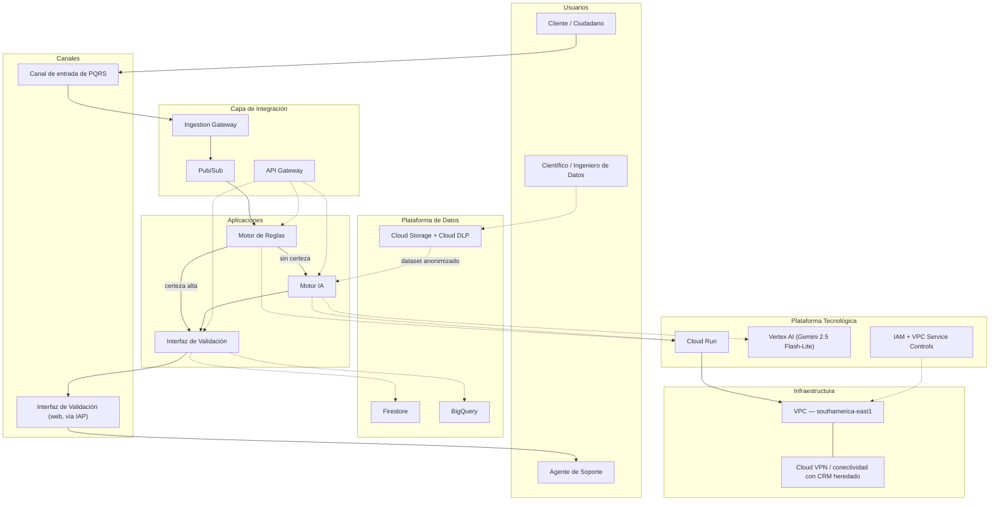

### 8.2 Vista lógica

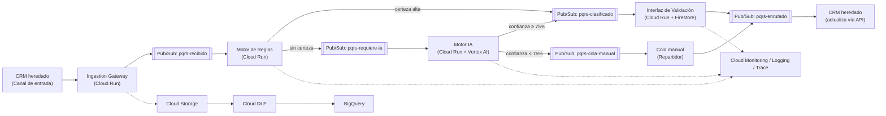

### 8.3 Vista física

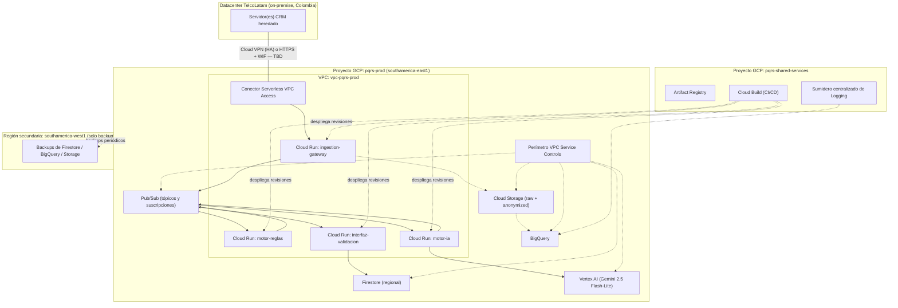

### 8.4 Vista de despliegue

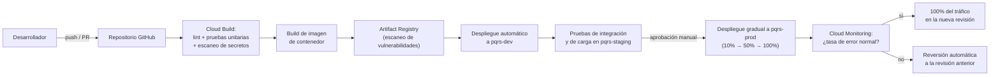

### 8.5 Vista de integración

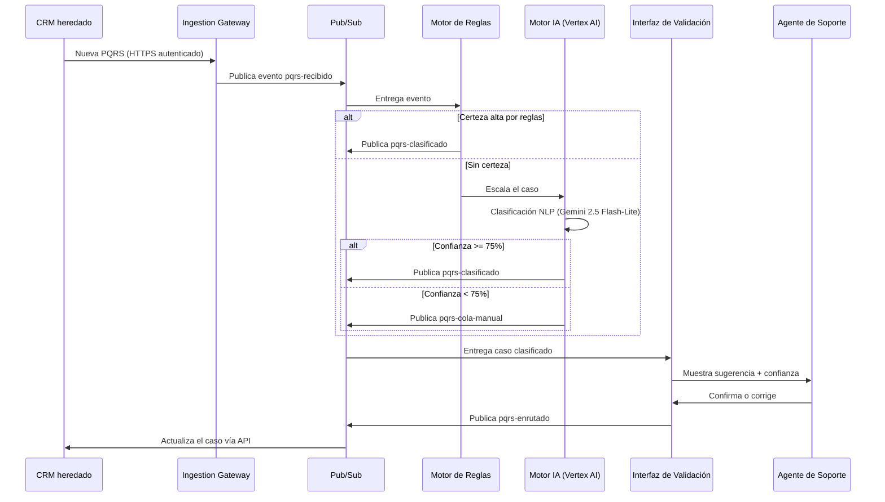

### 8.6 Vista de seguridad

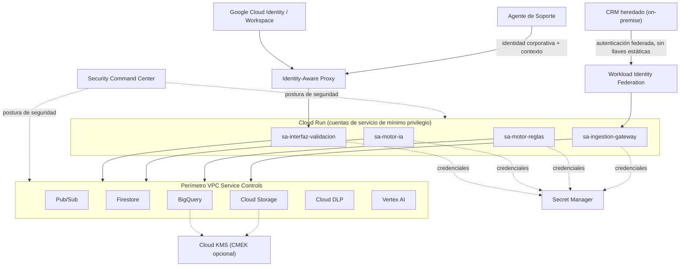

## 9. Catálogo de componentes tecnológicos

| ID | Componente | Categoría | Baseline | Target | Propósito | Dependencias |
|---|---|---|---|---|---|---|
| COMP-01 | CRM heredado | Aplicación / plataforma | Sí (sin cambios funcionales) | Sí (extendido con conectividad) | Registro y distribución del caso | COMP-16 o COMP-24 |
| COMP-02 | Ingestion Gateway | Cómputo (Cloud Run) | No | Sí | Traduce la llamada del CRM a un evento Pub/Sub autenticado | COMP-03, COMP-16/24 |
| COMP-03 | Pub/Sub | Integración / mensajería | No | Sí | Desacopla el CRM de los servicios de clasificación, con reintentos | COMP-02, COMP-04, COMP-05, COMP-06 |
| COMP-04 | Motor de Reglas | Cómputo (Cloud Run) | No | Sí | Clasificación determinística de primer nivel | COMP-03 |
| COMP-05 | Motor IA | Cómputo (Cloud Run) + IA | No | Sí | Clasificación NLP de segundo nivel | COMP-03, COMP-06 |
| COMP-06 | Vertex AI (Gemini 2.5 Flash-Lite) | Plataforma de IA | No | Sí | Modelo de lenguaje para clasificación | COMP-05 |
| COMP-07 | Interfaz de Validación | Cómputo (Cloud Run) | No | Sí | Confirmación/corrección humana de la sugerencia | COMP-03, COMP-08, COMP-19 |
| COMP-08 | Firestore | Almacenamiento (datos operacionales) | No | Sí | Estado de los casos en validación | COMP-07 |
| COMP-09 | Cloud Storage | Almacenamiento (objetos) | No | Sí | Archivo del texto crudo y del dataset anonimizado | COMP-10 |
| COMP-10 | Cloud DLP | Datos / cumplimiento | No | Sí | Anonimización antes de reentrenar el modelo | COMP-09 |
| COMP-11 | BigQuery | Almacenamiento analítico | No | Sí | KPI, analítica y auditoría | COMP-09 |
| COMP-12 | Cloud Monitoring / Logging / Trace | Observabilidad | No | Sí | Métricas, logs y trazas de toda la ruta | Todos los COMP-0x de cómputo |
| COMP-13 | IAM | Seguridad / identidad | No | Sí | Cuentas de servicio de mínimo privilegio | Todos |
| COMP-14 | VPC Service Controls | Seguridad / perímetro | No | Sí | Evita exfiltración de datos de PQRS | COMP-03, 06, 08, 09, 10, 11 |
| COMP-15 | Secret Manager | Seguridad / secretos | No | Sí | Gestión y rotación de credenciales | Todos los COMP-0x de cómputo |
| COMP-16 | Cloud VPN (HA VPN) | Red | No | Condicional (ADR-02) | Conectividad privada con el CRM heredado | COMP-01, COMP-02 |
| COMP-17 | Serverless VPC Access | Red | No | Sí | Permite a Cloud Run alcanzar recursos privados | COMP-16 |
| COMP-18 | API Gateway | Integración / API management | No | Sí | Punto único de gestión de las APIs REST | COMP-02, 04, 05, 07 |
| COMP-19 | Identity-Aware Proxy (IAP) | Seguridad / Zero Trust | No | Sí | Acceso de agentes por identidad, no por red | COMP-07, COMP-23 |
| COMP-20 | Artifact Registry | CI/CD | No | Sí | Almacena y escanea imágenes de contenedor | COMP-21 |
| COMP-21 | Cloud Build | CI/CD | No | Sí | Integración y despliegue continuo | COMP-20 |
| COMP-22 | Terraform (IaC) | Gestión de configuración | No | Sí | Despliegue reproducible de toda la infraestructura | — |
| COMP-23 | Google Cloud Identity / Workspace | Identidad | No | Sí (supuesto, sección 4.6) | Directorio corporativo para IAP | COMP-19 |
| COMP-24 | Workload Identity Federation | Seguridad / identidad | No | Condicional (ADR-02) | Autenticación del CRM sin llaves estáticas | COMP-02 |
| COMP-25 | Cloud KMS | Seguridad / cifrado | No | Opcional (ADR-09) | CMEK para datos anonimizados | COMP-09, COMP-11 |
| COMP-26 | Security Command Center | Seguridad / postura | No | Sí (nivel estándar) | Gestión continua de vulnerabilidades y postura | COMP-14 |
| COMP-27 | Cloud Billing Budgets & Alerts | Gobernanza / FinOps | No | Sí | Alertas de consumo frente al presupuesto aprobado | — |

## 10. Estándares tecnológicos

| ID | Dominio | Estándar | Justificación | Obligatorio |
|---|---|---|---|---|
| TE-01 | APIs | REST + JSON, documentado con OpenAPI 3.0 | Interoperabilidad (RT-18) y consistencia con RS-02 | Sí |
| TE-02 | Autenticación de servicios | OAuth 2.0 / OIDC vía cuentas de servicio de GCP; Workload Identity Federation donde sea posible | Evita llaves estáticas (RT-15) | Sí |
| TE-03 | Cifrado en tránsito | TLS 1.2 o superior en todas las comunicaciones | RT-04 | Sí |
| TE-04 | Infraestructura como Código | Terraform (HCL) | RT-05, reproducibilidad y auditabilidad | Sí |
| TE-05 | Control de versiones y commits | Git con *Conventional Commits*, ramas protegidas en `main` | Trazabilidad de cambios en producción | Sí |
| TE-06 | Logging estructurado | JSON, con campo de identificador de caso (*trace ID*) obligatorio | RT-20 | Sí |
| TE-07 | Contenedores | Imágenes base mínimas (*distroless* o equivalente) | Reduce superficie de ataque (gestión de vulnerabilidades) | Recomendado |
| TE-08 | Cumplimiento normativo | Ley 1581 de 2012, Decreto 1377 de 2013, Resolución CRC 5050 de 2016 | Marco legal aplicable (Fase A/C) | Sí |
| TE-09 | Marco de arquitectura cloud | Google Cloud Architecture Framework (pilares de seguridad, confiabilidad, costo, rendimiento) | Alineación con las buenas prácticas del proveedor ya seleccionado | Recomendado |
| TE-10 | Versionado de APIs | Semántico, con prefijo de versión en la ruta (`/v1/...`) | RT-19, independencia tecnológica | Sí |

## 11. Principios tecnológicos

| ID | Principio | Descripción | Justificación | Implicaciones |
|---|---|---|---|---|
| PT-01 | Serverless-first | Preferir servicios completamente administrados (Cloud Run, Pub/Sub, Firestore, Vertex AI) sobre infraestructura auto-gestionada (VMs, Kubernetes) | Menor costo operativo y de mantenimiento, alineado al presupuesto y al principio *cloud-first* de la Fase A | No se despliega GKE ni VMs para los componentes de esta arquitectura (sección 7.4) |
| PT-02 | Zero Trust para acceso humano | El acceso de personas se controla por identidad y contexto, no por pertenecer a una red específica | Reduce el riesgo de accesos indebidos y elimina la dependencia de VPN para los agentes | La Interfaz de Validación se expone vía IAP, no vía IP interna abierta (sección 7.7) |
| PT-03 | Privacidad desde el diseño | Heredado de la Fase A: anonimización antes de cualquier uso secundario del dato | Cumplimiento de la Ley 1581 de 2012 | Cloud DLP es un paso obligatorio antes de que cualquier dato llegue al bucket de entrenamiento |
| PT-04 | Infraestructura reproducible (IaC) | Toda la infraestructura se declara en Terraform; no hay cambios manuales en producción | Auditabilidad, consistencia entre entornos, recuperación más rápida ante desastres | Cualquier cambio de infraestructura pasa por el pipeline de CI/CD (sección 7.12) |
| PT-05 | Observabilidad por defecto | Todo componente nuevo debe nacer con métricas, logs y trazas, no añadirse después | Detección temprana de degradación (p. ej. aumento de escalamiento a IA) | Se exige instrumentación de Cloud Trace desde el primer despliegue (RT-20) |
| PT-06 | Gestión centralizada de secretos | Ninguna credencial se almacena en código fuente o variables de entorno sin cifrar | Reduce superficie de fuga de credenciales | Secret Manager es la única fuente de credenciales en tiempo de ejecución |
| PT-07 | Independencia tecnológica del modelo de IA | El Motor IA debe poder cambiar de proveedor de modelo sin rediseñar el resto del sistema | Heredado de la Fase A; evita bloqueo (*vendor lock-in*) en el componente más propenso a cambiar de precio/rendimiento | La interfaz entre Motor de Reglas/Motor IA e Interfaz de Validación se mantiene estable aunque cambie el modelo subyacente |
| PT-08 | Degradación segura ante fallas | Ante cualquier falla del sistema automatizado, el proceso cae de vuelta al flujo manual ya existente, nunca se detiene la atención al cliente | Continuidad de negocio de bajo costo, aprovechando que el proceso manual ya es la línea base | Fundamenta la estrategia de DR de la sección 7.14 (ADR-06) |

## 12. Gap Analysis

| ID | Situación Baseline | Situación Target | Gap | Impacto | Prioridad | Acción |
|---|---|---|---|---|---|---|
| GAP-01 | Sin infraestructura como código; cambios manuales (si los hubiera) | Terraform gestiona toda la infraestructura | Ausencia total de IaC | Alto — riesgo de configuración inconsistente entre entornos | Alta | Construir los módulos Terraform desde la Fase 1 de la hoja de ruta (sección 18) |
| GAP-02 | Sin integración automatizada entre sistemas | Pub/Sub + Ingestion Gateway + API Gateway | Falta de capa de integración | Alto — es la base de todo el proyecto | Alta | Ya cubierto por el diseño de esta fase; ejecutar en el Mes 1-2 |
| GAP-03 | Sin observabilidad de sistema | Cloud Monitoring/Logging/Trace + alertas | Ausencia de visibilidad operativa | Alto — sin esto no se puede detectar degradación del modelo ni fallas | Alta | Instrumentar cada servicio desde su primer despliegue (PT-05) |
| GAP-04 | Sin gestión de secretos formal | Secret Manager + Workload Identity Federation | Riesgo de credenciales expuestas | Alto | Alta | Definir la política de secretos antes de escribir el primer servicio |
| GAP-05 | Sin perímetro de seguridad definido | VPC Service Controls | Datos de PQRS sin contención formal | Alto — riesgo de incumplimiento de la Ley 1581 | Alta | Definir el perímetro antes de mover cualquier dato real (Mes 1) |
| GAP-06 | Conectividad CRM–nube no diseñada | Cloud VPN o WIF (condicional, ADR-02) | Postura de red del CRM no confirmada | Medio — bloquea el diseño final de red | Alta | Confirmar con el Gerente de TI antes de finalizar el Mes 1 |
| GAP-07 | Sin estrategia de backup/DR | RPO ≤ 24h / RTO ≤ 4h + degradación segura a manual | Falta de objetivos de recuperación formales | Medio — mitigado por el propio diseño de degradación segura (PT-08) | Media | Configurar exportaciones automáticas desde el primer entorno productivo |
| GAP-08 | Sin gestión de vulnerabilidades | Artifact Registry (escaneo) + Security Command Center | Superficie de ataque no monitoreada | Medio | Media | Habilitar el escaneo antes del primer despliegue a `pqrs-prod` |
| GAP-09 | Sin catálogo de APIs ni gestión de cuotas | API Gateway | Falta de control de consumo y versión | Bajo-Medio | Media | Configurar junto con el despliegue del Ingestion Gateway |
| GAP-10 | Disponibilidad regional de Vertex AI (Gemini) no confirmada en `southamerica-east1` | Requiere validación técnica temprana | Riesgo de latencia cross-region no presupuestada | Medio | Alta | Validar en un *spike* técnico durante la primera semana del Mes 1 (sección 21) |

## 13. Dependencias arquitectónicas

* La arquitectura tecnológica depende de que la Fase C (aplicaciones y datos) no cambie sustancialmente el diseño de tres niveles (reglas → IA → manual); cualquier cambio ahí obliga a revisar el dimensionamiento de Cloud Run y Vertex AI de esta fase.
* Depende de la confirmación del Gerente de TI sobre la postura de red del CRM heredado (GAP-06) para cerrar el diseño final de conectividad (ADR-02).
* Depende de la constitución del comité de gobierno de datos/IA (ya señalada como pendiente en la Fase A, sección 5, y reiterada en la Fase C, sección 4.3) para aprobar formalmente el pipeline de anonimización antes de cualquier entrenamiento real.
* Depende de la disponibilidad confirmada de modelos Vertex AI en la región elegida (GAP-10); de no estar disponibles, esta fase debería revisarse para adoptar `us-central1` como región del componente de IA (con el resto de la plataforma permaneciendo en `southamerica-east1`), lo que introduciría latencia adicional a evaluar contra RT-09.
* Depende de que TelcoLatam mantenga (o adquiera) una suscripción a Google Workspace/Cloud Identity para habilitar IAP (sección 4.6); si no la tiene, el mecanismo de Zero Trust deberá sustituirse por una alternativa (p. ej., Cloud Identity Free tier o federación con un IdP externo vía SAML).

## 14. Matriz de trazabilidad

| Requisito | Capacidad | Componente tecnológico | Decisión arquitectónica | Evidencia |
|---|---|---|---|---|
| RN-01 / RS-01 | Clasificación automática ≥ 85% sin intervención humana | Motor de Reglas + Motor IA (Vertex AI) | ADR-03, ADR-09 | Sección 7.4, 5.4 |
| RN-02 / RS-02 | Integración por microservicios y APIs REST | Cloud Run + API Gateway + Pub/Sub | ADR-04, ADR-08 | Sección 7.4, 7.6 |
| RN-03 / RS-03 | Interfaz de validación con corrección manual | Interfaz de Validación (Cloud Run + Firestore) + IAP | ADR-03 | Sección 7.5, 7.7 |
| RN-04 / RS-04 | Enrutamiento a cola manual bajo el umbral de confianza | Pub/Sub (`pqrs-cola-manual`) | PT-08, ADR-06 | Sección 8.2, 8.5 |
| RN-05 / RS-05 | Cumplimiento de la Ley 1581 de 2012 | Cloud DLP + VPC Service Controls | ADR-09 (CMEK opcional) | Sección 7.7, 7.5 |
| RN-06 / RS-06 | Auditoría y balanceo del dataset | BigQuery (`pqrs_audit`) + Cloud Monitoring | — | Sección 7.5, 7.11 |
| RN-07 / RS-07 | Plantilla oficial y lineamientos sin cambios | CRM heredado + suite ofimática (sin cambios) | — | Sección 6, 4.1 |
| RN-08 / RS-08 | Presupuesto y plazo del MVP | Serverless-first (PT-01), niveles gratuitos de GCP | ADR-01, ADR-04, ADR-08 | Sección 7.4, Fase A §12.3 |
| RS-09 | El Motor de Reglas resuelve sin invocar IA cuando hay certeza | Motor de Reglas (Cloud Run) | — | Sección 7.4, 8.2 |
| RS-10 / Riesgo 3 (Fase A) | Reintentos y cola de contingencia ante indisponibilidad del CRM | Pub/Sub + Ingestion Gateway | ADR-02, ADR-06 | Sección 7.6, 7.14 |

## 15. Decisiones arquitectónicas

**ADR-01 — Selección de región GCP primaria**
- **Contexto:** GCP no tiene una región dentro de Colombia; hay dos regiones sudamericanas disponibles: `southamerica-east1` (São Paulo) y `southamerica-west1` (Santiago).
- **Alternativas consideradas:** (a) `southamerica-east1`, (b) `southamerica-west1`, (c) una región de Norteamérica (`us-central1`) con mayor disponibilidad de servicios pero mayor latencia y posible fricción regulatoria.
- **Decisión adoptada:** `southamerica-east1` como región primaria; `southamerica-west1` como destino de backups.
- **Justificación:** es la región sudamericana con el catálogo de servicios GCP históricamente más completo y madura en soporte, minimizando el riesgo de encontrar servicios no disponibles (aunque persiste el riesgo puntual de Vertex AI, ver GAP-10).
- **Consecuencias:** latencia moderada desde Colombia (a validar); mantiene el dato dentro de Sudamérica.
- **Riesgos:** disponibilidad de Vertex AI (Gemini) no confirmada en esta región (ver ADR-09 y sección 21).

**ADR-02 — Conectividad entre el CRM heredado y GCP**
- **Contexto:** no se sabe si el CRM on-premise tiene salida a internet o si la política de seguridad de TelcoLatam exige conectividad privada.
- **Alternativas consideradas:** (a) Cloud VPN (HA VPN) — privada, mayor costo y complejidad de configuración; (b) llamada HTTPS saliente con Workload Identity Federation — simple y económica, requiere que el CRM tenga egress a internet.
- **Decisión adoptada:** condicional — se recomienda (b) por simplicidad y costo si el CRM tiene egress a internet; de lo contrario, (a).
- **Justificación:** (b) es más económica y rápida de implementar dentro del plazo de 3 meses; (a) es más segura si la política de red de TelcoLatam lo exige.
- **Consecuencias:** el diseño final de red no puede cerrarse hasta confirmar con el Gerente de TI (GAP-06).
- **Riesgos:** un cambio de (b) a (a) durante la implementación añadiría tiempo y costo no presupuestado.

**ADR-03 — Acceso de agentes a la Interfaz de Validación mediante IAP (Zero Trust)**
- **Contexto:** los Agentes de Soporte necesitan acceder a la Interfaz de Validación de forma segura, potencialmente desde distintas ubicaciones.
- **Alternativas consideradas:** (a) acceso solo desde la red corporativa/VPN; (b) Identity-Aware Proxy (IAP) con identidad corporativa.
- **Decisión adoptada:** (b) IAP.
- **Justificación:** evita depender de la topología de red (más flexible para trabajo remoto) y es coherente con el principio Zero Trust (PT-02).
- **Consecuencias:** requiere que TelcoLatam tenga o adquiera Google Workspace/Cloud Identity (sección 4.6).
- **Riesgos:** si TelcoLatam no puede adoptar Cloud Identity a tiempo, se debe caer a la alternativa (a) como plan de contingencia.

**ADR-04 — Cloud Run en lugar de Kubernetes (GKE) para los servicios de clasificación**
- **Contexto:** se necesita una plataforma de cómputo para el Motor de Reglas, el Motor IA y la Interfaz de Validación.
- **Alternativas consideradas:** (a) Google Kubernetes Engine (GKE); (b) Cloud Run (serverless).
- **Decisión adoptada:** (b) Cloud Run.
- **Justificación:** el volumen (>10.000 PQRS/día, tráfico moderado) no justifica la complejidad operativa ni el costo base de un clúster GKE; Cloud Run escala a cero y cubre RT-11/RT-12 con menor esfuerzo.
- **Consecuencias:** menor control de bajo nivel sobre el entorno de ejecución, aceptable dado el perfil de carga.
- **Riesgos:** si el volumen creciera órdenes de magnitud por encima de lo proyectado, podría requerirse revisar esta decisión.

**ADR-05 — Terraform como herramienta de Infraestructura como Código**
- **Contexto:** se requiere una forma reproducible y auditable de desplegar la infraestructura GCP.
- **Alternativas consideradas:** (a) Terraform; (b) Google Cloud Deployment Manager (nativo, pero en desuso); (c) Pulumi.
- **Decisión adoptada:** (a) Terraform.
- **Justificación:** es el estándar de facto para IaC multi-nube, con amplio soporte de la comunidad y del propio proveedor GCP, y facilita una eventual migración parcial si se revisara el principio de independencia tecnológica.
- **Consecuencias:** requiere que el equipo (Arquitecto de TI / Ingeniero Cloud, ya presupuestado en la Fase A) tenga o adquiera competencia en Terraform.
- **Riesgos:** ninguno significativo dado el tamaño del proyecto.

**ADR-06 — Estrategia de continuidad basada en degradación segura hacia el proceso manual**
- **Contexto:** se necesita una estrategia de continuidad de negocio y recuperación ante desastres proporcional al presupuesto del proyecto.
- **Alternativas consideradas:** (a) arquitectura multi-región activa-activa de alto costo; (b) degradación segura hacia el proceso manual ya existente, con backups de datos y recuperación en una sola región.
- **Decisión adoptada:** (b).
- **Justificación:** el proceso manual (línea base) sigue siendo un canal de contingencia válido y ya operativo; invertir en una arquitectura multi-región activa-activa no es proporcional al riesgo ni al presupuesto (~USD 11.270 de inversión incremental).
- **Consecuencias:** RTO/RPO más laxos (sección 7.14) que en un diseño de alta disponibilidad multi-región, pero con cero riesgo de interrupción del servicio al cliente.
- **Riesgos:** si el volumen de PQRS creciera tanto que el proceso manual ya no pudiera absorber una caída prolongada del sistema automatizado, esta decisión debería revisarse.

**ADR-07 — Workload Identity Federation y Secret Manager para gestión de credenciales**
- **Contexto:** se requiere autenticar al CRM heredado y a los servicios internos sin exponer credenciales estáticas.
- **Alternativas consideradas:** (a) llaves de cuenta de servicio JSON estáticas; (b) Workload Identity Federation (sin llaves) + Secret Manager para lo que no pueda federarse.
- **Decisión adoptada:** (b), con (a) como respaldo solo si el CRM no soporta federación.
- **Justificación:** reduce drásticamente el riesgo de fuga de credenciales de larga duración (RT-15).
- **Consecuencias:** mayor complejidad de configuración inicial.
- **Riesgos:** si el CRM heredado no soporta ningún mecanismo de federación moderno, se debe usar (a) con rotación estricta vía Secret Manager.

**ADR-08 — API Gateway en lugar de Apigee para gestión de APIs**
- **Contexto:** se necesita un punto único de gestión de las APIs REST internas (cuotas, autenticación, versión).
- **Alternativas consideradas:** (a) Apigee (gestión de APIs de nivel empresarial); (b) API Gateway (GCP, más simple y económico).
- **Decisión adoptada:** (b).
- **Justificación:** el volumen y la complejidad del proyecto no justifican el costo ni las capacidades avanzadas de Apigee; API Gateway cubre TE-01 y RT-18 suficientemente.
- **Consecuencias:** menos funcionalidades de monetización/analítica de API avanzada, irrelevantes para este proyecto.
- **Riesgos:** ninguno significativo.

**ADR-09 — Ajuste de la expectativa de latencia del Motor IA y evaluación de CMEK**
- **Contexto:** RS-01 (Fase C) describe una respuesta "en el orden de milisegundos", una expectativa realista para el Motor de Reglas pero no necesariamente para una llamada a un modelo de lenguaje.
- **Alternativas consideradas:** (a) mantener la expectativa literal de milisegundos para todo el pipeline; (b) diferenciar la expectativa por componente (reglas vs. IA) con métricas realistas.
- **Decisión adoptada:** (b), formalizada en RT-08/RT-09/RT-10.
- **Justificación:** evita comprometer un SLA técnicamente inalcanzable para la llamada a Vertex AI, sin renunciar al objetivo de negocio de reducir el tiempo de triage en 90% (que se mide contra los 3-5 minutos de la línea base, no contra milisegundos absolutos).
- **Consecuencias:** ninguna sobre el KPI de negocio, que sigue siendo alcanzable.
- **Riesgos:** ninguno; es una aclaración, no un incumplimiento.
- **Nota adicional:** esta misma decisión evalúa Cloud KMS (CMEK) como mejora de cifrado opcional para los buckets de datos anonimizados y BigQuery — no se incluye en el MVP por no ser exigido explícitamente por el marco legal identificado (Ley 1581 no exige CMEK), pero queda documentado como mejora disponible si el Oficial de Protección de Datos lo requiere.

## 16. Riesgos tecnológicos

| ID | Riesgo | Probabilidad | Impacto | Mitigación | Responsable |
|---|---|---|---|---|---|
| TR-01 | El CRM heredado no permite ninguna de las dos opciones de conectividad diseñadas (ni egress a internet ni VPN) | Baja | Alto | Escalar a un adaptador intermedio (agente local que sí pueda alcanzar GCP) como plan C; validar con el Gerente de TI antes del Mes 1 | Gerente de TI / Arquitecto de TI |
| TR-02 | Vertex AI (Gemini 2.5 Flash-Lite) no está disponible en `southamerica-east1` | Media | Medio | Usar el endpoint global/`us-central1` para el Motor IA únicamente, aceptando latencia adicional (ver RT-09) | Arquitecto de TI |
| TR-03 | El diccionario de reglas se desactualiza y aumenta la carga (y el costo) sobre el Motor IA | Media | Bajo-Medio | Monitorear la tasa de escalamiento reglas→IA como señal de alerta (RT-21); revisión periódica del diccionario (heredado de la Fase C) | Científico de Datos |
| TR-04 | Configuración incorrecta de IAM o del perímetro VPC Service Controls expone datos de PQRS | Baja | Alto | Revisión de IAM en cada *pull request* de Terraform; Security Command Center activo | Arquitecto de TI |
| TR-05 | Escalamiento inesperado de costos de Vertex AI por un aumento no previsto en la tasa de casos ambiguos | Media | Medio | Alertas de presupuesto (Cloud Billing Budgets, RT-21); límites de cuota configurados en Vertex AI | Gerente de TI |
| TR-06 | Vulnerabilidades en imágenes de contenedor no detectadas antes de producción | Baja | Medio | Escaneo obligatorio en Artifact Registry como *quality gate* bloqueante | Ingeniero Cloud/Backend |
| TR-07 | Dependencia de un único proveedor cloud (vendor lock-in) | Media | Bajo | Uso de Terraform (portable) y de estándares abiertos (REST/OpenAPI) donde sea posible; el principio de independencia tecnológica (PT-07) ya limita el acoplamiento al modelo de IA específico | Arquitecto Empresarial |
| TR-08 | TelcoLatam no dispone de Google Workspace/Cloud Identity para habilitar IAP | Media | Bajo-Medio | Plan de contingencia: acceso vía VPN + red interna mientras se resuelve (ver ADR-03) | Gerente de TI |
| TR-09 | Retraso en la constitución del comité de gobierno de datos/IA (pendiente desde la Fase A) bloquea la validación del pipeline de anonimización | Media | Medio | Escalar la constitución del comité como hito explícito del Mes 1 de la hoja de ruta (sección 18) | Director de Servicio al Cliente |

## 17. Consideraciones de implementación

* **Orden de construcción recomendado:** (1) proyectos GCP y jerarquía de IAM base → (2) VPC, conectividad con el CRM (una vez resuelto GAP-06) y VPC Service Controls → (3) Pub/Sub y Ingestion Gateway → (4) Motor de Reglas → (5) pipeline de datos (Cloud Storage + Cloud DLP) y Motor IA → (6) Interfaz de Validación (Cloud Run + Firestore + IAP) → (7) observabilidad y alertas → (8) BigQuery y tableros de KPI.
* **Entornos:** `pqrs-dev` para desarrollo individual, `pqrs-staging` para pruebas de integración y de carga (incluida una prueba de carga que valide RT-11 antes del despliegue a producción), `pqrs-prod` para producción.
* **Pruebas de carga:** dado que no existe un perfil de tráfico horario real (sección 4.6), se recomienda instrumentar `pqrs-staging` con tráfico sintético antes del piloto, para validar RT-08/RT-09/RT-10 con datos reales de latencia de Vertex AI en la región elegida.
* **Bootstrap de secretos:** las primeras credenciales (p. ej., la clave inicial de Workload Identity Federation) deben crearse manualmente una sola vez por un administrador, y todo lo posterior debe fluir por el pipeline de CI/CD.
* **Capacitación:** el Ingeniero Cloud/Backend y el Científico de Datos ya presupuestados (Fase A, sección 12.3) deben adquirir o confirmar competencia en Terraform, Cloud Run y Vertex AI antes del inicio del Mes 2.

## 18. Impacto sobre la hoja de ruta

La hoja de ruta de 3 meses ya definida en la Fase B (sección 8) y detallada con componentes de aplicaciones/datos en la Fase C (sección 8) se mantiene sin cambios en su duración total; esta fase añade el detalle tecnológico por mes:

| Fase | Horizonte | Componentes tecnológicos añadidos por la Fase D |
|---|---|---|
| Fase 1 — Cimentación | Mes 1 | Confirmación de la postura de red del CRM (GAP-06); creación de proyectos GCP y jerarquía de IAM; diseño de la VPC y del perímetro VPC Service Controls; validación de disponibilidad regional de Vertex AI (GAP-10); constitución del comité de gobierno de datos/IA |
| Fase 2 — Construcción | Mes 2 | Módulos Terraform para Pub/Sub, Cloud Run e IAM; pipeline de CI/CD (Cloud Build + Artifact Registry); configuración de Secret Manager y Workload Identity Federation; instrumentación de observabilidad desde el primer despliegue |
| Fase 3 — Integración y despliegue | Mes 3 | Conectividad final CRM↔GCP (Cloud VPN o WIF); configuración de IAP para la Interfaz de Validación; pruebas de carga en `pqrs-staging`; despliegue gradual a `pqrs-prod`; alertas de presupuesto y de degradación activas antes del piloto |

## 19. Recomendaciones

1. Confirmar con el Gerente de TI, antes de iniciar la Fase 1, si el CRM heredado tiene salida a internet — esta única respuesta determina si se construye Cloud VPN o la ruta más simple de Workload Identity Federation (ADR-02, GAP-06).
2. Ejecutar un *spike* técnico de una semana para confirmar la disponibilidad de Vertex AI (Gemini 2.5 Flash-Lite) en `southamerica-east1` antes de comprometer el dimensionamiento final (GAP-10).
3. Adoptar Terraform desde el primer commit de infraestructura, no como una regularización posterior — evita deuda técnica de configuración manual.
4. Priorizar la constitución del comité de gobierno de datos/IA (pendiente desde la Fase A) en paralelo a la construcción técnica, no después de ella, para no bloquear el pipeline de anonimización en el Mes 2.
5. Tratar la estrategia de continuidad (degradación segura al proceso manual, ADR-06) como una ventaja competitiva a comunicar a los stakeholders, no como una limitación: reduce el costo de DR sin sacrificar la continuidad del servicio al cliente.

## 20. Conclusiones

Esta Fase D dimensiona técnicamente la arquitectura en GCP ya seleccionada en la Fase A y detallada como arquitectura de aplicaciones y datos en la Fase C: selecciona una región primaria sudamericana, diseña la conectividad con el CRM heredado bajo dos alternativas condicionadas a una confirmación pendiente, establece un perímetro de seguridad de mínimo privilegio con acceso Zero Trust para los agentes, define una estrategia de CI/CD e Infraestructura como Código, y adopta una estrategia de continuidad de bajo costo apoyada en el propio proceso manual existente como mecanismo de degradación segura. Con esta arquitectura tecnológica documentada, el proyecto "IA-PQRS Smart Routing" queda listo para avanzar hacia la Fase E (Oportunidades y Soluciones) y la Fase F (Planificación de la Migración), sujeto a resolver los puntos pendientes listados en la sección 21.

## 21. Información pendiente / TBD

| # | Punto pendiente | Por qué es necesario | Responsable sugerido |
|---|---|---|---|
| 1 | Postura de red del CRM heredado (¿tiene egress a internet? ¿su política de seguridad exige conectividad privada?) | Determina la decisión final del ADR-02 (Cloud VPN vs. Workload Identity Federation); tiene un impacto directo de ≈ US$80-105/mes sobre el presupuesto operativo (sección 7.15) | Gerente de TI |
| 2 | Disponibilidad de Vertex AI (Gemini 2.5 Flash-Lite) en `southamerica-east1` | Determina si el Motor IA opera en la misma región o requiere una llamada cross-region (impacta RT-09) | Arquitecto de TI |
| 3 | Especificaciones técnicas del hardware/infraestructura actual del CRM heredado | No documentadas en las Fases A-C; necesarias para completar la sección 6.2-6.6 con precisión | Gerente de TI |
| 4 | Disponibilidad de Google Workspace/Cloud Identity en TelcoLatam | Determina si IAP puede implementarse tal como se diseñó (ADR-03) o si se requiere una alternativa | Gerente de TI |
| 5 | Perfil real de tráfico horario de las PQRS (picos, estacionalidad) | Necesario para calibrar los límites de instancias de Cloud Run (sección 7.4) con precisión, más allá del supuesto de la sección 4.6 | Director de Servicio al Cliente |
| 6 | Requisitos de residencia de datos más allá de la Ley 1581 (p. ej., políticas internas de TelcoLatam) | Podría cambiar la decisión de región (ADR-01) o exigir CMEK (ADR-09) | Oficial de Protección de Datos |
| 7 | Fecha de constitución del comité de gobierno de datos/IA | Pendiente desde la Fase A (sección 5); bloquea la validación formal del pipeline de anonimización | Director de Servicio al Cliente |
| 8 | Tolerancia real de negocio a RTO/RPO (¿4 horas y 24 horas son aceptables para el Director de Servicio al Cliente?) | Los valores de la sección 5.7 son una propuesta técnica razonable, no una cifra confirmada por el negocio | Director de Servicio al Cliente |

# Fase E — Oportunidades y Soluciones

## 1. Información del documento

| Campo | Valor |
|---|---|
| Proyecto | IA-PQRS Smart Routing |
| Empresa de referencia | TelcoLatam |
| Fase ADM | Fase E — Oportunidades y Soluciones (*Opportunities & Solutions*) |
| Fases de entrada | Fase A (Visión de la Arquitectura), Fase B (Arquitectura de Negocio), Fase C (Arquitectura de Sistemas de Información), Fase D (Arquitectura Tecnológica) |
| Fase siguiente | Fase F — Planificación de la Migración |
| Proveedor cloud | Google Cloud Platform (GCP) — decisión ya tomada en la Fase A, sección 12; esta fase no la modifica |
| Estado | Borrador para revisión del Director de Servicio al Cliente y el Gerente de TI |
| Fecha | 2026-10-13 |
| Autor | Arquitectura Empresarial — continuación documental de las Fases A, B, C y D |

> **Convenciones de este documento.** Para separar lo que ya está establecido de lo que se propone aquí, se usan cuatro categorías: (1) **hallazgo documentado**, siempre con la referencia a la fase y sección de origen; (2) **propuesta de esta fase**, elaborada en este documento y pendiente de aprobación por los patrocinadores; (3) **Pendiente de definición / Requiere validación / No especificado en la documentación disponible**, cuando el dato no existe en las Fases A-D; y (4) **concepto metodológico de TOGAF**, cuando se describe el método y no un dato del proyecto. Los valores marcados como **(supuesto)** conservan ese carácter desde su fase de origen. Los identificadores existentes (RN, RS, RT, PT, TE, GAP, ADR, TR, COMP) se reutilizan sin cambios. Esta fase solo introduce los prefijos GC (brecha consolidada), OP (oportunidad), CI (incremento de capacidad), SBB (bloque de construcción de solución), WP (paquete de trabajo), AD (alternativa pendiente de decisión), TA (arquitectura de transición), F (factor de implementación) e I (inconsistencia documental).

## 2. Objetivo

TOGAF establece tres objetivos para la Fase E (The Open Group, 2018a):

1. Generar la versión inicial completa de la Hoja de Ruta de Arquitectura, a partir del análisis de brechas y de los componentes candidatos de hoja de ruta de las Fases B, C y D.
2. Determinar si se requiere un enfoque incremental y, si es así, identificar las Arquitecturas de Transición que entreguen valor de negocio de forma continua.
3. Definir los bloques de construcción de solución (SBB) que completan la Arquitectura Objetivo, a partir de los bloques de construcción de arquitectura (ABB).

La Fase E se concentra en *cómo* entregar la arquitectura. Agrupa lógicamente en paquetes de trabajo el conjunto completo de brechas entre la línea base y el objetivo en todos los dominios, con el foco en el objetivo final y entregando valor incremental. Es además el paso inicial del Plan de Implementación y Migración, que se completa en la Fase F (The Open Group, 2018a).

Aplicado a este proyecto, esta Fase E convierte la arquitectura objetivo ya documentada —clasificación de PQRS en 3 niveles (reglas → IA → manual) sobre servicios administrados de GCP— en los cuatro conceptos que TOGAF considera clave para pasar del desarrollo a la entrega:

* **Paquetes de trabajo** (sección 10): grupos lógicos de cambios necesarios para alcanzar el objetivo.
* **Arquitecturas de Transición** candidatas (sección 12).
* **Hoja de Ruta de Arquitectura, versión 0.1** (sección 13): los paquetes de trabajo ubicados en el tiempo.
* **Plan de Implementación y Migración, versión 0.1** (sección 14).

Todo ello queda trazado a las brechas, requisitos y decisiones de las fases anteriores. Esta fase no redefine la arquitectura objetivo: la completa con los SBB, la agrupa y la secuencia, y hace explícito lo que aún no está decidido.

## 3. Alcance

**Dentro del alcance de esta fase:**
* Atributos de cambio, restricciones, evaluación de capacidades y preparación para la transformación.
* Consolidación de los resultados del análisis de brechas de las Fases B (sección 6), C (sección 6) y D (sección 12) en la Matriz Consolidada de Brechas, Soluciones y Dependencias, incluidos los riesgos.
* Consolidación de los requisitos por función de negocio, y de los requisitos, tipos, grados y conflictos de interoperabilidad.
* Oportunidades, estrategia de implementación y migración, SBB, clasificación de los sistemas actuales y oportunidades de reutilización.
* Paquetes de trabajo, agrupación en proyectos, dependencias y Arquitecturas de Transición candidatas.
* Hoja de Ruta de Arquitectura, versión 0.1, y Plan de Implementación y Migración, versión 0.1.
* Evaluación de impactos, relación con los objetivos empresariales y registro de las inconsistencias encontradas entre las Fases A-D.

**Fuera del alcance de esta fase:**
* Versión definitiva del Plan de Implementación y Migración: priorización por valor de negocio, análisis costo-beneficio, cronograma detallado y asignación de costos por paquete (Fase F).
* Gobierno de la implementación y contratos de arquitectura (Fase G).
* Modificación retrospectiva de las Fases A, B, C y D. TOGAF indica actualizar la Visión, el Documento de Definición de Arquitectura y la Especificación de Requisitos con los resultados de esta fase (The Open Group, 2018a), pero en este proyecto esas actualizaciones se registran como solicitudes de cambio (sección 18) y no se aplican sobre los documentos de origen.
* Selección de las alternativas pendientes de decisión (sección 9.5), que corresponde a los patrocinadores o a los responsables indicados.

## 4. Contexto y entradas

### 4.1 Problema empresarial (síntesis)

La gestión de PQRS en TelcoLatam es 100% manual: un agente lee cada ticket y lo asigna en el CRM heredado, con un promedio de 3 a 5 minutos por caso y una cola de hasta 24 horas cuando la capacidad de triage no absorbe el volumen de más de 10.000 PQRS/día (Fase A, secciones 3.1 y 4; Fase B, sección 2). La Resolución CRC 5050 de 2016 (art. 2.1.24.3) exige responder cada PQR en 15 días hábiles, bajo pena de Silencio Administrativo Positivo (Fase A, sección 3). El objetivo de negocio es reducir en 40% el tiempo promedio de primera respuesta durante el primer trimestre de implementación, con un MVP en 3 meses, un presupuesto de USD 50.000 y cumplimiento de la Ley 1581 de 2012 y el Decreto 1377 de 2013 (Fase A, sección 3).

### 4.2 Entradas de la Fase E según TOGAF y su disponibilidad en el proyecto

TOGAF agrupa las entradas de la Fase E en tres categorías: materiales de referencia externos a la empresa, entradas no arquitectónicas y entradas arquitectónicas (The Open Group, 2018a). La tabla indica qué equivalente existe en la documentación del proyecto:

| Entrada (TOGAF) | Equivalente en el proyecto | Estado |
|---|---|---|
| Materiales de referencia de arquitectura | Google Cloud Architecture Framework (TE-09) | Disponible como referencia |
| Información de producto | Páginas oficiales de precios de Google Cloud consultadas en la Fase D (sección 7.15) | Disponible (debe reverificarse antes de la aprobación final, según la propia Fase D) |
| Solicitud de Trabajo de Arquitectura | — | **No especificado en la documentación disponible** |
| Evaluación de capacidades | Capacidad base, objetivo y brechas (Fase A, sección 4) | Disponible; actualizada en la sección 5.3 |
| Plan de Comunicaciones | Su desarrollo se menciona en la Fase A, sección 11 | El plan, como documento, **no está disponible** |
| Metodologías de planificación | La Fase A (sección 1) menciona el "marco de gestión de proyectos de TelcoLatam" | Su contenido **no está especificado** |
| Modelo Organizacional para la Arquitectura Empresarial | Roles (Fase A, sección 11; Fase C, sección 9.1), restricciones y presupuesto (Fase A, sección 3), patrocinio (Fase A, sección 1) | Parcial; no hay evaluación de madurez de arquitectura empresarial |
| Modelos y marcos de gobierno | Aprobación por los patrocinadores en cada fase; comité de gobierno de datos/IA pendiente (Fase A, sección 5) | Parcial; no se documentan los marcos de portafolio, proyectos, desarrollo ni operación |
| Marco de Arquitectura Adaptado | ADM de TOGAF con las convenciones documentales de las fases | No documentado formalmente; las herramientas no están especificadas |
| Declaración de Trabajo de Arquitectura | Descrita en la Fase A, sección 11 | El documento formal **no está disponible** |
| Visión de la Arquitectura | Fase A completa | Disponible |
| Repositorio de Arquitectura | Mencionado en la Fase A (sección 8); en la práctica, la carpeta documental del proyecto | Parcial; los bloques reutilizables se identifican en la sección 9.4 |
| Borrador del Documento de Definición de Arquitectura (líneas base y objetivo por dominio) | Negocio: Fase B, secciones 2 y 3. Datos: Fase C, sección 4 (objetivo), con la línea base solo descrita en la Fase C, sección 2.5, y la Fase D, sección 6.4. Aplicación: Fase C, secciones 2 y 3. Tecnología: Fase D, secciones 6 y 7 | Disponible; la línea base tecnológica tiene vacíos declarados (Fase D, sección 21) |
| Borrador de la Especificación de Requisitos de Arquitectura | RN-01 a RN-08 (Fase B, sección 7), RS-01 a RS-10 (Fase C, sección 7), RT-01 a RT-21 (Fase D, sección 5); brechas (Fase B, sección 6; Fase C, sección 6; Fase D, sección 12) | Disponible |
| Requisitos de gestión de servicios de TI | Disponibilidad, continuidad, observabilidad y operación (Fase D, secciones 5.3, 5.7 y 5.9) | Parcial; no hay requisitos formales de gestión de servicios (p. ej., gestión de incidentes o mesa de ayuda) |
| Solicitudes de cambio a programas y proyectos existentes | — | **No especificado en la documentación disponible** |
| Componentes candidatos de la Hoja de Ruta de las Fases B, C y D | Fase B, sección 8; Fase C, sección 8; Fase D, sección 18 | Disponible |

### 4.3 Insumos por fase

| Fase | Secciones | Insumo | Uso en esta Fase E |
|---|---|---|---|
| Fase A | 2, 3, 3.1, 4, 5 | Partes interesadas, objetivos, impulsores, restricciones, capacidades y preparación | Sección 5 |
| Fase A | 6, 7, 9, 10 | Alcance, principios, KPI y Riesgos 1-5 | Secciones 8.1, 16 y 17 |
| Fase A | 12 | Concepto de solución en GCP; presupuesto del MVP (≈ USD 11.270) y de operación (≈ USD 550-570/mes) | Secciones 9.2 y 14.2; AD-05 |
| Fase B | 3, 4, 5, 6, 7, 8 | Arquitectura de negocio objetivo, matrices, brechas, RN-01 a RN-08, hoja de ruta | Secciones 6, 7 y 13 |
| Fase C | 3, 4, 5, 6, 7, 8, 9.3, Anexo A | Catálogos y matrices de aplicaciones y datos, estrategia comprar/desarrollar, brechas, RS-01 a RS-10, hoja de ruta, riesgos técnicos | Secciones 6, 7, 9 y 10 |
| Fase D | 5, 7, 9, 12-19, 21 | RT-01 a RT-21, COMP-01 a COMP-27, GAP-01 a GAP-10, ADR-01 a ADR-09, TR-01 a TR-09, orden de construcción, hoja de ruta tecnológica y puntos TBD | Secciones 9, 10, 11, 13, 14 y 24 |

### 4.4 Elementos que se conservan sin modificaciones

* La clasificación en 3 niveles: Motor de Reglas → Motor IA → cola manual del Repartidor (Fase A, sección 12.2; Fase B, sección 3.1; Fase C, sección 3.1).
* El umbral de confianza del 75% como punto de partida, ajustable durante el piloto (Fase A, sección 9).
* El catálogo de servicios GCP (Fase A, sección 12.2; Fase C, sección 3.4) y su dimensionamiento, incluida la región primaria `southamerica-east1` (Fase D, sección 7.3; ADR-01).
* El CRM heredado permanece on-premise y no se migra (Fase D, secciones 3 y 4.5).
* La proyección, revisión y firma de la respuesta permanecen sin cambios (RN-07, RS-07).
* Cada división responde de forma independiente cuando un caso involucra a varias divisiones (Fase A, secciones 6 y 8).
* El chatbot y la consolidación automática de respuestas entre divisiones están fuera del alcance (Fase A, sección 6).
* El presupuesto de USD 50.000 y el plazo de 3 meses del MVP (RN-08), con el desglose oficial de la Fase A, sección 12.3.
* El marco legal: Ley 1581 de 2012, Decreto 1377 de 2013 y Resolución CRC 5050 de 2016 (TE-08).
* Las decisiones arquitectónicas ADR-01 y ADR-03 a ADR-09 de la Fase D, y el carácter condicional de ADR-02.

### 4.5 Aplicación de los pasos de la Fase E de TOGAF

TOGAF permite adaptar el orden de los pasos a la situación y a la gobernanza de arquitectura establecida, siempre que todas las actividades iniciadas se cierren en el último paso (The Open Group, 2018a). En este documento, las dependencias (paso 6) se presentan después de los paquetes de trabajo (paso 9) porque se refinan sobre ellos:

| Paso de TOGAF (Fase E) | Sección de este documento |
|---|---|
| 12.3.1 Determinar/confirmar los atributos clave del cambio corporativo | 5.1, 5.3 y 5.5 |
| 12.3.2 Determinar las restricciones de negocio para la implementación | 5.2 |
| 12.3.3 Revisar y consolidar los resultados del análisis de brechas de las Fases B a D | 6 |
| 12.3.4 Revisar los requisitos consolidados entre funciones de negocio relacionadas | 7.1 |
| 12.3.5 Consolidar y conciliar los requisitos de interoperabilidad | 7.2 y 7.3 |
| 12.3.6 Refinar y validar las dependencias | 11 |
| 12.3.7 Confirmar la preparación y el riesgo para la transformación del negocio | 5.4, 6.2 (columna de riesgos) y 17 |
| 12.3.8 Formular la estrategia de implementación y migración | 9.1 |
| 12.3.9 Identificar y agrupar los principales paquetes de trabajo | 9.3 y 10 |
| 12.3.10 Identificar las Arquitecturas de Transición | 12 |
| 12.3.11 Crear la Hoja de Ruta de Arquitectura y el Plan de Implementación y Migración | 13 y 14 |

## 5. Atributos de cambio, restricciones, capacidades y preparación

### 5.1 Atributos clave del cambio corporativo y capacidades de transición

Este paso evalúa cómo puede implementarse la arquitectura aprovechando la cultura de la organización. Incluye las capacidades de transición de las unidades organizacionales involucradas (cultura y habilidades) y de la empresa en su conjunto (The Open Group, 2018a).

| Atributo | Ámbito | Situación documentada | Fuente |
|---|---|---|---|
| Patrocinio | Empresa | Formal, de dos directivos: Director de Servicio al Cliente (negocio) y Gerente de TI (tecnología) | Fase A, sección 1 |
| Cultura organizacional | Unidad: Atención al Cliente (Agentes de Soporte) | Preparación baja/media; resistencia al cambio y temor al reemplazo laboral | Fase A, sección 5; Riesgo 4 |
| Habilidades técnicas | Unidad: TI | Sin talento interno especializado en IA ni operación cloud nativa | Fase A, sección 4; Fase B, sección 6 |
| Gobierno de datos | Empresa | No existe; falta constituir el comité de gobierno de datos/IA | Fase A, sección 5; Fase C, sección 4.3 |
| Capacidad de las áreas receptoras | Unidades: Facturación, Soporte Técnico, Retención | Sin evaluar formalmente | Fase A, sección 5 |
| Preparación legal | Empresa | Media; no se ha evaluado si la política de tratamiento de datos vigente cubre el entrenamiento de modelos de IA | Fase A, sección 5 |
| Naturaleza del cambio | Proceso PQRSD | Se automatiza únicamente el paso de clasificación y enrutamiento; el resto del proceso permanece igual | Fase A, sección 6; Fase B, sección 3.1 |

Los factores derivados de estos atributos se documentan en la Matriz de Evaluación de Factores de Implementación y Deducciones (sección 5.5). Esa matriz es también el registro de las decisiones de implementación y migración que se tomen en adelante.

### 5.2 Restricciones de negocio para la implementación

TOGAF indica revisar los planes de negocio y estratégicos, tanto corporativos como de la línea de negocio, y la evaluación de madurez de la arquitectura empresarial (The Open Group, 2018a). **No especificado en la documentación disponible:** el proyecto no cuenta con un plan estratégico corporativo documentado (más allá de su alineación con el marco de gestión estratégica de Servicio al Cliente, Fase A, sección 1) ni con una evaluación de madurez de arquitectura empresarial. Las restricciones que sí condicionan la secuencia de implementación son:

* **Plazo:** MVP en 3 meses (Fase A, sección 3; RN-08).
* **Presupuesto:** techo de USD 50.000; inversión incremental estimada del MVP ≈ USD 11.270 y operación ≈ USD 550-570/mes (Fase A, sección 12.3). Toda partida nueva debe caber en ese marco o justificar una excepción (Fase D, sección 4.5).
* **Cumplimiento legal:** ningún dato histórico de PQRS puede usarse para entrenamiento sin anonimización y sin validación previa del Oficial de Protección de Datos (Fase A, sección 7; Fase C, sección 4.3). Esto obliga a que el gobierno de datos preceda al uso del histórico.
* **Continuidad del servicio:** la atención de PQRS no puede interrumpirse durante la implementación, porque el plazo regulatorio de 15 días hábiles sigue corriendo (Fase A, sección 3; PT-08).
* **Alcance:** no se alteran la plantilla oficial ni el ciclo de proyección, revisión y firma (RN-07), y no se incorporan chatbot ni consolidación entre divisiones (Fase A, sección 6).

### 5.3 Evaluación de capacidades de negocio y de TI

| Tipo | Capacidad | Línea base | Objetivo | Brecha consolidada | Fuente |
|---|---|---|---|---|---|
| Negocio | Clasificación y enrutamiento de PQRS | Manual, 3-5 min/ticket, cola de hasta 24 h | Clasificación en 3 niveles con umbral de confianza | GC-01 | Fase A, sección 4; Fase B, secciones 2 y 3 |
| Negocio | Validación de la clasificación | No existe | El agente confirma o corrige la sugerencia | GC-01, GC-08 | Fase B, sección 3.3 |
| Negocio | Atención por división responsable | Distribución secuencial tras la cola | Distribución simultánea a una o varias divisiones | Sin brecha formal (sección 6.3) | Fase A, sección 8; Fase B, sección 3.4 |
| Negocio | Gobierno y medición del proceso | Sin medición; métricas base ilustrativas | Tablero de KPI (cobertura, exactitud, tiempo de ciclo) | GC-06 | Fase A, secciones 4 y 9; Fase B, sección 5 |
| TI | Integración entre sistemas | Ninguna interfaz automatizada | Integración asíncrona desacoplada | GC-03 | Fase C, sección 2.3; Fase D, sección 6.9 |
| TI | Plataforma de cómputo y datos en la nube | Inexistente | Servicios administrados de GCP | GC-04 | Fase A, sección 4; Fase D, sección 7 |
| TI | Inteligencia artificial | Sin talento ni plataforma | Motor IA sobre Vertex AI | GC-01, GC-02, GC-09 | Fase A, sección 4; Fase C, sección 3 |
| TI | Gobierno y protección de datos | Histórico disperso, sin anonimizar | Dataset anonimizado y gobernado | GC-05 | Fase C, secciones 2.5 y 4.3 |
| TI | Seguridad, operación y continuidad | Sin perímetro, secretos, observabilidad, CI/CD ni DR | Perímetro, IaC, observabilidad y degradación segura | GC-04, GC-06, GC-07 | Fase D, sección 12 |

### 5.4 Preparación para la transformación y riesgo

La Fase A (sección 5) realizó una Evaluación de Preparación para la Transformación del Negocio, que no se ha actualizado con datos nuevos en las fases posteriores. Esta fase revisa su impacto sobre la Hoja de Ruta y la estrategia de implementación. Los riesgos asociados se clasifican y registran en la matriz consolidada (sección 6.2) y se detallan en la sección 17.

| Factor de preparación (Fase A, sección 5) | Nivel documentado | Impacto sobre la Hoja de Ruta y la estrategia |
|---|---|---|
| TI | Media | La integración con el CRM es el punto de mayor incertidumbre técnica (GAP-06, I-05) |
| Cultura organizacional | Baja/media | La gestión del cambio debe empezar antes del piloto, no al final (WP-08); limita la capacidad de absorber varios cambios seguidos (sección 12) |
| Gobernanza y patrocinio | Alta en patrocinio; comité de datos/IA sin constituir | El comité es una dependencia bloqueante del uso del histórico de PQRS (WP-04) |
| Capacidad de las áreas receptoras | Sin evaluar | Debe confirmarse antes del piloto (WP-08) |
| Preparación legal / cumplimiento | Media | Requiere validar la política de tratamiento de datos antes de usar el histórico (WP-04) |

### 5.5 Matriz de Evaluación de Factores de Implementación y Deducciones

La matriz documenta, en tres columnas (factor, descripción y deducción), los factores que afectan al Plan de Implementación y Migración (The Open Group, 2018b). Se construye solo con factores documentados en las Fases A-D o derivados de la consolidación de brechas (sección 6):

| ID | Factor | Descripción | Deducción |
|---|---|---|---|
| F-01 | Plazo de 3 meses | El MVP debe completarse en 3 meses (RN-08); la hoja de ruta está dividida en Cimentación, Construcción e Integración y despliegue (Fase B, sección 8) | Los paquetes y las transiciones se ajustan a esos tres meses |
| F-02 | Decisiones pendientes concentradas en el Mes 1 | La postura de red del CRM (GAP-06), la disponibilidad regional de Vertex AI (GAP-10) y la constitución del comité de gobierno de datos/IA (TR-09) están programadas para el Mes 1 (Fase D, sección 18) | Cualquier retraso desplaza los paquetes dependientes (sección 11.3); deben gestionarse como hitos explícitos |
| F-03 | Margen presupuestal | El costo estimado del MVP (≈ USD 11.270) deja un margen de ≈ USD 38.730 frente al techo (Fase C, Anexo A.2) | El margen no está asignado; su uso es una decisión pendiente (AD-05) |
| F-04 | Costos condicionales | Cloud VPN (≈ USD 77-105/mes adicionales) y licencias de Cloud Identity/Workspace dependen de decisiones abiertas (Fase D, sección 7.15) | El presupuesto operativo definitivo no puede cerrarse antes de resolver AD-01 y AD-03 |
| F-05 | Ausencia de talento en IA | No existe equipo interno de ciencia de datos (Fase B, sección 6) | La incorporación de un Científico de Datos/ML Engineer contratista (supuesto, Fase A, sección 12.3) y la capacitación del equipo técnico antes del Mes 2 (Fase D, sección 17) condicionan WP-04 y WP-05 |
| F-06 | Preparación cultural baja/media | Riesgo 4: resistencia al cambio (Fase A, sección 10) | La gestión del cambio es un paquete propio (WP-08) y un insumo del diseño de la Interfaz de Validación (WP-06); el número de cambios que perciben los agentes debe considerarse al elegir la transición (sección 12) |
| F-07 | Comité de gobierno de datos/IA sin constituir | Bloquea la validación formal del pipeline de anonimización (Fase D, sección 13; TR-09) | WP-04 no puede cerrarse, ni empezar el uso del histórico en WP-05, sin el comité |
| F-08 | Capacidad del CRM heredado no confirmada | Postura de red desconocida (GAP-06) e información contradictoria sobre su capacidad de API (I-05) | WP-02 concentra la mayor incertidumbre técnica; TR-01 prevé un adaptador intermedio como plan C |
| F-09 | Proceso manual existente | Sigue operativo y es la estrategia de continuidad (ADR-06, PT-08) | Permite introducir la automatización de forma gradual y en paralelo con la operación manual (estrategia evolutiva, sección 9.1) |
| F-10 | Sin perfil de tráfico real | No se dispone de un perfil horario de las PQRS (Fase D, sección 4.6) | Las pruebas de carga con tráfico sintético son prerrequisito del piloto (WP-09) |
| F-11 | Métricas base ilustrativas | CSAT (61/100) y tasa de reasignaciones (≈ 18%) son supuestos (Fase A, sección 4) | Medir la línea base real es una actividad del MVP (WP-07) |
| F-12 | Vocabulario común de clasificación no confirmado | Las divisiones se mencionan como ejemplo (Facturación, Soporte Técnico, Retención); no hay un catálogo cerrado de categorías compartido por las reglas, la IA, la Interfaz de Validación y el CRM | Requisito de interoperabilidad de información (sección 7.2); debe definirse antes de construir el diccionario de reglas (WP-03) y el Motor IA (WP-05) |
| F-13 | Conectividad final programada en el Mes 3 | La conectividad final CRM-GCP figura en el Mes 3 (Fase D, sección 18) | Ninguna transición puede operar con PQRS reales antes de que exista esa conectividad (sección 12.4) |

## 6. Consolidación del análisis de brechas

### 6.1 Fuentes y vistas utilizadas

Se consolidan las cinco brechas de la Fase B (sección 6), las cinco de la Fase C (sección 6) y las diez de la Fase D (GAP-01 a GAP-10, sección 12). Las brechas de las Fases B y C no tienen identificador propio; se citan por su nombre y fase. Al agrupar los elementos similares, se obtienen nueve brechas consolidadas (GC).

Para determinar las dependencias entre dominios, TOGAF recomienda usar vistas como la matriz de interacción de negocio, la matriz Entidad de Datos/Función de Negocio y la matriz Aplicación/Función (The Open Group, 2018a). En el proyecto existen la Matriz Actor-Proceso (Fase B, sección 4), la Matriz Función de Negocio-Organización (Fase B, sección 5), la Matriz Entidad de Datos-Aplicación (Fase C, sección 4.2) y la Matriz Aplicación-Función de Negocio (Fase C, sección 5). No existe una matriz Entidad de Datos/Función de Negocio como tal; la relación se obtiene combinando las dos matrices de la Fase C.

### 6.2 Matriz Consolidada de Brechas, Soluciones y Dependencias

La matriz agrupa las brechas, evalúa sus soluciones y dependencias, permite identificar los SBB que las resuelven (The Open Group, 2018b) y registra los riesgos asociados, como exige el paso 12.3.7. En la columna "Tipo de solución", cada solución se clasifica como nuevo desarrollo, producto existente o compra. Para los desarrollos se indica además si la ejecución es interna o contratada, según el presupuesto de la Fase A (sección 12.3): Ingeniero Cloud/Backend interno y Científico de Datos/ML Engineer contratista (supuesto).

| ID | Dominio | Brecha consolidada | Brechas de origen | Solución documentada | Tipo de solución (ejecución) | SBB | Dependencias | Riesgos asociados | Paquete |
|---|---|---|---|---|---|---|---|---|---|
| GC-01 | Negocio / Aplicación | Clasificación 100% manual, sin umbral de confianza ni trazabilidad | Fase B: Proceso; Fase C: Clasificación automática | Clasificación en 3 niveles con umbral del 75% y validación humana (Fase A, sección 12.2; Fase C, sección 3) | Nuevo desarrollo (Motor de Reglas, Interfaz de Validación: ejecución interna) + compra (Vertex AI) | SBB-03, SBB-04, SBB-05 | GC-03, GC-05, GC-09 | Riesgo 1, Riesgo 4, TR-03, TR-05 | WP-03, WP-05, WP-06 |
| GC-02 | Organización | Sin talento interno en IA | Fase A, sección 4; Fase B: Talento en IA | Científico de Datos/ML Engineer contratista (supuesto, Fase A, sección 12.3); capacitación técnica (Fase D, sección 17) | Contratación externa + capacitación | — | Presupuesto (F-03) | Sin riesgo registrado; ver F-05 | WP-08 (capacitación); contratación en la Fase F |
| GC-03 | Aplicación / Tecnología | Sin integración automatizada; conectividad CRM-nube no diseñada; sin gestión de APIs | Fase C: Integración; Fase D: GAP-02, GAP-06, GAP-09 | Ingestion Gateway + Pub/Sub + API Gateway; conectividad condicional según ADR-02 | Nuevo desarrollo (Ingestion Gateway, interno) + servicios administrados | SBB-01, SBB-02, SBB-11, SBB-12 | GAP-06; I-05; GC-04 | Riesgo 3, TR-01 | WP-02 |
| GC-04 | Tecnología | Sin infraestructura cloud, IaC, gestión de secretos, perímetro de seguridad ni gestión de vulnerabilidades | Fase B: Infraestructura; Fase D: GAP-01, GAP-04, GAP-05, GAP-08 | Proyectos GCP, Terraform, Secret Manager + Workload Identity Federation, VPC Service Controls, Artifact Registry con escaneo y Security Command Center | Servicios administrados (configuración interna con IaC) | SBB-10, SBB-13, SBB-14 | Ninguna previa; es prerrequisito de las demás | TR-04, TR-06, TR-07 | WP-01 |
| GC-05 | Datos / Cumplimiento | Histórico disperso, sin etiquetar ni anonimizar; sin comité de gobierno ni proceso formal de anonimización | Fase B: Datos; Fase C: Gobierno de datos y Cumplimiento legal | Curaduría, etiquetado, auditoría y balanceo; anonimización con Cloud DLP; validación del Oficial de Protección de Datos; comité de gobierno de datos/IA | Servicios administrados + actividad de datos (contratista, supuesto) + revisión de cumplimiento (supuesto, Fase A, sección 12.3) | SBB-07, SBB-08 | Comité (TR-09); perímetro previo al uso de datos reales (GAP-05) | Riesgo 2, Riesgo 5, TR-09 | WP-04 |
| GC-06 | Aplicación / Tecnología | Sin observabilidad ni medición del proceso | Fase C: Monitoreo; Fase D: GAP-03 | Cloud Monitoring/Logging/Trace, BigQuery y alertas | Servicios administrados | SBB-08, SBB-09, SBB-14 | GC-04 | TR-03, TR-05 (detección) | WP-07 |
| GC-07 | Tecnología | Sin estrategia de backup ni de recuperación ante desastres | Fase D: GAP-07 | Degradación segura al proceso manual; backups con RPO ≤ 24 h y RTO ≤ 4 h | Producto existente (proceso manual) + servicios administrados | SBB-17 | Primer entorno productivo | Riesgo 3 (contingencia) | WP-09 |
| GC-08 | Negocio / Organización | Preparación cultural baja/media y temor al reemplazo | Fase B: Adopción / cultura | Rol de validación, capacitación e involucramiento de los agentes en el diseño de la interfaz | Gestión del cambio (interna) | SBB-05 | GC-01 | Riesgo 4 | WP-08, WP-06 |
| GC-09 | Tecnología | Disponibilidad de Vertex AI (Gemini 2.5 Flash-Lite) en `southamerica-east1` no confirmada | Fase D: GAP-10 | *Spike* técnico en la primera semana del Mes 1; alternativa del endpoint global/`us-central1` | Compra (servicio administrado) | SBB-04 | Ninguna; bloquea el dimensionamiento final del Motor IA | TR-02 | WP-05 |

### 6.3 Brechas sin solución documentada

Al racionalizar la matriz aparecieron situaciones que ninguna fase registra como brecha ni resuelve. Sus factores se añadieron a la matriz de la sección 5.5, como indica TOGAF:

* **Capacidad de las áreas receptoras.** Sin evaluar (Fase A, sección 5). No hay brecha ni acción asociada en las Fases B-D. Esta fase la incluye como actividad de validación en WP-08.
* **Medición del tiempo de ciclo total.** La Fase A (sección 3.1) recomienda medirlo de extremo a extremo, pero la proyección, la revisión y la firma ocurren en la suite ofimática, sin integración (Fase C, sección 2.3). **No especificado en la documentación disponible:** cómo se capturarán esos tiempos.
* **Medición de la exactitud del modelo.** No se especifica el método. La entidad "Decisión del agente" (Fase C, sección 4.1) es un insumo candidato. **Requiere validación.**
* **Vocabulario común de clasificación.** No existe un catálogo cerrado de divisiones o categorías compartido por todos los componentes (F-12).

## 7. Requisitos consolidados e interoperabilidad

### 7.1 Requisitos consolidados y servicios compartidos

Este paso busca un conjunto mínimo de requisitos cuya integración en paquetes de trabajo permita atender varias funciones de negocio con soluciones y servicios compartidos (The Open Group, 2018a).

| Función de negocio (Fase B, sección 3.3) | Requisitos de negocio | Requisitos de sistema | Requisitos tecnológicos | Paquete |
|---|---|---|---|---|
| Recepción y registro de solicitudes | RN-02 | RS-02, RS-10 | RT-01, RT-02 | WP-02 |
| Clasificación por reglas | RN-01 | RS-09 | RT-08 | WP-03 |
| Clasificación automática por IA | RN-01, RN-04 | RS-01, RS-04 | RT-09, RT-19 | WP-05 |
| Validación humana de la sugerencia | RN-03 | RS-03 | RT-03, RT-13 | WP-06 |
| Gobierno y protección de los datos de entrenamiento | RN-05, RN-06 | RS-05, RS-06 | RT-04, RT-14 | WP-04 |
| Gobierno y KPI del proceso | RN-01 (medición) | RS-06 | RT-20, RT-21 | WP-07 |
| Integración e infraestructura | RN-02, RN-08 | RS-02, RS-08 | RT-05, RT-06, RT-11, RT-12, RT-15, RT-18 | WP-01, WP-02 |
| Continuidad del servicio | — | RS-10 | RT-07, RT-16, RT-17 | WP-09 |
| Elaboración y aprobación de respuestas | RN-07 | RS-07 | — | Ninguno (sin cambios) |

**Servicios compartidos identificados.** Varios requisitos de distintas funciones se satisfacen con los mismos servicios. Por eso conviene que cada uno pertenezca a un único paquete y no se replique por función:

| Servicio compartido | Funciones de negocio que atiende | Paquete propietario |
|---|---|---|
| Pub/Sub (tópicos `pqrs-recibido`, `pqrs-requiere-ia`, `pqrs-clasificado`, `pqrs-cola-manual`, `pqrs-enrutado`) | Recepción, clasificación por reglas, clasificación por IA, validación, cola manual y continuidad | WP-02 |
| IAM, VPC Service Controls y Secret Manager | Todas las funciones con componentes en GCP; protección de datos | WP-01 |
| BigQuery (`pqrs_analytics`, `pqrs_audit`) | Gobierno y KPI del proceso; auditoría de sesgo del dataset (RS-06) | WP-07 (analítica) y WP-04 (auditoría) |
| Cloud Monitoring / Logging / Trace | Todas las funciones automatizadas | WP-07 |
| API Gateway | Recepción, clasificación y validación (interfaces REST internas) | WP-02 |

### 7.2 Tipos y grados de interoperabilidad

Entre las salidas de la Fase E, TOGAF incluye la definición de los tipos y grados de interoperabilidad dentro de la Visión de Arquitectura (The Open Group, 2018a). La Fase A no los define. Esta sección los propone con base en la guía de TOGAF sobre requisitos de interoperabilidad (The Open Group, 2018c), que distingue la interoperabilidad de negocio u operacional, la de información y la técnica, y define cuatro grados de intercambio de información: (1) intercambio de datos no estructurados, (2) intercambio de datos estructurados que requiere manipulación manual, (3) intercambio automatizado de datos basado en un modelo de intercambio común y (4) intercambio de información con interpretación común entre aplicaciones cooperantes. **La clasificación por interfaz es una propuesta de esta fase.**

| Interfaz | Origen → Destino | Tipo predominante | Grado en la línea base | Grado objetivo propuesto | Mecanismo documentado | Pendiente |
|---|---|---|---|---|---|---|
| Ingesta de la PQRS | CRM heredado → Ingestion Gateway → Pub/Sub | Técnica / información | Grado 1-2: copia manual del caso (Fase C, sección 2.3) | Grado 3 | HTTPS autenticado (WIF) o Cloud VPN (ADR-02); publicación autenticada (RT-02) | Postura de red (GAP-06); contrato de la llamada del CRM: **No especificado** |
| Servicios internos | Motor de Reglas, Motor IA, Interfaz de Validación | Técnica | No existe | Grado 3 | REST/JSON con OpenAPI 3.0 (TE-01), `/v1` (TE-10), API Gateway (ADR-08) | Contratos OpenAPI: **Pendiente de definición** |
| Inferencia | Motor IA → Vertex AI | Técnica / información | No existe | Grado 3 | API REST o SDK nativo (Fase D, sección 7.10); sustituible (RT-19, PT-07) | Región del endpoint (GAP-10, AD-02) |
| Resultado de clasificación | Reglas/IA → Interfaz de Validación → CRM | Información | No existe | Grado 3; el grado 4 exigiría un vocabulario común de categorías interpretado igual por todos los componentes | Área sugerida + puntaje de confianza (Fase C, sección 3.5) | Catálogo común de divisiones o categorías (F-12) |
| Actualización del caso | Pub/Sub (`pqrs-enrutado`) → CRM heredado | Técnica / información | Grado 1-2 (asignación manual) | Grado 3 | "Actualiza el caso vía API" (Fase D, sección 8.2) | Capacidad real de API del CRM (I-05) |
| Validación del agente | Agente de Soporte ↔ Interfaz de Validación | Negocio / operacional | No existe | No aplica (interacción humana) | Aplicación web vía IAP (ADR-03) | Cloud Identity (Fase D, sección 21, punto 4); integración en el flujo del agente (I-06) |
| Distribución a divisiones | CRM → Facturación / Soporte Técnico / Retención | Negocio / operacional | Distribución secuencial | Distribución simultánea con respuestas independientes | Proceso vigente (Fase A, sección 8) | Capacidad de las áreas receptoras (sección 6.3) |
| Correlación de eventos | Todos los componentes de la ruta | Técnica | No existe | Grado 3 | Logging JSON con identificador único de caso (TE-06, RT-20) | — |

### 7.3 Conflictos de interoperabilidad y forma de resolverlos

Los SBB reutilizados, los productos comerciales y los servicios de terceros suelen imponer requisitos de interoperabilidad incompatibles. TOGAF plantea dos enfoques para resolver esos conflictos: crear un bloque de construcción que transforme o traduzca entre los bloques en conflicto, o cambiar la especificación de alguno de ellos (The Open Group, 2018a).

| Conflicto | Bloques en conflicto | Enfoque | Estado | Fuente |
|---|---|---|---|---|
| El CRM heredado no habla nativamente el protocolo de Pub/Sub | SBB-01 (CRM) ↔ SBB-02 (Pub/Sub) | Bloque traductor: Ingestion Gateway | Resuelto en el diseño | RT-02; Fase D, sección 7.4 |
| Vertex AI impone su API propietaria, frente al principio de independencia tecnológica | SBB-04 (Vertex AI) ↔ resto de la arquitectura | Bloque traductor: el servicio orquestador `motor-ia` aísla el modelo y mantiene estable la interfaz con los demás componentes | Resuelto en el diseño | PT-07, RT-19; Fase D, sección 7.15 (COMP-05) |
| Capacidad incierta del CRM para recibir la actualización del caso por API | SBB-02 ↔ SBB-01 | Cambiar la especificación del CRM queda fuera del alcance (Fase D, sección 3); dentro del alcance solo es viable un bloque traductor, como el adaptador intermedio de TR-01 | **Sin resolver**; depende de I-05 | Fase A, sección 5; Fase C, sección 2.5 |
| La identidad corporativa de los agentes no está confirmada frente al requisito de IAP | SBB-06 (IAP) ↔ directorio corporativo de TelcoLatam | Traductor: federación con un IdP externo vía SAML. Cambio de especificación: adoptar Cloud Identity/Workspace | **Sin resolver** (AD-03) | Fase D, sección 13 |
| "Interfaz integrada al CRM" frente a aplicación web independiente | SBB-05 ↔ SBB-01 (desde la perspectiva de negocio) | Pendiente: requiere decidir la experiencia del agente | **Sin resolver** (I-06) | Fase B, sección 3.2; Fase D, sección 7.7 |
| Vocabulario de clasificación no unificado | SBB-03, SBB-04, SBB-05 y SBB-01 | Cambiar la especificación: definir un único catálogo de categorías para todos los componentes | **Sin resolver** (F-12) | Sección 6.3 |

## 8. Oportunidades identificadas

Cada oportunidad responde a un problema registrado en la documentación. Ninguna introduce funcionalidad fuera del alcance aprobado.

| ID | Oportunidad | Problema o evidencia de origen | Objetivo, KPI o requisito vinculado | Brechas | Paquetes |
|---|---|---|---|---|---|
| OP-01 | Automatizar el triage con clasificación escalonada (reglas → IA → manual) | Triage manual de 3-5 min/ticket y cola de hasta 24 h (Fase A, secciones 3.1 y 4) | –40% en primera respuesta; –90% en triage; cobertura ≥ 85%; RN-01, RN-04 | GC-01, GC-09 | WP-03, WP-05, WP-06 |
| OP-02 | Desacoplar el CRM heredado mediante integración asíncrona | Riesgo 3 (Fase A, sección 10); ninguna integración automatizada (Fase C, sección 2.3) | RN-02, RS-02, RS-10; principio de independencia tecnológica | GC-03 | WP-02 |
| OP-03 | Convertir el histórico de PQRS en un activo gobernado y conforme a la Ley 1581 | Histórico disperso y sin etiquetar; Riesgos 2 y 5 (Fase A, sección 10; Fase C, sección 2.5) | RN-05, RN-06; principios "los datos son un activo" y de privacidad desde el diseño | GC-05 | WP-04 |
| OP-04 | Reposicionar el rol del agente hacia la validación | Temor al reemplazo y fatiga por reasignación manual (Fase A, sección 2.1); Riesgo 4 | RN-03; adopción del paso de validación | GC-08 | WP-06, WP-08 |
| OP-05 | Medir el proceso de extremo a extremo | Sin monitoreo ni trazabilidad (Fase C, sección 2.5); métricas base ilustrativas (Fase A, sección 4) | Demostrar el –40%, el –90%, la cobertura, la exactitud y el ROI (Fase A, sección 9) | GC-06 | WP-07 |
| OP-06 | Establecer una plataforma cloud gobernada y reproducible | Sin infraestructura cloud, IaC, perímetro ni gestión de secretos (Fase D, sección 12) | RN-08, RT-04, RT-05, RT-14, RT-15; principio *cloud-first* | GC-04 | WP-01 |
| OP-07 | Usar el proceso manual existente como mecanismo de continuidad | El proceso manual sigue operativo; una arquitectura multi-región no es proporcional al presupuesto (ADR-06) | RT-07, RT-16, RT-17 | GC-07 | WP-09 |

### 8.1 Oportunidades excluidas

* **Respuesta automatizada al cliente (chatbot)** y **consolidación automática de respuestas entre divisiones:** fuera del alcance (Fase A, sección 6).
* **Automatización de la proyección, revisión y firma.** Permanecen sin cambios (RN-07). Si la medición de OP-05 confirma que se convierten en el nuevo cuello de botella (Fase A, sección 3.1), abordarlas requeriría un nuevo ciclo del ADM.
* **Migración del CRM heredado a la nube:** fuera del alcance (Fase D, sección 3).
* **Cómputo activo en una región secundaria:** descartado para el MVP (ADR-06; Fase D, sección 7.14).
* **CMEK:** opcional y no incluido en el MVP (ADR-09; AD-04).

## 9. Soluciones

### 9.1 Estrategia de implementación y migración

**Enfoque estratégico.** TOGAF distingue tres enfoques básicos (The Open Group, 2018a): *greenfield* (implementación completamente nueva), revolucionario (cambio radical: encender lo nuevo y apagar lo anterior) y evolutivo (estrategia de convergencia, como la operación en paralelo o la introducción por fases de nuevas capacidades). **Propuesta de esta fase:** caracterizar la estrategia del proyecto como **evolutiva**, por estas razones documentadas:

* El CRM heredado se conserva como sistema de registro y distribución (Fase C, sección 3.4).
* Los pasos posteriores a la distribución no cambian (RN-07).
* La clasificación automática se introduce como una capacidad nueva dentro del proceso PQRSD vigente.
* El proceso manual opera en paralelo como cola para los casos bajo el umbral y como mecanismo de degradación segura (ADR-06).

Los enfoques *greenfield* y revolucionario son incompatibles con la restricción de continuidad del servicio (sección 5.2) y con la conservación del CRM.

**Metodología de implementación.** TOGAF menciona como metodologías más comunes el *quick win* (resultados rápidos), los objetivos alcanzables (*achievable targets*) y el método de la cadena de valor (*value chain method*). La metodología se elige según cómo aborde los riesgos registrados en la matriz consolidada (The Open Group, 2018a). **La documentación de las Fases A-D no selecciona ninguna.** La elección está ligada a la de la Arquitectura de Transición (AD-06, sección 9.5):

* La Alternativa 1 (sección 12.2) se corresponde con alcanzar un único objetivo completo al final del MVP.
* La Alternativa 2 (sección 12.3) entrega antes la capacidad de menor dificultad.

**Enfoque por componente.** Se mantiene el criterio de la Fase C (sección 3.3): **comprar** el servicio administrado de Vertex AI, **desarrollar a medida** el Motor de Reglas y la Interfaz de Validación, y usar Pub/Sub como plataforma de integración administrada. Esta fase añade **reutilizar** lo existente (sección 9.4).

**Estado.** Según TOGAF, la formulación de la estrategia termina con el acuerdo sobre ella. Ese acuerdo de los patrocinadores está **pendiente**.

### 9.2 Bloques de construcción: de la arquitectura a la solución

En la terminología de TOGAF, los bloques de construcción de arquitectura (ABB) describen la capacidad requerida con independencia del producto. Los bloques de construcción de solución (SBB) son los componentes concretos que la implementan. La Fase E define los SBB que completan la Arquitectura Objetivo a partir de los ABB (The Open Group, 2018a). En este proyecto, las Fases A, C y D ya seleccionaron productos concretos, de modo que los SBB se derivan directamente de ellas:

| SBB | Capacidad (ABB) | Solución | Componentes (Fase D) | Enfoque | Estado de la decisión | Fuente |
|---|---|---|---|---|---|---|
| SBB-01 | Recepción y registro del caso | CRM heredado on-premise | COMP-01 | Reutilizar | Confirmado | Fase C, sección 3.4 |
| SBB-02 | Ingesta y mensajería asíncrona | Ingestion Gateway (Cloud Run) + Pub/Sub (5 tópicos) | COMP-02, COMP-03 | Desarrollar (gateway) + servicio administrado | Confirmado | Fase C, sección 3.4; Fase D, secciones 5.1 y 7.15 |
| SBB-03 | Clasificación determinística | Motor de Reglas (Cloud Run) con diccionario de palabras clave por división | COMP-04 | Desarrollar | Confirmado | Fase C, sección 3.3 |
| SBB-04 | Clasificación por lenguaje natural | Motor IA (Cloud Run) + Vertex AI, Gemini 2.5 Flash-Lite | COMP-05, COMP-06 | Comprar (modelo) + desarrollar (orquestación) | Confirmado; región pendiente (AD-02); forma de preparación pendiente (AD-08) | Fase C, sección 3.3; Fase D, sección 7.15 |
| SBB-05 | Validación humana de la sugerencia | Interfaz de Validación (Cloud Run) + Firestore | COMP-07, COMP-08 | Desarrollar | Confirmado; integración con el CRM pendiente (I-06) | Fase C, sección 3.4 |
| SBB-06 | Acceso de agentes por identidad | Identity-Aware Proxy + Cloud Identity/Workspace | COMP-19, COMP-23 | Servicio administrado | Condicional (supuesto, Fase D, sección 4.6; AD-03) | ADR-03 |
| SBB-07 | Archivo y anonimización de datos | Cloud Storage (`pqrs-raw`, `pqrs-training-anonymized`) + Cloud DLP | COMP-09, COMP-10 | Servicio administrado | Confirmado | Fase D, sección 7.5 |
| SBB-08 | Analítica, KPI y auditoría | BigQuery (`pqrs_analytics`, `pqrs_audit`) | COMP-11 | Servicio administrado | Confirmado | Fase D, sección 7.5 |
| SBB-09 | Observabilidad | Cloud Monitoring / Logging / Trace | COMP-12 | Servicio administrado | Confirmado | Fase D, sección 7.11 |
| SBB-10 | Seguridad e identidad de servicios | IAM, VPC Service Controls, Secret Manager, Security Command Center | COMP-13, COMP-14, COMP-15, COMP-26 | Servicio administrado | Confirmado | Fase D, sección 7.7 |
| SBB-11 | Conectividad con el CRM heredado | (a) HA VPN + Serverless VPC Access, o (b) HTTPS + Workload Identity Federation | COMP-16, COMP-17 o COMP-24 | Servicio administrado | Condicional (ADR-02, AD-01) | Fase D, sección 7.6 |
| SBB-12 | Gestión de APIs | API Gateway | COMP-18 | Servicio administrado | Confirmado | ADR-08 |
| SBB-13 | Entrega continua e infraestructura como código | Terraform, Cloud Build, Artifact Registry, repositorio de control de versiones existente | COMP-20, COMP-21, COMP-22 | Servicio administrado + reutilizar (repositorio) | Confirmado | ADR-05; Fase D, sección 7.12 |
| SBB-14 | Control de costos | Cloud Billing Budgets & Alerts | COMP-27 | Servicio administrado | Confirmado | Fase D, sección 7.11 |
| SBB-15 | Cifrado con llaves del cliente | Cloud KMS (CMEK) | COMP-25 | Servicio administrado | Opcional, fuera del MVP (AD-04) | ADR-09 |
| SBB-16 | Elaboración, revisión y firma de la respuesta | Suite ofimática + editor de texto con certificado de firma digital + plantilla oficial | — | Reutilizar sin cambios | Confirmado | RN-07; Fase C, sección 2.2 |
| SBB-17 | Contingencia operativa | Cola manual del Repartidor (proceso manual vigente) | — | Reutilizar | Confirmado | ADR-06; PT-08 |

### 9.3 Clasificación de los sistemas actuales

TOGAF pide clasificar cada sistema actual en una de tres categorías (The Open Group, 2018a): *Mainstream* (forma parte del sistema de información futuro), *Contain* (se espera reemplazarlo o modificarlo en el horizonte de planificación, los próximos tres años) o *Replace* (se reemplazará en ese horizonte). La documentación no contiene planes para los sistemas actuales más allá de este proyecto. **La clasificación siguiente es una propuesta de esta fase y requiere validación del Gerente de TI.**

| Sistema actual (Fase C, sección 2.2) | Clasificación propuesta | Justificación | Condición que cambiaría la clasificación |
|---|---|---|---|
| CRM heredado (on-premise) | *Mainstream* | Sigue como sistema de registro y distribución del caso ("Sin cambios (extendido)", Fase C, sección 3.4); no se migra en este proyecto (Fase D, sección 3) | Si TelcoLatam prevé reemplazarlo o modificarlo sustancialmente en los próximos tres años (**No especificado**), o si la extensión de conectividad (WP-02) se considera una modificación, correspondería *Contain* |
| Suite ofimática | *Mainstream* | Sin cambios (RN-07, RS-07) | — |
| Lector de PDF | *Mainstream* | Sin cambios | — |
| Editor de texto + certificado de firma digital | *Mainstream* | Sin cambios (RN-07) | — |
| Repositorio de plantillas | *Mainstream* | Custodia de la plantilla oficial, sin cambios (RN-07) | — |

Ningún sistema actual queda clasificado como *Replace*: el proyecto añade capacidades nuevas sin sustituir sistemas existentes, lo que es coherente con la estrategia evolutiva (sección 9.1).

### 9.4 Oportunidades de reutilización

| Elemento existente | Forma de reutilización | Fuente | Condición o pendiente |
|---|---|---|---|
| CRM heredado | Sigue como sistema de registro y distribución; se extiende con conectividad hacia GCP | Fase C, sección 3.4; Fase D, sección 9 | Capacidad real de API (I-05) y postura de red (GAP-06) |
| Suite ofimática, firma digital y plantilla oficial | Sin cambios en el ciclo de proyección, revisión y firma | RN-07, RS-07 | — |
| Proceso manual y rol del Repartidor | Cola manual para los casos bajo el umbral y mecanismo de continuidad | RN-04; ADR-06 | ADR-06 debería revisarse si el volumen superara lo que el proceso manual puede absorber (Fase D, sección 15) |
| Repositorio de control de versiones del proyecto | Código de los servicios y carpeta `infra/` de Terraform | Fase D, sección 7.12 | — |
| Niveles gratuitos de GCP | Reducen el costo de infraestructura durante el MVP | Fase A, sección 12.3; Fase D, sección 7.15 | El crédito de USD 300 no es un ahorro recurrente (Fase A, sección 12.4) |
| Directorio corporativo de Google (Cloud Identity/Workspace) | Base de identidad para IAP | Fase D, sección 4.6 | **Requiere validación:** se desconoce si TelcoLatam ya tiene una suscripción (Fase D, sección 21, punto 4) |

### 9.5 Alternativas pendientes de decisión

Las alternativas de esta sección provienen de las fases anteriores o se derivan directamente de ellas. **Ninguna se declara elegida.**

**AD-01 — Conectividad entre el CRM heredado y GCP (ADR-02, GAP-06)**
- **Alternativas:** (a) Cloud VPN de alta disponibilidad (HA VPN); (b) llamada HTTPS saliente con Workload Identity Federation; (c) como plan C, un adaptador intermedio local (TR-01).
- **Ventajas:** (a) conectividad privada; (b) más simple, económica y rápida de implementar.
- **Limitaciones:** (a) ≈ USD 77-105/mes adicionales y mayor complejidad (Fase D, sección 7.15); (b) requiere que el CRM tenga salida a internet.
- **Dependencias:** confirmación de la postura de red del CRM; afecta a WP-02 y al presupuesto operativo (F-04).
- **Riesgos:** cambiar de (b) a (a) durante la implementación añadiría tiempo y costo no presupuestados (ADR-02).
- **Responsable sugerido:** Gerente de TI.

**AD-02 — Ubicación del endpoint del Motor IA (GAP-10, TR-02)**
- **Alternativas:** (a) Vertex AI en `southamerica-east1`; (b) endpoint global/`us-central1` solo para el Motor IA.
- **Ventajas:** (a) mantiene el procesamiento en la región primaria; (b) mayor disponibilidad de modelos.
- **Limitaciones:** (a) disponibilidad no confirmada; (b) latencia adicional frente a RT-09, y los datos de PQRS cruzarían de región durante la inferencia (Fase D, sección 7.15, COMP-06).
- **Dependencias:** *spike* técnico (Fase D, sección 19) y validación de los requisitos de residencia de datos (Fase D, sección 21, punto 6).
- **Riesgos:** si (b) fuera incompatible con los requisitos de residencia, podría cambiar ADR-01.
- **Responsable sugerido:** Arquitecto de TI, con el Oficial de Protección de Datos.

**AD-03 — Mecanismo de acceso de los agentes (ADR-03, TR-08)**
- **Alternativas:** (a) IAP con Cloud Identity/Workspace; (b) VPN y red interna como contingencia; (c) federación con un IdP externo vía SAML (Fase D, sección 13).
- **Ventajas:** (a) Zero Trust (PT-02); (b) no depende de un directorio nuevo.
- **Limitaciones:** (a) posible costo de licencias, no confirmado (COMP-23); (b) contradice PT-02 y RT-13.
- **Dependencias:** confirmar si TelcoLatam dispone de Cloud Identity/Workspace.
- **Riesgos:** TR-08.
- **Responsable sugerido:** Gerente de TI.

**AD-04 — Cifrado con llaves administradas por el cliente (ADR-09)**
- **Alternativas:** (a) llaves administradas por Google (opción base); (b) Cloud KMS (CMEK).
- **Limitaciones:** (b) ≈ USD 1-5/mes adicionales; no incluido en el MVP.
- **Dependencias:** exigencia del Oficial de Protección de Datos o de políticas internas.
- **Responsable sugerido:** Oficial de Protección de Datos.

**AD-05 — Uso del margen presupuestal (Fase A, sección 12.3; Fase C, Anexo A.2)**
- **Alternativas:** (a) mantener los USD 50.000 como margen de contingencia e iteración; (b) reasignar el excedente a otras iniciativas del portafolio de TI.
- **Dependencias:** costos condicionales abiertos (F-04).
- **Responsable sugerido:** comité de aprobación (Fase A, sección 12.3); su composición no está especificada.

**AD-06 — Arquitectura de Transición y metodología de implementación (secciones 9.1 y 12)**
- **Alternativas:** (a) transición única, según la secuencia documentada; (b) transición escalonada (propuesta de esta fase).
- **Dependencias:** la metodología de implementación de TOGAF que se adopte; F-06 y F-13.
- **Responsable sugerido:** Director de Servicio al Cliente y Gerente de TI.

**AD-07 — Valor definitivo del umbral de confianza (Fase A, sección 9)**
- **Alternativas:** (a) mantener el 75%; (b) ajustarlo según el balance de cobertura y exactitud del piloto.
- **Contexto:** la Fase A advierte que un único umbral no garantiza ambas metas a la vez.
- **Dependencias:** datos del piloto (WP-09) y medición (WP-07).
- **Responsable sugerido:** Director de Servicio al Cliente, con el Científico de Datos.

**AD-08 — Forma de preparación del Motor IA (inconsistencia I-04)**
- **Alternativas:** (a) modelo base de Gemini 2.5 Flash-Lite sin *fine-tuning* (COMP-06, Fase D); (b) entrenamiento o afinamiento con el dataset histórico anonimizado (Fase B, sección 8; Fase C, sección 3.5).
- **Implicaciones:** cambia el alcance de WP-04 y WP-05, y posiblemente el costo de Vertex AI estimado en la Fase D. **Requiere validación.**
- **Responsable sugerido:** Arquitecto de TI, con el Científico de Datos.

## 10. Paquetes de trabajo

### 10.1 Criterios de agrupación

Siguiendo a TOGAF, los paquetes se forman agrupando lógicamente las actividades con base en la Matriz Consolidada de Brechas, Soluciones y Dependencias (sección 6.2) y en la Matriz de Evaluación de Factores de Implementación y Deducciones (sección 5.5) (The Open Group, 2018a). Además, se respetan el orden de construcción de la Fase D (sección 17) y la distribución por meses de las Fases B (sección 8), C (sección 8) y D (sección 18). Los horizontes provienen de esas hojas de ruta; los responsables son **sugeridos** con base en los roles documentados.

### 10.2 Catálogo de paquetes de trabajo

| ID | Paquete | Alcance (actividades y componentes documentados) | Brechas | Requisitos | SBB | Horizonte | Responsable sugerido |
|---|---|---|---|---|---|---|---|
| WP-01 | Fundación de plataforma, seguridad e IaC | Proyectos `pqrs-dev`, `pqrs-staging`, `pqrs-prod` y `pqrs-shared-services`; IAM con una cuenta de servicio por componente; VPC y perímetro VPC Service Controls; Secret Manager y Workload Identity Federation; módulos Terraform; Cloud Build y Artifact Registry con escaneo; Security Command Center; alertas de presupuesto | GC-04 | RT-04, RT-05, RT-14, RT-15, RN-08 | SBB-10, SBB-13, SBB-14 | Mes 1-2 (Fase D, sección 18) | Arquitecto de TI / Ingeniero Cloud/Backend |
| WP-02 | Integración con el CRM heredado | Confirmación de la postura de red (GAP-06); tópicos y suscripciones de Pub/Sub, incluido el tópico de mensajes fallidos; Ingestion Gateway; API Gateway; conectividad final según AD-01; contrato de actualización del caso en el CRM | GC-03 | RN-02, RS-02, RS-10, RT-01, RT-02, RT-18 | SBB-01, SBB-02, SBB-11, SBB-12 | Mes 1-3 (Fase C, sección 8; Fase D, sección 18) | Gerente de TI (confirmación de red) / Arquitecto de TI |
| WP-03 | Motor de Reglas | Catálogo común de categorías (F-12); diccionario de palabras clave por división (Mes 1); despliegue en Cloud Run (Mes 2); mecanismo de revisión periódica del diccionario (Fase C, sección 9.3; TR-03) | GC-01 | RN-01, RS-09, RT-08 | SBB-03 | Mes 1-2 (Fase C, sección 8) | **Pendiente de definición**: ninguna fase asigna la construcción del diccionario; la Fase D asigna el seguimiento de TR-03 al Científico de Datos |
| WP-04 | Gobierno de datos y cumplimiento | Constitución del comité de gobierno de datos/IA; recolección, limpieza, etiquetado, auditoría y balanceo del histórico; buckets `pqrs-raw` y `pqrs-training-anonymized`; pipeline de Cloud DLP; validación del Oficial de Protección de Datos; métricas de sesgo (RS-06); política de retención | GC-05 | RN-05, RN-06, RS-05, RS-06, RT-04, RT-14 | SBB-07, SBB-08 | Mes 1-2 (Fase B, sección 8; Fase C, sección 8; Fase D, sección 18) | Director de Servicio al Cliente (comité, TR-09); Oficial de Protección de Datos; Científico/Ingeniero de Datos |
| WP-05 | Motor IA | *Spike* de disponibilidad regional (primera semana del Mes 1); servicio `motor-ia` con Vertex AI (Gemini 2.5 Flash-Lite); umbral de confianza y enrutamiento a `pqrs-cola-manual`; independencia del proveedor (RT-19); cuotas de Vertex AI (TR-05); resolución de AD-08 | GC-01, GC-09 | RN-01, RN-04, RS-01, RS-04, RT-09, RT-19 | SBB-04 | Mes 1-3 (*spike* en el Mes 1, configuración en el Mes 2 y ajuste en el piloto del Mes 3) | Arquitecto de TI (TR-02) / Científico de Datos o ML Engineer |
| WP-06 | Interfaz de Validación y acceso de agentes | Aplicación web en Cloud Run con Firestore (PITR); área sugerida, confianza y corrección (RS-03); publicación en `pqrs-enrutado`; IAP con Cloud Identity o su contingencia (AD-03); participación de los agentes en el diseño (Riesgo 4) | GC-01, GC-08 | RN-03, RS-03, RT-03, RT-13 | SBB-05, SBB-06 | Mes 2-3 (Fase C, sección 8; Fase D, sección 18) | Arquitecto de TI; Gerente de TI (Cloud Identity, TR-08) |
| WP-07 | Observabilidad, analítica y KPI | Métricas, logs y trazas con identificador de caso (RT-20); alertas de RT-21; tableros de BigQuery para cobertura, exactitud y tiempo de ciclo; línea base real de CSAT y reasignaciones (Fase A, sección 4); KPI de tiempo de ciclo total (Fase A, sección 3.1) | GC-06 | RT-20, RT-21, RS-06 | SBB-08, SBB-09, SBB-14 | Mes 1-3 (esquema en el Mes 1, instrumentación desde el primer despliegue, KPI iniciales en el Mes 3) | Director de Servicio al Cliente (KPI, Fase B, sección 3.2) / Arquitecto de TI |
| WP-08 | Gestión del cambio y capacitación | Comunicación del rol de validación (Riesgo 4); involucramiento de los agentes en el diseño de WP-06; capacitación de los agentes (≈ USD 800, supuesto, Fase A, sección 12.3); capacitación técnica antes del Mes 2 (Fase D, sección 17); validación de la capacidad de las áreas receptoras (Fase A, secciones 2.2 y 5); Plan de Comunicaciones (Fase A, sección 11) | GC-02, GC-08 | RN-03 (adopción) | — | Mes 1-3 (Fase B, sección 8; Fase D, sección 17) | Líder de producto o gerente de proyecto (rol previsto en la Fase A, sección 11; **persona no designada**) |
| WP-09 | Pruebas, piloto, despliegue y continuidad | Pruebas de carga con tráfico sintético en `pqrs-staging` (RT-08 a RT-11); piloto en 3 niveles; despliegue gradual a `pqrs-prod` (10% → 50% → 100%) con reversión automática; backups de Firestore, BigQuery y Cloud Storage con réplica a `southamerica-west1`; verificación de la degradación segura (RT-07) | GC-07 | RT-06, RT-07, RT-10, RT-11, RT-16, RT-17 | SBB-17 y todos los anteriores | Mes 3 (Fase B, sección 8; Fase D, sección 18); backups desde el primer entorno productivo (GAP-07) | Arquitecto de TI / Ingeniero Cloud/Backend; aprobante del paso a producción: **No especificado** (Fase D, sección 8.4) |

### 10.3 Portafolio de paquetes: objetivos, oportunidad, incrementos de capacidad y valor

TOGAF pide describir, para cada paquete del portafolio de la Hoja de Ruta, sus objetivos, la oportunidad a la que responde, su relación con el Documento de Definición de Arquitectura y la Especificación de Requisitos, los incrementos de capacidad y el valor de negocio (The Open Group, 2018a). Los incrementos de capacidad (CI) se derivan de los servicios de negocio nuevos de la Fase B (sección 3.3) y de las capacidades objetivo de datos y medición:

* **CI-01:** clasificación por reglas (servicio nuevo, Fase B, sección 3.3).
* **CI-02:** clasificación automática por IA (servicio nuevo, Fase B, sección 3.3).
* **CI-03:** validación humana de la sugerencia (servicio nuevo, Fase B, sección 3.3).
* **CI-04:** datos de PQRS gobernados (estado objetivo de datos, Fase B, sección 6).
* **CI-05:** medición del proceso (función "Gobierno y KPI del proceso", Fase B, sección 5).

El valor de negocio se expresa en términos cualitativos, vinculados a los KPI de la Fase A. Esta fase no estima cifras de valor por paquete.

| Paquete | Objetivo | Oportunidad | Incremento de capacidad | Relación con el ADD y la ARS | Valor de negocio |
|---|---|---|---|---|---|
| WP-01 | Disponer de una plataforma GCP segura, reproducible y controlada en costo | OP-06 | Habilitante de CI-01 a CI-05 | Fase D, secciones 7.3, 7.7, 7.8 y 7.12; RT-04, RT-05, RT-14, RT-15 | Indirecto: condición de cumplimiento (Ley 1581) y de control presupuestal (RN-08) |
| WP-02 | Conectar el CRM con los servicios de clasificación sin acoplarlos | OP-02 | Habilitante de CI-01 a CI-03 | Fase C, sección 3.5; Fase D, sección 7.6; RS-02, RS-10 | Mitiga el Riesgo 3; sin él no hay clasificación automática de casos reales |
| WP-03 | Clasificar sin IA los casos que admiten certeza por palabras clave | OP-01 | CI-01 | Fase C, sección 3.1; RS-09 | Reduce el tiempo de triage de los casos que resuelve, sin costo de inferencia y con decisiones 100% explicables (Fase A, sección 12.2) |
| WP-04 | Disponer de un dataset gobernado, anonimizado y auditado | OP-03 | CI-04 | Fase C, sección 4; RS-05, RS-06 | Reduce los riesgos de sanción (Riesgo 5) y de sesgo (Riesgo 2) |
| WP-05 | Clasificar por IA los casos que las reglas no resuelven, con umbral de confianza | OP-01 | CI-02 | Fase C, sección 3.1; RS-01, RS-04 | Aporta a la cobertura ≥ 85% y a la reducción del 90% del tiempo de triage |
| WP-06 | Permitir que el agente confirme o corrija la sugerencia | OP-01, OP-04 | CI-03 | Fase C, sección 3.4; RS-03 | Control de calidad de la clasificación y adopción (Riesgo 4) |
| WP-07 | Medir el proceso de extremo a extremo | OP-05 | CI-05 | Fase C, sección 3.4 (BigQuery); Fase D, sección 7.11; RT-20, RT-21 | Hace verificables el –40%, el –90%, la cobertura, la exactitud y el ROI |
| WP-08 | Preparar a las personas y a las áreas receptoras para el cambio | OP-04 | Habilitante de CI-03 | Fase A, secciones 2.2, 5 y 11; Fase B, sección 6 (Adopción) | Mitiga el Riesgo 4; condición para que las áreas absorban casos casi en tiempo real |
| WP-09 | Validar y desplegar la solución sin interrumpir la atención | OP-07 | Consolida CI-01 a CI-05 en producción | Fase D, secciones 7.12 y 7.14; RT-06, RT-07, RT-16, RT-17 | Entrega el MVP; mantiene la continuidad del servicio y el cumplimiento del plazo regulatorio |

### 10.4 Agrupación en proyectos y portafolio

La documentación define un único proyecto formal, "IA-PQRS Smart Routing", gestionado con el marco de gestión de proyectos de TelcoLatam y alineado con el marco de gestión estratégica de Servicio al Cliente (Fase A, sección 1). Por eso, los nueve paquetes se agrupan en ese único proyecto. El portafolio de TI en el que se integra el proyecto **no está especificado en la documentación disponible** (la Fase C, Anexo A.2, solo lo menciona al hablar del margen presupuestal). Dividir el proyecto en subproyectos, por ejemplo plataforma e integración frente a clasificación y adopción, es una decisión de planificación que corresponde a la Fase F.

## 11. Dependencias

### 11.1 Dependencias de implementaciones existentes

TOGAF destaca las dependencias de las implementaciones existentes de servicios de negocio y de servicios de sistemas de información, y de sus cambios (The Open Group, 2018a). En este proyecto son:

| Implementación existente | Paquetes que dependen de ella | Naturaleza de la dependencia | Fuente |
|---|---|---|---|
| CRM heredado (registro y distribución del caso) | WP-02, WP-06, WP-09 | Origen de los eventos y destino de la actualización del caso; capacidad de API y postura de red no confirmadas | Fase C, sección 3.4; I-05; GAP-06 |
| Proceso PQRSD de proyección, revisión y firma | WP-09 (piloto) | Debe seguir operando sin cambios mientras se introduce la clasificación automática | RN-07 |
| Cola manual del Repartidor | WP-05, WP-09 | Destino de los casos bajo el umbral y mecanismo de degradación segura | RN-04; ADR-06 |
| Áreas receptoras (Facturación, Soporte Técnico, Retención) | WP-08, WP-09 | Deben absorber los casos casi en tiempo real | Fase A, sección 5 |
| Histórico de PQRS | WP-04, WP-05 | Insumo del dataset; su uso depende del comité y del Oficial de Protección de Datos | Fase C, sección 4.3 |

### 11.2 Dependencias entre paquetes de trabajo

| Dependencia | Tipo | Justificación | Fuente |
|---|---|---|---|
| WP-01 → WP-02 a WP-07 y WP-09 | Técnica | Proyectos, IAM, VPC, perímetro y pipeline son la base de todos los componentes en GCP | Fase D, sección 17, pasos (1) y (2) |
| WP-01 → WP-04 | Cumplimiento | El perímetro debe existir antes de mover cualquier dato real | GAP-05 |
| WP-02 → WP-03 | Técnica | El Motor de Reglas consume los eventos de la capa de ingesta | Fase D, sección 17, pasos (3) y (4); sección 8.2 |
| WP-03 → WP-05 | Técnica | El Motor IA recibe solo los casos que las reglas no resolvieron (`pqrs-requiere-ia`) | Fase C, sección 3.1; Fase D, sección 8.2 |
| WP-04 → WP-05 | Datos / cumplimiento | El uso del histórico requiere anonimización y validación previa; su alcance depende de AD-08 | Fase A, sección 7; Fase C, sección 4.3; Fase D, sección 13 |
| WP-05 → WP-06 | Técnica | La Interfaz de Validación muestra la sugerencia y la confianza del Motor IA | Fase C, sección 3.5; Fase D, sección 17, pasos (5) y (6) |
| WP-03 → WP-06 | Técnica, condicionada | Los casos resueltos por reglas pasan por la Interfaz de Validación según las Fases C y D, o se enrutan directo según las Fases A y B (I-03) | Fase D, sección 8.2; Fase B, sección 3.2 |
| WP-08 → WP-06 | Insumo de diseño | Involucrar a los agentes en el diseño de la interfaz es parte de la mitigación del Riesgo 4 | Fase A, sección 10 |
| WP-06 → WP-09 | Técnica | El piloto requiere la ruta completa hasta la validación del agente | Fase B, sección 8 |
| WP-07 → WP-09 | Operación | Las alertas de presupuesto y de degradación deben estar activas antes del piloto | Fase D, sección 18 |
| WP-08 → WP-09 | Organizacional | La capacitación de los agentes se realiza junto con el piloto, en el Mes 3 | Fase B, sección 8; Fase C, sección 8 |
| WP-02 → WP-09 (transitiva) | Técnica | La conectividad final CRM-GCP se completa en el Mes 3 (F-13) | Fase D, sección 18 |

### 11.3 Dependencias externas y decisiones bloqueantes

| Dependencia externa | Paquetes afectados | Momento requerido | Responsable sugerido | Fuente |
|---|---|---|---|---|
| Postura de red del CRM heredado (AD-01) | WP-02, presupuesto operativo | Antes de finalizar el Mes 1 | Gerente de TI | GAP-06 |
| Disponibilidad de Vertex AI en `southamerica-east1` (AD-02) | WP-05 | Primera semana del Mes 1 | Arquitecto de TI | GAP-10 |
| Constitución del comité de gobierno de datos/IA | WP-04, WP-05 | Mes 1 | Director de Servicio al Cliente | TR-09; Fase D, sección 18 |
| Catálogo común de categorías de clasificación (F-12) | WP-03, WP-05, WP-06 | Antes de construir el diccionario (Mes 1) | Director de Servicio al Cliente | Sección 6.3 |
| Disponibilidad de Cloud Identity/Workspace (AD-03) | WP-06 | Antes de configurar IAP (Mes 3) | Gerente de TI | Fase D, sección 21, punto 4 |
| Requisitos de residencia de datos (AD-02, AD-04) | WP-04, WP-05 | Antes de la implementación | Oficial de Protección de Datos | Fase D, sección 4.6 y sección 21, punto 6 |
| Forma de preparación del Motor IA (AD-08) | WP-04, WP-05 | Antes del Mes 2 | Arquitecto de TI / Científico de Datos | I-04 |
| Capacidad de las áreas receptoras | WP-08, WP-09 | Antes del piloto | Líderes de Facturación, Soporte Técnico y Retención | Fase A, sección 5 |

### 11.4 Diagrama de paquetes de trabajo y dependencias

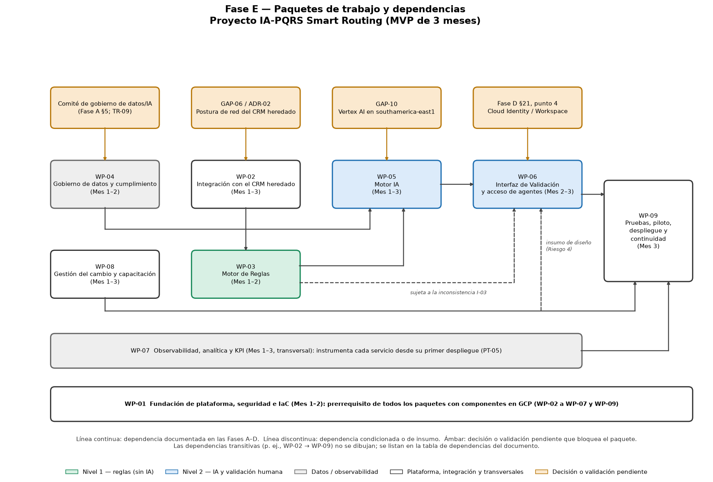

*Figura 1. Paquetes de trabajo de la Fase E y sus dependencias. En ámbar, las decisiones o validaciones pendientes que bloquean cada paquete; en verde, el nivel de reglas; en azul, el nivel de IA y la validación humana; en gris, los paquetes de datos y observabilidad. WP-01 se representa como la base común de los paquetes con componentes en GCP.*

### 11.5 Secuencia crítica e incrementos lógicos

Tres confirmaciones externas (AD-01, AD-02 y la constitución del comité) están programadas para el Mes 1, y de ellas dependen la integración, el Motor IA y el gobierno de datos. Además, el perímetro de seguridad debe existir antes de mover cualquier dato real. Esta concentración en el primer mes es un **hallazgo de esta fase**.

Las dependencias permiten identificar dos incrementos lógicos de entrega:

* uno basado en la plataforma, la integración y el Motor de Reglas, que no depende del comité ni de GAP-10;
* otro que añade el Motor IA y la validación.

Ambos fundamentan la Alternativa 2 de la sección 12.3. El cálculo de la ruta crítica y de las holguras corresponde a la Fase F.

## 12. Arquitecturas de Transición

### 12.1 Necesidad de Arquitecturas de Transición

Una Arquitectura de Transición describe la empresa en un estado arquitectónicamente significativo entre la línea base y el objetivo, y es necesaria cuando el alcance del cambio requiere un enfoque incremental. Debe aportar valor de negocio medible y se desarrolla con base en el enfoque de implementación preferido, la matriz consolidada, la lista de proyectos y la capacidad de la empresa para crear y absorber el cambio. TOGAF recomienda, salvo razones de peso, implementar las actividades difíciles después de las que entregan con mayor facilidad la capacidad faltante (The Open Group, 2018a).

Las Fases A-D **no definen Arquitecturas de Transición formales**. Sin embargo, las hojas de ruta de las Fases B (sección 8) y C (sección 8) incluyen un piloto con la clasificación en 3 niveles antes del despliegue del MVP, y la Fase D (sección 7.12) prevé un despliegue gradual. Con esa evidencia se plantean dos alternativas. **La selección es una decisión pendiente (AD-06).**

### 12.2 Alternativa 1: transición única (secuencia documentada)

Los paquetes WP-01 a WP-08 construyen la solución completa. El piloto del Mes 3 opera la clasificación en 3 niveles, con el umbral del 75% en ajuste y la medición de los KPI iniciales. WP-09 lleva el piloto al MVP en producción mediante despliegue gradual. El piloto es la única Arquitectura de Transición.

### 12.3 Alternativa 2: transición escalonada (propuesta de esta fase)

**Propuesta pendiente de aprobación.**

* **TA-1:** plataforma (WP-01), integración (WP-02), Motor de Reglas (WP-03) y observabilidad (WP-07) en operación. Lo que las reglas no resuelven va a la cola manual del Repartidor, mediante el mismo mecanismo que prevén RS-04 y RT-07. Sin Motor IA. El tratamiento de los casos resueltos por reglas depende de I-03.
* **TA-2:** se añaden el Motor IA (WP-05) y la Interfaz de Validación (WP-06), con WP-04 y WP-08 completados. Equivale al piloto de la Alternativa 1.

**Justificación.** La Alternativa 2 aplica la recomendación de TOGAF de dejar las actividades difíciles para después:

* El Motor de Reglas no requiere dataset de entrenamiento y es inmediato de construir (Fase A, sección 12.2).
* El nivel de IA concentra las decisiones pendientes con mayor incertidumbre: GAP-10, el comité de gobierno de datos/IA y AD-08.
* La degradación a la cola manual ya está diseñada (ADR-06).

### 12.4 Comparación de alternativas

| Criterio | Alternativa 1 — Transición única | Alternativa 2 — Transición escalonada |
|---|---|---|
| Coherencia con la documentación | Es la secuencia documentada en las Fases B-D | Reordena los mismos paquetes; no añade componentes ni alcance |
| Guía de TOGAF sobre actividades difíciles | Construye en paralelo las actividades fáciles y las difíciles | Entrega primero la capacidad más fácil (CI-01) y después la más difícil (CI-02) |
| Valor de negocio medible de la transición | El piloto mide todos los KPI | TA-1 es medible con la tasa de casos resueltos por reglas y el tiempo de triage de esos casos (paneles de la Fase D, sección 7.11). Su magnitud no puede estimarse de antemano porque la proporción de casos que las reglas resolverían **no está especificada** |
| Exposición a las decisiones pendientes | El piloto completo depende de que GAP-10, el comité y AD-08 estén resueltos | TA-1 no depende de GAP-10 ni del comité, solo de GAP-06 |
| Momento posible dentro del MVP | Mes 3 | La conectividad final está documentada en el Mes 3 (F-13). Para que TA-1 opere con casos reales antes que TA-2, habría que adelantar esa conectividad; si no, ambas transiciones se concentrarían en el Mes 3 |
| Capacidad para absorber el cambio | Un solo cambio percibido por los agentes y el Repartidor | Dos cambios sucesivos en el mismo trimestre, con una preparación cultural baja/media (F-06) |
| Esfuerzo de gestión | Un solo paso a producción | Un paso adicional a producción y su estabilización |
| Relación con la cobertura del 85% | Medible desde el piloto | TA-1, por sí sola, no permite evaluarla |

### 12.5 Evolución de estados por dominio y relación con el Documento de Definición de Arquitectura

| Dominio | Línea base | Transición (piloto o TA-2) | Objetivo (MVP) | Elementos del ADD que se realizan |
|---|---|---|---|---|
| Negocio | Triage 100% manual por el Repartidor; distribución secuencial | Clasificación en 3 niveles en piloto; el Agente de Soporte valida; el Repartidor atiende la cola manual | Igual, en producción; distribución simultánea | Fase B, secciones 3.2 a 3.5 |
| Aplicación | CRM y herramientas ofimáticas sin integración | Motor de Reglas, Motor IA e Interfaz de Validación integrados vía Pub/Sub | Igual, con el umbral ajustado (AD-07) | Fase C, secciones 3.4 y 3.5 |
| Datos | Histórico disperso y sin etiquetar | Dataset anonimizado y validado; métricas en BigQuery | Igual, con auditoría y reentrenamiento gobernados por el comité | Fase C, sección 4 |
| Tecnología | On-premise, sin nube, IaC ni observabilidad | Plataforma GCP en `pqrs-staging` y `pqrs-prod` con despliegue gradual | `pqrs-prod` al 100% del tráfico, con backups y degradación segura verificados | Fase D, sección 7 |

En la Alternativa 2, TA-1 realiza solo los elementos del Motor de Reglas, la integración y la observabilidad: Fase B, sección 3.4 (procesos "Clasificación por reglas" y "Certeza de la clasificación por reglas"); Fase C, sección 3.4 (Ingesta de eventos, Motor de Reglas y Observabilidad); y Fase D, secciones 7.3 a 7.8.

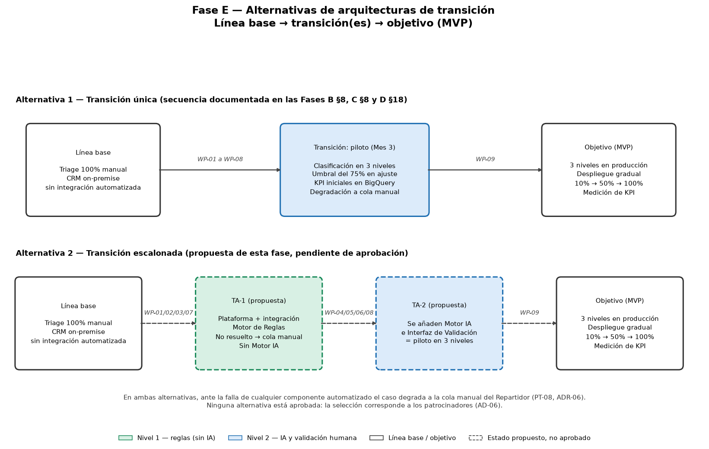

*Figura 2. Alternativas de Arquitecturas de Transición. Arriba, la secuencia documentada en las Fases B-D; abajo, la transición escalonada propuesta en esta fase (contorno discontinuo: estado propuesto, no aprobado).*

## 13. Hoja de Ruta de Arquitectura, versión 0.1

La Hoja de Ruta de Arquitectura, versión 0.1, consolida los paquetes de trabajo y las Arquitecturas de Transición en una línea de tiempo que va de la línea base al objetivo y enmarca la planificación de la Fase F (The Open Group, 2018a). Su nivel de detalle es similar al de las Fases B-D: horizonte mensual, sin fechas calendario, que no existen en la documentación.

| Horizonte | Fase de la hoja de ruta (Fases B, C y D) | Paquetes activos | Resultados esperados al cierre | Transición |
|---|---|---|---|---|
| Mes 1 | Fase 1 — Cimentación | WP-01, WP-02 (confirmación de red y diseño de tópicos), WP-03 (catálogo de categorías y diccionario), WP-04 (comité y dataset), WP-05 (*spike*), WP-07 (esquema), WP-08 (comunicación y capacitación técnica) | AD-01 y AD-02 resueltas; comité constituido; perímetro y proyectos GCP creados; diccionario de reglas construido | — |
| Mes 2 | Fase 2 — Construcción | WP-01 (Terraform, CI/CD, secretos), WP-03 (despliegue), WP-04 (pipeline DLP validado), WP-05 (configuración del Motor IA), WP-06 (desarrollo con participación de los agentes), WP-07 (instrumentación), WP-08 | Motor de Reglas, Motor IA e Interfaz de Validación desplegados en entornos no productivos; dataset anonimizado validado por el Oficial de Protección de Datos | Alternativa 2: TA-1 posible si la conectividad se adelanta (sección 12.4) |
| Mes 3 | Fase 3 — Integración y despliegue | WP-02 (conectividad final), WP-05 (ajuste del umbral), WP-06 (IAP), WP-07 (KPI iniciales), WP-08 (capacitación de agentes), WP-09 | Piloto en 3 niveles operado; pruebas de carga superadas; despliegue gradual a producción; alertas y backups activos; KPI iniciales medidos | Piloto (Alternativa 1) o TA-2 (Alternativa 2), seguido del objetivo (MVP) |

La duración total de 3 meses no cambia. La selección de las transiciones (AD-06) y la secuencia detallada dentro de cada mes se cierran en la Fase F.

## 14. Plan de Implementación y Migración, versión 0.1

El Plan de Implementación y Migración, versión 0.1, muestra la actividad necesaria para realizar la Hoja de Ruta. Debe permitir identificar los proyectos y los requerimientos de recursos, y es la base de la planificación de la Fase F (The Open Group, 2018a).

### 14.1 Estrategia de implementación y migración

Estrategia evolutiva (propuesta, sección 9.1). La metodología de implementación y la transición quedan pendientes (AD-06).

### 14.2 Proyectos y requerimientos de recursos

* **Proyecto:** "IA-PQRS Smart Routing", con los paquetes WP-01 a WP-09 (sección 10.4).
* **Roles requeridos:** los documentados en la Declaración de Trabajo de Arquitectura (Fase A, sección 11) y en el presupuesto (Fase A, sección 12.3).
* **Partidas de costo:** las ya documentadas. Esta fase no las redistribuye ni crea partidas nuevas.

| Recurso | Origen | Paquetes en los que participa | Partida documentada relacionada |
|---|---|---|---|
| Científico de Datos / ML Engineer (contratista, perfil semi-senior) | Fase A, sección 12.3 (supuesto) | WP-03 (TR-03), WP-04, WP-05, WP-07 | ≈ USD 7.400 en el MVP; ≈ USD 490/mes en operación con 20% de dedicación (supuesto) |
| Ingeniero Cloud/Backend (interno, ya asignado) | Fase A, sección 12.3 | WP-01, WP-02, WP-03, WP-05, WP-06, WP-09 | ≈ USD 2.600 (costo de oportunidad, no desembolso nuevo) |
| Arquitecto de TI | Fase A, sección 11; Fase B, sección 3.2 | WP-01, WP-02, WP-05, WP-06, WP-07, WP-09 | No costeado por separado en la documentación |
| Responsable de cumplimiento / Oficial de Protección de Datos | Fase A, secciones 2.2 y 11 | WP-04 | Revisión de cumplimiento ≈ USD 1.500 (supuesto) |
| Líder de producto o gerente de proyecto | Fase A, sección 11 | WP-08, coordinación general | No costeado; **persona no designada** |
| Agentes de Soporte | Fase A, secciones 2.1 y 10 | WP-06 (diseño), WP-08 (capacitación), WP-09 (piloto) | Capacitación ≈ USD 800 (supuesto) |
| Líderes de Facturación, Soporte Técnico y Retención | Fase A, sección 2.2 | WP-08, WP-09 | No costeado |
| Infraestructura GCP | Fase A, sección 12.3; Fase D, sección 7.15 | WP-01 a WP-07, WP-09 | ≈ USD 100 en el MVP; ≈ USD 40-100/mes en el escenario base de operación |
| Contingencia | Fase A, sección 12.3 | Todo el proyecto | ≈ USD 1.470 (15%) |

### 14.3 Secuencia de implementación

TOGAF menciona, entre otros enfoques, la secuencia guiada por datos: primero se implementan los sistemas que crean los datos y después los que los procesan (The Open Group, 2018a). El orden de construcción de la Fase D (sección 17) ya sigue esa lógica:

1. Plataforma.
2. Conectividad y perímetro.
3. Ingesta, que crea los eventos de PQRS.
4. Motor de Reglas, que los procesa.
5. Pipeline de datos y Motor IA.
6. Interfaz de Validación.
7. Observabilidad.
8. Analítica.

La sección 11.1 recoge las dependencias de los SBB ya instalados (CRM, proceso manual y suite ofimática), cuyo ciclo de vida se clasifica en la sección 9.3.

### 14.4 Recomendaciones de implementación

**Criterios de medida de efectividad.** Todos son valores ya documentados:

| Criterio | Meta | Fuente |
|---|---|---|
| Cobertura de enrutamiento automático | ≥ 85% (definición sujeta a I-01 e I-02) | Fase A, sección 9 |
| Exactitud sobre el tramo automático | > 88% (método de medición pendiente, sección 6.3) | Fase A, sección 9 |
| Reducción del tiempo de triage | 90% frente a 3-5 minutos | Fase A, sección 9 |
| Reducción del tiempo de primera respuesta | 40% en el primer trimestre (meta a validar, Fase A, sección 3.1) | Fase A, sección 3 |
| ROI | 8 meses (memoria de cálculo con supuestos) | Fase A, sección 9 |
| Latencia | Motor de Reglas p95 ≤ 300 ms; Motor IA p95 ≤ 3 s; ciclo automático p95 ≤ 8 s | RT-08, RT-09, RT-10 |
| Disponibilidad y continuidad | ≥ 99,5% mensual; RPO ≤ 24 h; RTO ≤ 4 h | RT-06, RT-16, RT-17 |
| Señales operativas | Tasa de escalamiento reglas → IA e IA → manual; profundidad de la cola de mensajes fallidos; consumo de presupuesto | Fase D, sección 7.11; RT-21 |

**Riesgos y problemas:** sección 17 (riesgos) y sección 18 (inconsistencias documentales).

**Bloques de construcción de solución:** sección 9.2.

## 15. Evaluación de impactos

| Dominio | Impacto | Paquetes | Observaciones |
|---|---|---|---|
| Negocio | Nuevos servicios de clasificación por reglas y por IA, y rol de validación del Agente de Soporte. El Repartidor atiende solo los casos bajo el umbral. Las divisiones reciben los casos en paralelo y casi en tiempo real | WP-03, WP-05, WP-06, WP-08 | La proyección, revisión y firma no cambian (RN-07). El impacto sobre las áreas receptoras está sin evaluar (sección 6.3) |
| Datos | El histórico de PQRS pasa a ser un activo gobernado, con anonimización obligatoria, auditoría de sesgo y registro de las decisiones del agente | WP-04, WP-07 | El alcance del uso del dataset depende de AD-08 |
| Aplicación | Nuevos servicios (Motor de Reglas, Motor IA, Interfaz de Validación, Ingestion Gateway) e integración asíncrona con el CRM | WP-02, WP-03, WP-05, WP-06 | El CRM se extiende, no se reemplaza (sección 9.3). Su capacidad de API debe validarse (I-05) |
| Tecnología | Nueva plataforma GCP con perímetro, IaC, CI/CD, observabilidad y continuidad; conectividad on-premise ↔ nube | WP-01, WP-02, WP-07, WP-09 | Costo operativo recurrente de ≈ USD 530-590/mes en el escenario base (Fase D, sección 7.15) y necesidad de competencias cloud (F-05) |
| Organización y gobierno | Comité de gobierno de datos/IA, participación del Oficial de Protección de Datos y responsable de la gestión del cambio | WP-04, WP-08 | Roles previstos en la Fase A, sección 11, aún sin personas designadas |

## 16. Relación con los objetivos empresariales

| Objetivo o KPI (Fase A, secciones 3 y 9) | Oportunidades | Paquetes | Condición para que la contribución se materialice |
|---|---|---|---|
| Reducir 40% el tiempo promedio de primera respuesta | OP-01, OP-05 | WP-03, WP-05, WP-06, WP-07 | Que la proyección, revisión y firma no se conviertan en el nuevo cuello de botella (Fase A, sección 3.1) |
| Cobertura de enrutamiento automático ≥ 85% | OP-01 | WP-03, WP-05 | Definición sujeta a I-01 e I-02 |
| Exactitud > 88% sobre el tramo automático | OP-01, OP-03, OP-05 | WP-04, WP-05, WP-07 | Método de medición pendiente (sección 6.3); umbral sujeto a AD-07 |
| Reducción del 90% en el tiempo de triage | OP-01 | WP-03, WP-05, WP-06 | Medida contra los 3-5 minutos de la línea base, con ciclo automático p95 ≤ 8 s (RT-10; ADR-09) |
| ROI en 8 meses | OP-05 | WP-07 | La memoria de cálculo es un **(supuesto)** (Fase A, sección 9); requiere la línea base real |
| Mitigación de penalizaciones regulatorias (Resolución CRC 5050 de 2016) | OP-01, OP-07 | WP-03, WP-09 | Decisiones de reglas explicables (Fase A, sección 12.2) y continuidad ante fallas (ADR-06) |
| Cumplimiento de la Ley 1581 de 2012 | OP-03, OP-06 | WP-01, WP-04 | Validación del Oficial de Protección de Datos y comité constituido |

## 17. Riesgos de implementación

Los riesgos ya registrados se vinculan con los paquetes afectados; también figuran en la columna de riesgos de la matriz consolidada (sección 6.2). Se conservan los niveles de las fases de origen.

| Riesgo (origen) | Paquetes afectados | Mitigación documentada | Observación para la Fase F |
|---|---|---|---|
| Riesgo 1 — Clasificación errónea (Fase A) | WP-05, WP-06 | Umbral de confianza del 75% y cola manual | Ajuste del umbral en el piloto (AD-07) |
| Riesgo 2 — Sesgo en los datos (Fase A) | WP-04 | Auditoría y balanceo del dataset; métricas de sesgo (RS-06) | Su alcance depende de AD-08 |
| Riesgo 3 — Integración con el CRM heredado (Fase A) | WP-02 | Pub/Sub con reintentos y cola de contingencia (RS-10) | Paquete con mayor incertidumbre (F-08) |
| Riesgo 4 — Resistencia al cambio (Fase A) | WP-06, WP-08 | Comunicación, capacitación temprana e involucramiento en el diseño | Responsable de la gestión del cambio no designado |
| Riesgo 5 — Incumplimiento de la Ley 1581 (Fase A) | WP-04 | Anonimización y validación del Oficial de Protección de Datos | Bloqueante para el uso del histórico |
| TR-01 — El CRM no admite ninguna opción de conectividad (Fase D) | WP-02 | Adaptador intermedio como plan C | Plan C no costeado |
| TR-02 — Vertex AI no disponible en la región (Fase D) | WP-05 | Endpoint global/`us-central1` | Implicación de residencia de datos (AD-02) |
| TR-03 — Diccionario de reglas desactualizado (Fase D) | WP-03, WP-07 | Monitorear la tasa de escalamiento reglas → IA; revisión periódica | Responsable de construcción pendiente |
| TR-04 — Configuración incorrecta de IAM o del perímetro (Fase D) | WP-01 | Revisión de IAM en cada *pull request*; Security Command Center | — |
| TR-05 — Escalamiento de costos de Vertex AI (Fase D) | WP-05, WP-07 | Alertas de presupuesto y cuotas | — |
| TR-06 — Vulnerabilidades en imágenes (Fase D) | WP-01 | Escaneo bloqueante en Artifact Registry | — |
| TR-07 — Dependencia de un único proveedor (Fase D) | WP-01, WP-05 | Terraform, estándares abiertos y PT-07 | — |
| TR-08 — Sin Cloud Identity/Workspace (Fase D) | WP-06 | Acceso vía VPN como contingencia | Ligado a AD-03 |
| TR-09 — Retraso del comité de gobierno de datos/IA (Fase D) | WP-04, WP-05 | Constitución del comité como hito del Mes 1 | Ligado a F-07 |
| Concentración de decisiones pendientes en el Mes 1 (observación de esta fase) | WP-02, WP-04, WP-05 | No documentada en las fases anteriores | Evaluar su efecto sobre el plazo de 3 meses (sección 11.5) |

## 18. Inconsistencias detectadas entre documentos

TOGAF indica actualizar la Visión, el Documento de Definición de Arquitectura y la Especificación de Requisitos con los resultados de esta fase. Conforme a la restricción de no modificar retrospectivamente las Fases A-D, las inconsistencias se registran aquí como **solicitudes de cambio**, sin resolverlas.

| ID | Inconsistencia | Fuentes | Impacto en la Fase E | Qué debe validarse | Responsable sugerido |
|---|---|---|---|---|---|
| I-01 | RN-01 exige "al menos 85% de **exactitud**", mientras que la Fase A define 85% de **cobertura** y > 88% de exactitud como magnitudes independientes | Fase B, sección 7 (RN-01); Fase A, secciones 2.1 y 9; Fase B, sección 1.1 | Criterios de éxito del piloto (WP-09) y de la medición (WP-07) | Redacción definitiva de RN-01 | Director de Servicio al Cliente |
| I-02 | La cobertura se define como "sin intervención humana", pero el Agente de Soporte revisa los casos con confianza ≥ 75% antes de la distribución | Fase A, secciones 2.1 y 9; Fase B, sección 3.2; Fase C, RS-03 | Si la validación cuenta como intervención humana, solo serían automáticos los casos enrutados sin validación (lo que depende de I-03), y el KPI podría no ser alcanzable tal como está redactado | Definición operativa de "sin intervención humana" | Director de Servicio al Cliente |
| I-03 | Casos resueltos por el Motor de Reglas: enrutamiento directo según las Fases A y B; paso por la Interfaz de Validación según la Fase C (Figura 2) y la Fase D (secciones 8.2 y 8.5) | Fase A, sección 12 (figura); Fase B, secciones 3.2 y 3.5; Fase C, sección 3.6; Fase D, secciones 8.2 y 8.5 | Determina la dependencia WP-03 → WP-06, la carga de los agentes y el contenido de TA-1 | Flujo definitivo de los casos con certeza alta por reglas | Director de Servicio al Cliente / Arquitecto de TI |
| I-04 | Las Fases B (sección 8) y C (sección 3.5) prevén entrenar el modelo con el dataset histórico; la Fase D (COMP-06) dimensiona el modelo base de Gemini 2.5 Flash-Lite sin *fine-tuning* | Fases B, C y D | Alcance de WP-04 y WP-05 (AD-08) y posiblemente su costo | Si el Motor IA se entrena o afina, o si usa el modelo base | Arquitecto de TI / Científico de Datos |
| I-05 | La Fase A (sección 5) indica que el CRM "tiene APIs"; la Fase C (sección 2.5) afirma que "no expone capacidad nativa de integración vía API" y advierte la contradicción | Fase A, sección 5; Fase C, sección 2.5; Fase D, RT-02 | Viabilidad de la actualización del caso en el CRM (WP-02; sección 7.3) | Capacidad real de API del CRM y su contrato | Gerente de TI |
| I-06 | La Fase B (sección 3.2) describe una "interfaz de validación integrada al CRM"; las Fases C y D la definen como aplicación web independiente en Cloud Run, vía IAP | Fase B, sección 3.2; Fase A, sección 4; Fase C, sección 3.4; Fase D, sección 7.7 | Experiencia del agente, adopción (Riesgo 4) y alcance de WP-06 | Forma de integración de la interfaz en el flujo del agente | Gerente de TI / Agentes de Soporte |
| I-07 | La Fase D cita contenidos ausentes de la documentación disponible: RabbitMQ y Kafka "descartados en la Fase A" (sección 7.9), la "Propuesta de Arquitectura GCP y Presupuesto, sección 7" (sección 7.15) y un "historial de falta de control presupuestal en la Fase A original" (sección 7.11) | Fase D, secciones 7.9, 7.11 y 7.15 | Esta fase no usa esas afirmaciones como evidencia | Disponibilidad de las fuentes o corrección de las referencias | Arquitecto Empresarial |
| I-08 | La Fase D (sección 7.3) remite al "Riesgo TR-03" para la disponibilidad de Vertex AI; en la sección 16 ese riesgo es TR-02 | Fase D, secciones 7.3 y 16 | Ninguno; esta fase usa TR-02 | Corrección de la referencia cruzada | Arquitecto Empresarial |
| I-09 | La Fase D (sección 4.2) describe el objetivo "con conectividad privada hacia el CRM", mientras que ADR-02 deja la conectividad como condicional | Fase D, sección 4.2 y ADR-02 | Esta fase la trata como condicional (AD-01) | Redacción de la sección 4.2 una vez resuelto AD-01 | Arquitecto de TI |
| I-10 | La Fase B no refleja las actualizaciones de la Fase A: la sección 1.1 y RN-05 mencionan "la Ley de Protección de Datos Personales" sin jurisdicción, y la sección 9.2 lista solo los Riesgos 1 y 2 | Fase B, secciones 1.1, 7 y 9.2; Fase A, secciones 0 y 10 | Ninguno; esta fase usa la jurisdicción y los Riesgos 1-5 de la Fase A | Actualización documental de la Fase B | Arquitecto Empresarial |

## 19. Consideraciones de implementación y gobernanza

* **Aprobación:** esta fase debe someterse a la revisión y aprobación del Director de Servicio al Cliente y del Gerente de TI antes de avanzar a la Fase F, siguiendo el Plan de Comunicaciones de Arquitectura Empresarial (Fase A, sección 11). Con esa aprobación se formaliza también el acuerdo sobre la estrategia de implementación y migración (sección 9.1).
* **Registro de decisiones:** las decisiones que se tomen sobre AD-01 a AD-08 deben registrarse en la Matriz de Evaluación de Factores de Implementación y Deducciones (sección 5.5), que TOGAF define como archivo de las decisiones de implementación y migración.
* **Puntos de control de cumplimiento:** el uso del histórico de PQRS está condicionado a la validación del comité de gobierno de datos/IA y del Oficial de Protección de Datos (Fase C, sección 4.3).
* **Paso a producción:** el despliegue a `pqrs-prod` requiere una aprobación manual (Fase D, sección 8.4), pero el rol que la otorga **no está especificado**.
* **Restricciones heredadas:** *serverless-first* (PT-01), IaC sin cambios manuales en producción (PT-04) y degradación segura (PT-08).
* **Gobierno de la implementación:** los contratos de arquitectura y las revisiones de cumplimiento corresponden a la Fase G.

## 20. Entregables de la Fase E

La tabla relaciona las salidas que TOGAF prevé para la Fase E (The Open Group, 2018a) con su tratamiento en este documento:

| Salida (TOGAF) | Contenido en este documento | Estado |
|---|---|---|
| Visión de la Arquitectura refinada, incluida la definición de tipos y grados de interoperabilidad | Tipos y grados de interoperabilidad propuestos (sección 7.2) | Propuesta; la Fase A no se modifica (solicitud de cambio) |
| Declaración de Trabajo de Arquitectura, actualizada si es necesario | No requiere actualización por esta fase; el documento formal no está disponible (sección 4.2) | Sin cambios |
| Borrador del Documento de Definición de Arquitectura (líneas base y objetivo por dominio, Arquitecturas de Transición, vistas) | Las líneas base y los objetivos de las Fases B-D se conservan; se añaden las Arquitecturas de Transición candidatas (sección 12) y las vistas de las Figuras 1 y 2 | Transiciones pendientes de selección (AD-06) |
| Borrador de la Especificación de Requisitos de Arquitectura: evaluación consolidada de brechas, soluciones y dependencias | Sección 6.2 | Completa con la información disponible |
| Evaluaciones de capacidad de negocio y de TI | Sección 5.3 | Completa con la información disponible |
| Hoja de Ruta de Arquitectura: portafolio de paquetes de trabajo (descripción, objetivos, requisitos funcionales, dependencias, relación con la oportunidad, con el ADD y la ARS y con los incrementos de capacidad, valor de negocio), matriz de factores e impacto | Secciones 10.2, 10.3, 11, 5.5, 15 y 13 | Versión 0.1 |
| Identificación de las Arquitecturas de Transición y su relación con el ADD | Secciones 12.2 a 12.5 | Dos alternativas; ninguna aprobada |
| Recomendaciones de implementación: criterios de medida de efectividad, riesgos y problemas, SBB | Secciones 14.4, 17, 18 y 9.2 | Completa con la información disponible |
| Plan de Implementación y Migración, versión 0.1, con la estrategia de implementación y migración | Sección 14 (estrategia en la sección 9.1) | Versión 0.1; se completa en la Fase F |
| Diagramas opcionales: Diagrama de Contexto del Proyecto y Diagrama de Beneficios | No se elaboran como figuras; la relación paquetes-oportunidades-objetivos está en las secciones 10.3 y 16, y las dependencias en la Figura 1 | Opcionales según TOGAF |

## 21. Relación con la Fase F — Planificación de la Migración

La Fase F recibe la Hoja de Ruta de Arquitectura, versión 0.1 (sección 13), y el Plan de Implementación y Migración, versión 0.1 (sección 14), junto con:

* el portafolio de paquetes de trabajo y sus incrementos de capacidad (sección 10);
* las dependencias (sección 11);
* las Arquitecturas de Transición candidatas (sección 12);
* las alternativas pendientes AD-01 a AD-08 (sección 9.5);
* la matriz de factores (sección 5.5);
* los riesgos (sección 17) y las solicitudes de cambio I-01 a I-10 (sección 18).

A la Fase F le corresponde:

* confirmar la Arquitectura de Transición y la metodología de implementación;
* evaluar el valor de negocio y priorizar los paquetes;
* asignar costos y recursos por paquete, incluida la incorporación del Científico de Datos/ML Engineer;
* decidir la eventual división en subproyectos;
* calcular la ruta crítica dentro de los 3 meses;
* integrar el plan en el portafolio de la empresa.

Esta Fase E no anticipa esas decisiones.

## 22. Recomendaciones

1. Resolver I-01, I-02 e I-03 antes de iniciar la Fase F, porque definen cómo se mide el éxito del piloto y qué recorrido sigue cada caso.
2. Definir el catálogo común de categorías de clasificación (F-12) antes de construir el diccionario de reglas.
3. Resolver AD-08 (I-04) antes del Mes 2, porque determina el alcance de WP-04 y WP-05.
4. Tratar las confirmaciones del Mes 1 (AD-01, AD-02 y comité) como hitos con fecha y responsable explícitos en la Fase F.
5. Designar a los responsables de la gestión del cambio (WP-08) y de la construcción del diccionario de reglas (WP-03).
6. Medir la línea base real de CSAT y reasignaciones antes del piloto (WP-07).
7. Seleccionar la Arquitectura de Transición (AD-06) a la luz de F-06 y F-13 y del grado de resolución de GAP-10 y del comité al cierre del Mes 1.
8. Validar con el Gerente de TI la clasificación propuesta de los sistemas actuales (sección 9.3).

## 23. Conclusiones

Siguiendo los once pasos de la Fase E de TOGAF, este documento:

* consolida en nueve brechas lo que las Fases B, C y D documentaron por separado, con sus soluciones, dependencias y riesgos;
* define diecisiete bloques de construcción de solución que completan la Arquitectura Objetivo;
* propone tipos y grados de interoperabilidad y el tratamiento de sus conflictos;
* agrupa el trabajo en nueve paquetes dentro del proyecto "IA-PQRS Smart Routing", con objetivos, oportunidades, incrementos de capacidad y valor de negocio;
* plantea dos Arquitecturas de Transición candidatas;
* entrega la Hoja de Ruta de Arquitectura y el Plan de Implementación y Migración en su versión 0.1.

La estrategia propuesta es evolutiva: conserva el CRM heredado y el ciclo de respuesta, introduce la clasificación automática como capacidad nueva y mantiene el proceso manual en paralelo como mecanismo de continuidad. Quedan explícitamente pendientes ocho decisiones y diez solicitudes de cambio sobre documentos anteriores. Con estos resultados, el proyecto queda en condiciones de avanzar a la Fase F: Planificación de la Migración, sujeto a resolver los puntos listados en la sección 24.

## 24. Información pendiente / requiere validación

| # | Punto pendiente | Por qué es necesario | Responsable sugerido |
|---|---|---|---|
| 1 | Postura de red del CRM heredado (Fase D, sección 21, punto 1) | Resuelve AD-01, el alcance de WP-02 y el presupuesto operativo | Gerente de TI |
| 2 | Disponibilidad de Vertex AI en `southamerica-east1` (Fase D, sección 21, punto 2) | Resuelve AD-02 y el dimensionamiento de WP-05 | Arquitecto de TI |
| 3 | Disponibilidad de Google Workspace/Cloud Identity (Fase D, sección 21, punto 4) | Resuelve AD-03 y el alcance de WP-06 | Gerente de TI |
| 4 | Requisitos de residencia de datos más allá de la Ley 1581 (Fase D, sección 21, punto 6) | Condiciona AD-02 y AD-04 | Oficial de Protección de Datos |
| 5 | Fecha de constitución del comité de gobierno de datos/IA (Fase D, sección 21, punto 7) | Bloquea WP-04 y el uso del histórico en WP-05 | Director de Servicio al Cliente |
| 6 | Forma de preparación del Motor IA (I-04, AD-08) | Define el alcance de WP-04 y WP-05 | Arquitecto de TI / Científico de Datos |
| 7 | Definición de cobertura y redacción de RN-01 (I-01, I-02) | Define los criterios de éxito del piloto | Director de Servicio al Cliente |
| 8 | Flujo de los casos resueltos por reglas (I-03) | Define la dependencia WP-03 → WP-06 y el contenido de TA-1 | Director de Servicio al Cliente / Arquitecto de TI |
| 9 | Capacidad real de API del CRM y contrato de actualización del caso (I-05) | Viabilidad de la interfaz `pqrs-enrutado` → CRM (sección 7.3) | Gerente de TI |
| 10 | Forma de integración de la Interfaz de Validación en el flujo del agente (I-06) | Alcance de WP-06 y mitigación del Riesgo 4 | Gerente de TI / Agentes de Soporte |
| 11 | Catálogo común de categorías de clasificación (F-12) | Requisito de interoperabilidad de información para las reglas, la IA, la interfaz y el CRM | Director de Servicio al Cliente |
| 12 | Capacidad de Facturación, Soporte Técnico y Retención para recibir casos casi en tiempo real (Fase A, sección 5) | Condición para el piloto, sin brecha ni acción en las Fases B-D | Líderes de Facturación, Soporte Técnico y Retención |
| 13 | Método de medición de la exactitud y del tiempo de ciclo total (sección 6.3) | Sin él no pueden verificarse los KPI de la Fase A | Director de Servicio al Cliente / Científico de Datos |
| 14 | Línea base real de CSAT y tasa de reasignaciones (Fase A, sección 4) | Reemplazar los supuestos para medir la mejora y el ROI | Director de Servicio al Cliente |
| 15 | Responsables de WP-03 y WP-08, y aprobante del paso a producción | Roles sin titular en la documentación | Patrocinadores |
| 16 | Selección de la Arquitectura de Transición y de la metodología de implementación (AD-06), y uso del margen presupuestal (AD-05) | Decisiones de los patrocinadores y del comité de aprobación, insumo de la Fase F | Director de Servicio al Cliente y Gerente de TI |
| 17 | Clasificación de los sistemas actuales (*Mainstream*/*Contain*/*Replace*) y planes del CRM a tres años (sección 9.3) | La clasificación propuesta se basa solo en el alcance de este proyecto | Gerente de TI |
| 18 | Entradas de TOGAF no disponibles: Solicitud de Trabajo de Arquitectura, plan estratégico corporativo, evaluación de madurez de arquitectura empresarial, Declaración de Trabajo formal y Plan de Comunicaciones (sección 4.2) | Completan el contexto de las restricciones y del gobierno de la implementación | Arquitecto Empresarial |
| 19 | Disponibilidad o corrección de las fuentes citadas en la Fase D y ausentes de la documentación (I-07) | Trazabilidad de las afirmaciones de la Fase D | Arquitecto Empresarial |

## Referencias

The Open Group. (2018a). *Phase E: Opportunities & solutions*. En *The TOGAF® Standard, Version 9.2* (Parte II, capítulo 12). https://pubs.opengroup.org/architecture/togaf9-doc/arch/index.html

The Open Group. (2018b). *Migration planning techniques*. En *The TOGAF® Standard, Version 9.2* (Parte III, capítulo 24). https://pubs.opengroup.org/architecture/togaf9-doc/arch/chap24.html

The Open Group. (2018c). *Interoperability requirements*. En *The TOGAF® Standard, Version 9.2* (Parte III, capítulo 25). https://pubs.opengroup.org/architecture/togaf9-doc/arch/chap25.html

*Nota: las referencias anteriores sustentan exclusivamente la metodología. Los datos del proyecto provienen de los documentos de las Fases A, B, C y D.*

---

### Aprobación

| Rol | Nombre | Firma | Fecha |
|---|---|---|---|
| Director de Servicio al Cliente | | | |
| Gerente de TI | | | |
